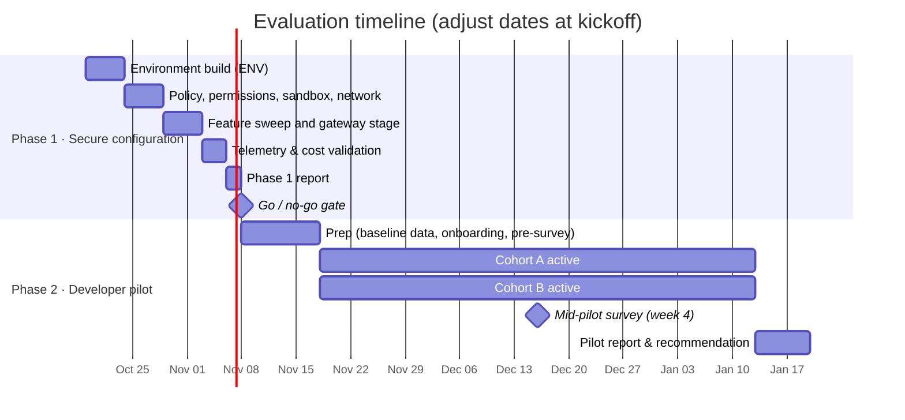
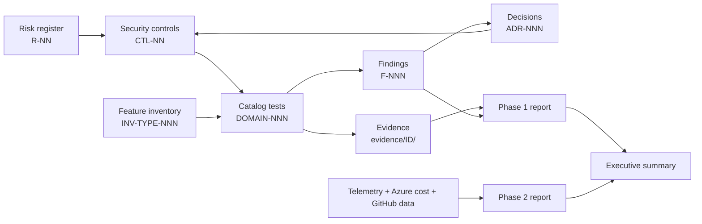

# Claude Code Enterprise Evaluation

This is the evaluation plan, test record, and reporting kit for adopting **Claude Code** at `<company>`. It sets out how we prove three things, and it holds the evidence:

| | Goal | Question we answer | Primary evidence |
|---|---|---|---|
| 🔐 | **Secure** | Can we run Claude Code isolated, with least privilege, and with controls developers cannot switch off? | [Security baseline](docs/02-security-baseline/defense-in-depth.md) → [test catalog](docs/03-test-plan/test-strategy.md) → [Phase 1 report](reports/phase1-security-configuration-report.md) |
| 💰 | **Cost** | What does it cost per developer, and can we predict and cap it? | [Cost model](docs/05-cost/cost-model.md) → [COST tests](docs/03-test-plan/catalog/cost.md) → [Phase 2 report](reports/phase2-pilot-report.md) |
| 🚀 | **Productivity & quality** | Do developers ship more, faster, without hurting quality? | [Measurement framework](docs/06-productivity-quality/measurement-framework.md) → [Phase 2 report](reports/phase2-pilot-report.md) |

> [!IMPORTANT]
> **Environment under evaluation:** Claude Code in a **Linux dev container on an isolated Windows VDI** (BeyondTrust jump host, Guardicore), using **Docker Desktop on the Hyper-V backend**. Models are served by **Microsoft Foundry** with **Entra ID only** (no API keys), first directly and then through the **Claude apps gateway** for per-user caps ([ADR-013](logs/decision-log.md#adr-013)). Claude Code, packages, and VS Code components come only from **Nexus**. **GitHub** access is limited to one repository per developer. Web search and fetch are off. The production target is the same images on users' PCs ([ADR-018](logs/decision-log.md#adr-018)). See the [reference architecture](docs/01-architecture/reference-architecture.md).

## Status board

| Phase | Scope | Status | Gate |
|---|---|---|---|
| **Phase 1**: Secure configuration | Evaluation lead only. Build the environment, lock it down, test every control and feature, validate telemetry and cost data. | ⏳ Not started | Go/no-go review → [Phase 1 report](reports/phase1-security-configuration-report.md) |
| **Phase 2**: Developer pilot | 15–20 developers in two staggered cohorts over 8 weeks. Measure cost, productivity, quality, and experience. | ⏳ Not started | Adoption decision → [Phase 2 report](reports/phase2-pilot-report.md) + [executive summary](reports/executive-summary.md) |

<!-- Update these counts as testing progresses. -->
| Test progress | Total | 🟩 Pass | 🟨 Issue | 🟥 Blocker | ⏭ | ⏳ |
|---|---|---|---|---|---|---|
| Catalog tests (P0) | 73 | 0 | 0 | 0 | 0 | 73 |
| Catalog tests (all) | 213 | 0 | 0 | 0 | 0 | 213 |
| Feature inventory rows | see [rollup](docs/04-feature-inventory/README.md) | | | | | |

## Timeline

> [!NOTE]
> In the gantt, cohort B is drawn starting with A. In practice cohort B starts **3 weeks later**, and that staggered start is what gives us a comparison window. See [measurement-framework.md](docs/06-productivity-quality/measurement-framework.md#study-design).

## Navigate

| Section | What's inside |
|---|---|
| **00 · Charter** | [Charter](docs/00-charter/charter.md) · [Success criteria](docs/00-charter/success-criteria.md) |
| **01 · Architecture** | [Reference architecture](docs/01-architecture/reference-architecture.md) · [Identity & access](docs/01-architecture/identity-and-access.md) · [Network egress](docs/01-architecture/network-egress.md) · [Threat model](docs/01-architecture/threat-model.md) |
| **02 · Security baseline** | [Defense in depth (control list)](docs/02-security-baseline/defense-in-depth.md) · [Managed settings](docs/02-security-baseline/managed-settings.md) · [Permissions](docs/02-security-baseline/permissions-policy.md) · [Sandbox](docs/02-security-baseline/sandbox-policy.md) · [Extensions](docs/02-security-baseline/extension-controls.md) · [Data handling](docs/02-security-baseline/data-handling.md) |
| **03 · Test plan** | [Test strategy](docs/03-test-plan/test-strategy.md) · Catalog: [ENV](docs/03-test-plan/catalog/env.md) · [POL](docs/03-test-plan/catalog/policy.md) · [PERM](docs/03-test-plan/catalog/permissions.md) · [SBX](docs/03-test-plan/catalog/sandbox.md) · [NET](docs/03-test-plan/catalog/network.md) · [IDN](docs/03-test-plan/catalog/identity.md) · [DATA](docs/03-test-plan/catalog/data.md) · [EXT](docs/03-test-plan/catalog/extensions.md) · [TEL](docs/03-test-plan/catalog/telemetry.md) · [COST](docs/03-test-plan/catalog/cost.md) · [FEAT](docs/03-test-plan/catalog/features.md) · [SURF](docs/03-test-plan/catalog/surfaces.md) · [OPS](docs/03-test-plan/catalog/operations.md) |
| **04 · Feature inventory** | [Rollup](docs/04-feature-inventory/README.md) · [Slash commands & shortcuts](docs/04-feature-inventory/slash-commands.md) · [CLI](docs/04-feature-inventory/cli-flags-and-subcommands.md) · [Settings keys](docs/04-feature-inventory/settings-keys.md) · [Environment variables](docs/04-feature-inventory/environment-variables.md) · [Tools, hooks & modes](docs/04-feature-inventory/tools-and-hooks.md) · [Surfaces](docs/04-feature-inventory/surfaces-and-integrations.md) |
| **05 · Cost** | [Cost model](docs/05-cost/cost-model.md) |
| **06 · Productivity & quality** | [Measurement framework](docs/06-productivity-quality/measurement-framework.md) · [GitHub metrics queries](docs/06-productivity-quality/github-metrics-queries.md) · [Benchmark tasks](docs/06-productivity-quality/benchmark-tasks.md) · [Surveys](docs/06-productivity-quality/surveys.md) |
| **07 · Phase 2 pilot** | [Pilot runbook](docs/07-phase2-pilot/pilot-runbook.md) · [Developer quick-start](docs/07-phase2-pilot/developer-quickstart.md) · [Acceptable use policy](docs/07-phase2-pilot/acceptable-use-policy.md) · [Training agenda](docs/07-phase2-pilot/training-agenda.md) |
| **Logs** | [Decision log (ADRs)](logs/decision-log.md) · [Risk register](logs/risk-register.md) · [Issue log](logs/issue-log.md) · [Journal](logs/journal/README.md) |
| **Evidence** | [Evidence rules & index](evidence/README.md) |
| **Reports** | [Phase 1: Security & configuration](reports/phase1-security-configuration-report.md) · [Phase 2: Pilot results](reports/phase2-pilot-report.md) · [Executive summary](reports/executive-summary.md) |
| **Templates** | [Style guide & templates](templates/README.md) |

## How the pieces connect

Every risk maps to a control, and every control maps to tests. Every test leaves evidence. Findings feed decisions, and decisions change controls. The reports cite IDs, so any claim can be traced back to its evidence.

## Legend

**Test results:** 🟩 Pass · 🟨 Issue · 🟥 Blocker · ⏭ N/A · ⏳ Not run · 🔁 Retest
**Policy (inventory):** 🟢 Allow · 🟡 Restrict · 🔴 Block · ⚪ Default · ⛔ Unavailable on Foundry / in this environment
**P0** go/no-go blocker · **P1** should pass or have an accepted risk · **P2** informational

The full conventions are in the [style guide](templates/README.md).

## Repository rules

> [!CAUTION]
> **No secrets or real identifiers in this repo.** Use placeholders (`<foundry-resource>`, `<tenant-id>`, `<org>`). Raw evidence that contains real values goes in the secure evidence store, not in git. See [evidence/README.md](evidence/README.md).

- Claims about Claude Code behavior cite the official docs at <https://code.claude.com/docs>. Anything not yet confirmed on our build is tagged `[verify]` and linked to a test.
- **Test records stay out of the agent's reach.** Tracker data, evidence, and private notes live outside the single repo Claude Code works on and are never mounted into a container ([ADR-019](logs/decision-log.md#adr-019), [R-27](logs/risk-register.md#r-27)). Don't use this docs repo as the agent's repo either.
- Results are valid only for the version they were run on. **Built against Claude Code 2.1.301.**
