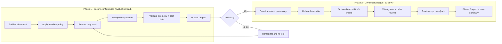

# Evaluation charter

[🏠 Home](../../README.md) › Charter › Evaluation charter

This charter defines why we're evaluating Claude Code, what's in and out of scope, who's involved, and how the evaluation runs. Stakeholders approve it before Phase 1 starts.

## Contents
- [Purpose](#purpose)
- [Objectives](#objectives)
- [Scope](#scope)
- [Approach](#approach)
- [Timeline](#timeline)
- [Roles and responsibilities](#roles-and-responsibilities)
- [Governance and gates](#governance-and-gates)
- [Assumptions and constraints](#assumptions-and-constraints)
- [Approval](#approval)

## Purpose

Claude Code is an agentic coding tool. It reads code, edits files, runs shell commands, and works with git on a developer's behalf. That autonomy is where both its value and its risk come from. Before adopting it, `<company>` needs evidence that:

1. It can run **isolated and least-privileged**, under controls that developers and the agent cannot switch off.
2. Its **cost** is measurable, predictable, and cappable.
3. It **improves developer productivity without degrading quality**.

## Objectives

| # | Objective | Measured by | Where |
|---|---|---|---|
| O1 | Prove a secure, isolated deployment pattern | All P0 security tests pass; no unmitigated Critical/High findings | [Test catalog](../03-test-plan/test-strategy.md), [Phase 1 report](../../reports/phase1-security-configuration-report.md) |
| O2 | Document every feature and configuration option and decide a policy for each | 100% of inventory rows have a Policy and a Result | [Feature inventory](../04-feature-inventory/README.md) |
| O3 | Measure cost per developer and build a rollout forecast | Reconciled cost per active dev-day and per month; forecast model | [Cost model](../05-cost/cost-model.md) |
| O4 | Measure productivity and quality impact | Pre-registered metrics vs. baseline and vs. the comparison window | [Measurement framework](../06-productivity-quality/measurement-framework.md) |
| O5 | Measure developer experience | Pre/mid/post surveys, weekly pulse, interviews | [Surveys](../06-productivity-quality/surveys.md) |
| O6 | Produce a production-ready configuration and rollout recommendation | Approved reference config + executive summary | [Executive summary](../../reports/executive-summary.md) |

Pass/fail thresholds are in [success-criteria.md](success-criteria.md).

## Scope

### In scope

- **Claude Code CLI 2.1.301** (pinned; upgrades are tested deliberately) inside a Linux dev container. It's installed in the **IT-built image** at build time, from a version held in **Nexus** ([ADR-014](../../logs/decision-log.md#adr-014)).
- **VS Code** with the Dev Containers extension and the Claude Code extension running in the container. VS Code Server and extensions are baked into the image, with pinned VSIX files in Nexus as the fallback ([ADR-015](../../logs/decision-log.md#adr-015)).
- **Microsoft Foundry** as the model provider: Claude model deployments (Hosted on Azure), Azure cost data, and **Entra ID only**, with API keys disabled on the resource ([ADR-006](../../logs/decision-log.md#adr-006)).
- **Claude apps gateway** in front of Foundry (proposed, [ADR-013](../../logs/decision-log.md#adr-013)): Entra sign-in, per-user spend caps, identity-stamped telemetry. Phase 1 proves direct Foundry first, then puts the gateway in front and re-tests identity, cost, and telemetry through it.
- **Isolated Windows 11 VDIs** as the host for both phases, reached through the **BeyondTrust** jump host, with the **Guardicore** agent. **Docker Desktop (Business)** on the **Hyper-V** backend. WSL is disabled.
- **Nexus Repository** as the only package source: Claude Code itself, Python, Java, and .NET packages, and VS Code components ([ADR-015](../../logs/decision-log.md#adr-015)).
- **.NET and VB.NET repos** at three capability tiers: full, compile-check, and edit-only ([ADR-017](../../logs/decision-log.md#adr-017)).
- **Portability to PCs.** The production target is the same Docker images on users' PCs. The evaluation tags every control as portable or VDI-only, and re-runs the portable P0 network tests on a host with internet access ([ADR-018](../../logs/decision-log.md#adr-018), [NET-014](../03-test-plan/catalog/network.md#net-014)).
- **GitHub** (one repository per developer): branches, commits, and PRs created with Claude Code's help.
- Managed settings, permissions, sandbox, network egress, hooks, MCP, plugins, skills, and subagents. That means every configuration surface. Web search and web fetch are disabled by policy ([ADR-016](../../logs/decision-log.md#adr-016)).
- **OpenTelemetry** export to a `<company>` collector, for cost, usage, and audit.
- Headless/CI usage (`claude -p`), and GitHub Actions if Foundry support is confirmed ([SURF-004](../03-test-plan/catalog/surfaces.md#surf-004)).

### Out of scope

| Item | Why |
|---|---|
| claude.ai-based surfaces (web, mobile, desktop cloud sessions, Remote Control, Slack, routines, ultrareview) | Need a claude.ai account. We use Foundry. Each is still recorded as ⛔ in the inventory. |
| Anthropic Teams/Enterprise analytics dashboard and contribution metrics | Not available with Foundry. We replace them with OTel + GitHub data ([R-13](../../logs/risk-register.md)). |
| Amazon Bedrock, Google Vertex AI, direct Anthropic API | Provider decision already made ([ADR-001](../../logs/decision-log.md#adr-001)). |
| Databricks Unity AI Gateway (`ug claude`) | Evaluated and rejected ([ADR-012](../../logs/decision-log.md#adr-012)). The Claude apps gateway covers the same per-user needs ([ADR-013](../../logs/decision-log.md#adr-013)). |
| Native Windows installs of Claude Code | Claude Code never runs natively, in the evaluation or in production. No OS sandbox on native Windows. Blocked by policy ([CTL-01](../02-security-baseline/defense-in-depth.md#ctl-01), [ADR-017](../../logs/decision-log.md#adr-017)). |
| Windows containers | Rejected: the VDIs don't have the memory for them ([ADR-017](../../logs/decision-log.md#adr-017)). |
| Modernizing Windows-only .NET projects | A long-term way to raise a repo's capability tier. Not part of the evaluation ([ADR-017](../../logs/decision-log.md#adr-017)). |
| The PC rollout itself | Comes after the evaluation. The evaluation proves which controls carry over to PCs ([ADR-018](../../logs/decision-log.md#adr-018)). |
| Production deployment, customer data, regulated data | The pilot uses normal development repositories only ([AUP](../07-phase2-pilot/acceptable-use-policy.md)). |
| Other AI coding tools head-to-head | Not part of this charter. The method here can be reused for one later. |

## Approach

- **Phase 1** is run by the evaluation lead alone. It's a configuration-and-controls exercise. Every control is tested with evidence. Every feature is clicked, run, or confirmed unavailable. Telemetry and cost pipelines are proven before any developer joins. Model access is staged: direct Foundry first, then the Claude apps gateway in front of it, with the gateway decision at the end of week 3 ([ADR-013](../../logs/decision-log.md#adr-013)).
- **Phase 2** puts the locked-down environment in front of 15–20 developers, all on VDIs. It measures real cost, productivity, quality, and experience against a baseline taken beforehand. The evaluation lead may run on a local PC as an optional PC track, using a standard (non-admin) account ([ADR-018](../../logs/decision-log.md#adr-018)).
- **Every result is recorded** in the local test tracker, which builds the final report. The records stay outside anything the agent under test can reach ([ADR-019](../../logs/decision-log.md#adr-019)).

## Timeline

| Phase | Duration | Key dates (fill in at kickoff) |
|---|---|---|
| Phase 1 · Week 1: environment build (image from Nexus, direct Foundry with Entra ID) | 5 days | `YYYY-MM-DD` |
| Phase 1 · Week 2: policy, permissions, sandbox, network, identity. Gateway build starts. | 5 days | |
| Phase 1 · Week 3: feature & surface sweep, extensions, data. Gateway tests ([IDN-014](../03-test-plan/catalog/identity.md#idn-014), [COST-013](../03-test-plan/catalog/cost.md#cost-013), [COST-015](../03-test-plan/catalog/cost.md#cost-015), [TEL-013](../03-test-plan/catalog/telemetry.md#tel-013)) and the **gateway decision**. | 5 days | Gateway decision: `YYYY-MM-DD` |
| Phase 1 · Week 4: telemetry & cost validation, portable P0 network re-run on an internet-connected host ([NET-014](../03-test-plan/catalog/network.md#net-014)), report, **gate** | 5 days | Gate: `YYYY-MM-DD` |
| Phase 2 · Prep: baseline pull, onboarding, pre-survey | 2 weeks | |
| Phase 2 · Pilot: cohort A weeks 1–8, cohort B weeks 4–8 (+ extension) | 8 weeks | Mid-survey: week 4 |
| Phase 2 · Analysis & reporting | 1 week | Final readout: `YYYY-MM-DD` |

The detailed gantt is on the [home page](../../README.md#timeline).

## Roles and responsibilities

| Activity | Evaluation lead | Security / IAM | Platform / VDI team | Azure / Foundry admin | GitHub admin | Eng. managers | Pilot devs | Finance |
|---|---|---|---|---|---|---|---|---|
| Charter & success criteria | **A/R** | C | C | C | C | C | I | C |
| VDI image, AppLocker, Hyper-V/Docker Desktop | C | C | **A/R** | | | | I | |
| Container image & firewall | **A/R** | C | R | | | | | |
| Claude apps gateway & PostgreSQL (deploy, operate) | **A/R** | C | R | C | | | | |
| Spend caps, notification job, runaway automation | **A/R** | I | | C | | I | I | C |
| Managed policy | **A/R** | C | C | | | | I | |
| Foundry resource, deployments, RBAC | C | C | | **A/R** | | | | I |
| GitHub tokens, rulesets, repo access | C | C | | | **A/R** | | | |
| OTel collector & dashboards | **A/R** | C | R | C | | | | I |
| Security testing (Phase 1) | **A/R** | C | | | | | | |
| Go/no-go decision | R | **A** | C | C | C | C | | C |
| Pilot cohort selection | C | | | | | **A/R** | I | |
| Pilot participation & feedback | I | | | | | C | **R** | |
| Cost review & budget | R | | | C | | I | | **A** |
| Final recommendation | **R** | C | C | C | C | C | C | **A** (budget) |

A = accountable · R = responsible · C = consulted · I = informed. Replace roles with names at kickoff.

### Supporting teams

These teams own parts of the environment the evaluation depends on. Bring them in at G0.

| Team | What they own for the evaluation | When |
|---|---|---|
| **Nexus owner** | Proxy repos for PyPI, Maven Central (plus the Gradle plugin portal), and NuGet. Raw repos for the Claude Code package (readable by the image-build account only), pinned VSIX files, and the `mvnw`/`gradlew` distributions. Read-only access for containers. Quarantine rules for new or suspicious packages. | Phase 1 week 1 |
| **Network / Guardicore team** | Internal and external firewall rules, ExpressRoute and the vWAN hub Cloud NGFW, private DNS forwarding to Azure, the Foundry private endpoint, Guardicore policies on the VDIs (and later on PCs). Answers the VPN full- vs split-tunnel question. | Phase 1 weeks 1–2 |
| **Desktop / endpoint team** | PC prerequisites for the production target: standard users (no local admin), Windows Pro/Enterprise with Hyper-V and BIOS virtualization, Docker Desktop Business licences, full-disk encryption (already in place), RAM, and Intune/AppLocker on PCs ([ENV-022](../03-test-plan/catalog/env.md#env-022)) | Phase 1 week 4, and before any PC track |
| **Entra / identity admin** | AD security group sync to Entra, the custom Foundry role assignment, the Entra app registration and managed identity for the gateway, Conditional Access | Phase 1 weeks 1–2 |

## Governance and gates

| Gate | When | Criteria | Decision by |
|---|---|---|---|
| **G0**: Charter approved | Before Phase 1 | Charter, success criteria, and AUP signed off | Sponsor + Security |
| **G1**: Phase 1 go/no-go | End of Phase 1 week 4 | All P0 tests 🟩, or 🟨 with accepted risk. No open Critical/High findings. Telemetry and cost pipeline proven. Gateway decision recorded ([ADR-013](../../logs/decision-log.md#adr-013)). See [success criteria](success-criteria.md#gate-g1-phase-1-go--no-go). | Security (A), sponsor |
| **G2**: Cohort B start | Pilot week 4 | No security incidents. Cost within budget. Cohort A feedback triaged. | Evaluation lead |
| **G3**: Adoption decision | After the Phase 2 report | Success criteria for cost, productivity, and quality evaluated | Sponsor + Finance + Security |

Weekly status uses [templates/weekly-status.md](../../templates/weekly-status.md). Decisions are logged as ADRs in the [decision log](../../logs/decision-log.md).

## Assumptions and constraints

- The VDI supports nested virtualization, so Hyper-V and Docker Desktop can run. If not, the architecture needs rework ([ENV-001](../03-test-plan/catalog/env.md#env-001), [R-02](../../logs/risk-register.md)).
- The Foundry subscription has Claude model deployments (Opus, Sonnet, and ideally Haiku), Hosted on Azure, with pinned versions, and enough TPM quota for 20 concurrent developers. The resource can sit behind a private endpoint with public access off [verify] ([NET-016](../03-test-plan/catalog/network.md#net-016)).
- Nexus can proxy PyPI, Maven Central, the Gradle plugin portal, and NuGet, and can host raw files.
- Each pilot developer works in **one** GitHub repository, and their tokens are scoped to it.
- Developers in the pilot don't handle regulated or customer data in their repos.
- The evaluation lead has admin rights to build the container image, publish managed settings to the VDI image path, run the gateway, and read Azure cost data and GitHub org data.
- Evaluation records (tracker data, evidence, private notes) are kept outside anything the agent under test can reach ([ADR-019](../../logs/decision-log.md#adr-019), [R-27](../../logs/risk-register.md#r-27)).
- In production, laptops use the VPN. Off the VPN nothing in the tenant is reachable, so Claude Code sessions fail closed ([NET-015](../03-test-plan/catalog/network.md#net-015)).
- Claude Code releases often. We pin **2.1.301** for the evaluation, and test any upgrade as a change ([OPS-001](../03-test-plan/catalog/operations.md#ops-001)).

## Approval

| Role | Name | Decision | Date |
|---|---|---|---|
| Executive sponsor | | | |
| Security | | | |
| Engineering leadership | | | |
| Finance | | | |
