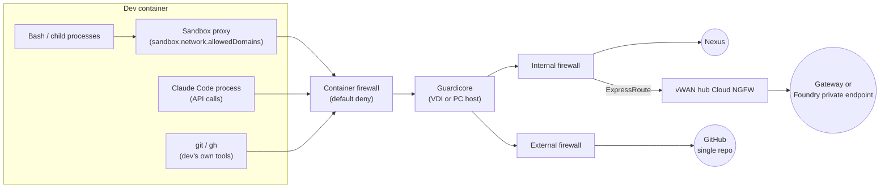

# Network egress

[🏠 Home](../../README.md) › Architecture › Network egress

This page lists exactly where the dev container may connect, and why. Everything else is denied. Inside the container there are two enforcement points: the **container firewall** (all processes) and the **Claude Code sandbox proxy** (Bash and its children). Outside it, **Guardicore** on the host, the **internal and external firewalls**, and the **vWAN hub Cloud NGFW** enforce the same intent. Model access is staged: direct to Foundry first, then through the Claude apps gateway ([ADR-013](../../logs/decision-log.md#adr-013)).

## Contents
- [Enforcement points](#enforcement-points)
- [Allowlist](#allowlist)
- [Must not be reachable](#must-not-be-reachable)
- [Network path rules](#network-path-rules)
- [DNS and private endpoints](#dns-and-private-endpoints)
- [Web tools and the firewall](#web-tools-and-the-firewall)
- [Anthropic endpoints and why we expect not to need them](#anthropic-endpoints-and-why-we-expect-not-to-need-them)
- [VDI-host egress for Docker Desktop](#vdi-host-egress-for-docker-desktop)
- [Host segmentation with Guardicore](#host-segmentation-with-guardicore)
- [VPN and users' PCs](#vpn-and-users-pcs)
- [Residual exfiltration paths](#residual-exfiltration-paths)
- [Proxy and TLS inspection](#proxy-and-tls-inspection)

## Enforcement points

| Point | Scope | Enforced by | Developer can change? | Portable to PCs? | Test |
|---|---|---|---|---|---|
| Container firewall | **Every** process in the container | iptables/ipset set at container start. `NET_ADMIN` dropped afterwards. | ❌ | ✅ Yes, and it's the primary control there | [NET-001](../03-test-plan/catalog/network.md#net-001), [NET-014](../03-test-plan/catalog/network.md#net-014) |
| Sandbox proxy | Bash, PowerShell, Monitor and their children | `sandbox.network.allowedDomains` + `allowManagedDomainsOnly` | ❌ (managed-only) | ✅ | [SBX-005](../03-test-plan/catalog/sandbox.md#sbx-005), [SBX-006](../03-test-plan/catalog/sandbox.md#sbx-006) |
| Guardicore | All processes on the VDI or PC; container traffic appears as Docker Desktop's process | Security team policy | ❌ | ✅ (agent runs on PCs) | [ENV-021](../03-test-plan/catalog/env.md#env-021) |
| Internal / external firewalls, Cloud NGFW | Traffic leaving the isolated VDI segment | Network team policy | ❌ | ⚠️ Depends on the PC VPN tunnel mode | [NET-002](../03-test-plan/catalog/network.md#net-002), [NET-016](../03-test-plan/catalog/network.md#net-016) |
| Corporate proxy (if used) | Explicit-proxy HTTPS | Network team policy | ❌ | ⚠️ | [NET-005](../03-test-plan/catalog/network.md#net-005), [NET-012](../03-test-plan/catalog/network.md#net-012) |

> [!IMPORTANT]
> On the isolated VDI, the VDI's own firewalls would block traffic even if the container firewall failed, which would hide the failure. Prove the container firewall on a host **with** internet access before claiming it for PCs ([NET-014](../03-test-plan/catalog/network.md#net-014), [R-23](../../logs/risk-register.md#r-23)).

## Allowlist

The container firewall allowlist depends on the stage. Stage 2 is smaller: the container talks to the gateway, never to Azure or Entra directly.

**Stage 1: direct Foundry**

| Destination | Port | Needed by | Container firewall | Sandbox `allowedDomains` | Notes |
|---|---|---|---|---|---|
| `<foundry-resource>.services.ai.azure.com` (resolves to the private endpoint) | 443 | Claude Code → model inference | ✅ | — (Claude Code process, not Bash) | Over ExpressRoute ([NET-004](../03-test-plan/catalog/network.md#net-004), [NET-016](../03-test-plan/catalog/network.md#net-016)) |
| `login.microsoftonline.com` | 443 | Entra token acquisition and refresh (`az`, `DefaultAzureCredential`) | ✅ | — | Stage 1 only ([IDN-001](../03-test-plan/catalog/identity.md#idn-001)) |
| `management.azure.com` | 443 | `az` CLI account selection during `az login` | ⚠️ [verify] | — | Remove if not needed |
| `<otel-collector>` | 4318 (HTTP) | OTel export | ✅ | — | Internal ([TEL-001](../03-test-plan/catalog/telemetry.md#tel-001)) |

**Stage 2: Claude apps gateway (target)**

| Destination | Port | Needed by | Container firewall | Sandbox `allowedDomains` | Notes |
|---|---|---|---|---|---|
| `<claude-gateway>.<internal-domain>` (private IP only) | 443 | Inference, device-flow sign-in, managed settings, OTLP relay | ✅ | — | Claude Code refuses a gateway that resolves to a public address. Put the host in `NO_PROXY` so the TLS pin check works ([IDN-014](../03-test-plan/catalog/identity.md#idn-014)). |
| `<foundry-resource>.services.ai.azure.com`, `login.microsoftonline.com`, `<otel-collector>` | — | Not needed | ❌ Removed | — | Blocking direct Foundry from devices is how we stop gateway bypass ([IDN-015](../03-test-plan/catalog/identity.md#idn-015)) |

**Both stages**

| Destination | Port | Needed by | Container firewall | Sandbox `allowedDomains` | Notes |
|---|---|---|---|---|---|
| `github.com`, `api.github.com` | 443 | git/gh to `<org>/<repo>` | ✅ | ✅ (Claude runs `git push` via Bash) | Via the external firewall. Token-scoped to one repo ([NET-009](../03-test-plan/catalog/network.md#net-009)). |
| `codeload.github.com`, `objects.githubusercontent.com` | 443 | git fetch / LFS / release assets | ⚠️ [verify] | ⚠️ [verify] | Only if needed by the repo |
| `<nexus-host>` | 443 | pip/uv, Maven/Gradle (and wrapper distributions), NuGet, VSIX fallback | ✅ | ✅ | Read-only access. Public registries blocked ([NET-010](../03-test-plan/catalog/network.md#net-010), [ENV-017](../03-test-plan/catalog/env.md#env-017), [IDN-016](../03-test-plan/catalog/identity.md#idn-016)). |
| `<corporate-proxy>` | `<port>` | Outbound HTTPS | ✅ | — | Only if the proxy is explicit (`HTTPS_PROXY`) |
| DNS resolver (`<internal-dns>`) | 53 | Name resolution | ✅ (internal resolver only) | — | Block external DNS ([NET-008](../03-test-plan/catalog/network.md#net-008)) |

## Must not be reachable

These are negative tests. Each must fail from **any** process in the container ([NET-002](../03-test-plan/catalog/network.md#net-002)), and again on a host with internet access ([NET-014](../03-test-plan/catalog/network.md#net-014)):

| Destination class | Example | Why |
|---|---|---|
| General internet | `example.com`, `pastebin.com`, `transfer.sh` | Exfiltration |
| Public package registries | `pypi.org`, `files.pythonhosted.org`, `repo1.maven.org`, `plugins.gradle.org`, `services.gradle.org`, `api.nuget.org`, `registry.npmjs.org` | Supply chain ([R-20](../../logs/risk-register.md#r-20), [R-26](../../logs/risk-register.md#r-26)). Use Nexus. |
| VS Code downloads | `marketplace.visualstudio.com`, `update.code.visualstudio.com` | Components are baked into the image ([ENV-018](../03-test-plan/catalog/env.md#env-018)) |
| Claude Code downloads | `downloads.claude.ai`, `claude.ai/install.ps1` | Claude Code comes only from the image ([ENV-016](../03-test-plan/catalog/env.md#env-016)) |
| Direct Foundry (stage 2) | `<foundry-resource>.services.ai.azure.com` from the container | Gateway bypass ([IDN-015](../03-test-plan/catalog/identity.md#idn-015)) |
| Other GitHub destinations via the token | Other repos, `gist.github.com` (create) | The token's scope prevents it ([NET-009](../03-test-plan/catalog/network.md#net-009)) |
| Cloud metadata endpoints | `169.254.169.254` | Credential theft |
| VDI host / internal networks beyond the allowlist | `10.0.0.0/8` except approved hosts | Lateral movement |
| External DNS | `8.8.8.8:53` | DNS tunnelling ([NET-008](../03-test-plan/catalog/network.md#net-008)) |
| IPv6 | Any | Firewall bypass if only IPv4 rules exist ([NET-013](../03-test-plan/catalog/network.md#net-013)) |

## Network path rules

These are the rules to hand to the network team. Sources are the isolated VDI segment (`<vdi-segment>`) and, in Azure, the gateway subnet (`<gateway-subnet>`). Everything not listed is denied ([CTL-27](../02-security-baseline/defense-in-depth.md#ctl-27)).

| Device | Source | Destination | Port | Stage | Purpose |
|---|---|---|---|---|---|
| Internal firewall | `<vdi-segment>` | `<nexus-host>` | 443 | Both | Packages, VSIX fallback |
| Internal firewall | `<vdi-segment>` | Company registry | 443 | Both | Image pulls by Docker Desktop |
| Internal firewall | `<vdi-segment>` | `<internal-dns>` | 53 | Both | Name resolution |
| Internal firewall → ExpressRoute | `<vdi-segment>` | Foundry private endpoint IP | 443 | 1 | Direct inference |
| Internal firewall → ExpressRoute | `<vdi-segment>` | `<otel-collector>` | 4318 | 1 | Telemetry (stage 2 goes through the gateway) |
| Internal firewall → ExpressRoute | `<vdi-segment>` | Gateway private IP | 443 | 2 | Inference, sign-in, policy, telemetry relay |
| vWAN hub Cloud NGFW | `<vdi-segment>` | Foundry private endpoint IP | 443 | 1 | Direct inference. **Remove in stage 2.** |
| vWAN hub Cloud NGFW | `<vdi-segment>` | Gateway private IP | 443 | 2 | — |
| vWAN hub Cloud NGFW | `<gateway-subnet>` | Foundry private endpoint IP | 443 | 2 | Gateway → Foundry (managed identity) |
| vWAN hub Cloud NGFW | `<gateway-subnet>` | Entra ID (`login.microsoftonline.com`) | 443 | 2 | OIDC discovery, token exchange, managed identity |
| vWAN hub Cloud NGFW | `<gateway-subnet>` | PostgreSQL, `<otel-collector>`, log platform | 5432, 4318, 443 | 2 | Gateway state, telemetry relay, audit events |
| External firewall | `<vdi-segment>` | `github.com`, `api.github.com` | 443 | Both | The single repo (the token, not the firewall, limits it to one repo) |
| External firewall | `<vdi-segment>` (browser only) | `login.microsoftonline.com` and the Entra sign-in hosts [verify list] | 443 | Both | Device-flow approval in the browser |
| External firewall | `<vdi-segment>` | Docker sign-in / licensing hosts [verify] | 443 | Both | [Docker Desktop host egress](#vdi-host-egress-for-docker-desktop) |
| External firewall | `<vdi-segment>` | Anything else | — | Both | **Deny** (no internet) |

## DNS and private endpoints

| Item | Design | Test |
|---|---|---|
| Foundry private endpoint | The Foundry resource gets a private endpoint in the Azure VNet. **Public network access is disabled** on the resource. Confirm that Claude deployments support this [verify]. | [NET-016](../03-test-plan/catalog/network.md#net-016) |
| DNS | On-prem DNS has conditional forwarders for the Foundry private DNS zone(s) and the gateway's zone, pointing at the inbound endpoint of an **Azure DNS Private Resolver**. Without this, the Foundry name resolves to a public IP and the traffic heads for the blocked internet path. | [NET-016](../03-test-plan/catalog/network.md#net-016) |
| Gateway address | The gateway hostname must resolve **only** to private addresses (RFC 1918 and similar). Claude Code refuses `/login` otherwise ([gateway docs](https://code.claude.com/docs/en/claude-apps-gateway)). | [IDN-014](../03-test-plan/catalog/identity.md#idn-014) |
| Gateway TLS | Internal PKI certificate. Claude Code pins it on first connect. Publish the SHA-256 fingerprint with the URL, and treat certificate rotation as a planned event. | [IDN-014](../03-test-plan/catalog/identity.md#idn-014) |

## Web tools and the firewall

- **WebSearch can't be stopped by any firewall.** On Foundry, the search runs on the server side, inside Foundry, so it works even with no internet on the machine. It is turned off by a managed deny rule instead ([CTL-26](../02-security-baseline/defense-in-depth.md#ctl-26), [NET-007](../03-test-plan/catalog/network.md#net-007), [ADR-016](../../logs/decision-log.md#adr-016)). The gateway also disables it on gateway sessions.
- **WebFetch is disabled** (`CLAUDE_CODE_DISABLE_WEB_FETCH=1` plus a deny rule), pending the evaluation lead's confirmation. With no internet it would only reach allowlisted hosts such as GitHub, which is an exfiltration path ([PERM-014](../03-test-plan/catalog/permissions.md#perm-014)).
- **`skipWebFetchPreflight: true`** keeps the WebFetch domain check from calling `api.anthropic.com` ([data usage docs](https://code.claude.com/docs/en/data-usage#webfetch-domain-safety-check)).

## Anthropic endpoints and why we expect not to need them

With Foundry as the provider, model traffic goes to Azure, not Anthropic ([network config docs](https://code.claude.com/docs/en/network-config)). We set `CLAUDE_CODE_DISABLE_NONESSENTIAL_TRAFFIC=1`, plus `DISABLE_UPDATES=1`, `DISABLE_AUTOUPDATER=1`, `DISABLE_TELEMETRY=1`, `DISABLE_ERROR_REPORTING=1`, and `ENABLE_CLAUDEAI_MCP_SERVERS=false` explicitly for clarity. In stage 2, the CLI also disables its own analytics while signed in to the gateway; `DISABLE_TELEMETRY` covers the moments before the first sign-in ([gateway deployment docs](https://code.claude.com/docs/en/claude-apps-gateway-deploy)). With those set, we **expect** none of the following to be needed. [NET-003](../03-test-plan/catalog/network.md#net-003) **proves it** by capturing egress for a full session with every feature exercised:

| Host | Normally used for | Expected with our config |
|---|---|---|
| `api.anthropic.com` | First-party inference, feature flags, telemetry, WebFetch preflight, fast-mode check | Not needed. WebFetch is disabled and `skipWebFetchPreflight: true` ([NET-006](../03-test-plan/catalog/network.md#net-006)). |
| `claude.ai`, `claude.com`, `platform.claude.com` | claude.ai / Console sign-in | Not needed (no claude.ai auth) |
| `mcp-proxy.anthropic.com` | claude.ai connectors | Not needed (disabled) |
| `downloads.claude.ai`, `storage.googleapis.com` | Installer/updater, plugin metadata | Not needed. Claude Code comes from Nexus at image build time ([ENV-016](../03-test-plan/catalog/env.md#env-016)). |
| `registry.npmjs.org` | npm-based install, MCP via npx | Not needed. The build uses the Nexus npm proxy. |
| `raw.githubusercontent.com` | Marketplaces, changelog | Not needed (plugins blocked) |
| `http-intake.logs.us5.datadoghq.com`, `browser-intake-us5-datadoghq.com` | Optional telemetry / error reports | Not needed (disabled; off by default on Foundry) |
| `bridge.claudeusercontent.com` | Claude in Chrome | Not needed (blocked) |
| `code.claude.com` | In-product doc lookups | Not reachable (no internet). Developers read the docs from their own browser. |

> [!IMPORTANT]
> Our own OpenTelemetry export (to the company collector, or to the gateway relay in stage 2) is configured separately with `CLAUDE_CODE_ENABLE_TELEMETRY=1`. Confirm it still works with the nonessential-traffic switch on [verify] ([TEL-001](../03-test-plan/catalog/telemetry.md#tel-001), [TEL-013](../03-test-plan/catalog/telemetry.md#tel-013)).

If NET-003 shows any of these being contacted, record a finding and decide whether to allow or block it ([ADR log](../../logs/decision-log.md)).

## VDI-host egress for Docker Desktop

The container firewall doesn't cover these. They're Docker Desktop's own connections from the **Windows VDI**, governed by the VDI firewalls and Guardicore:

| Destination | Needed for | Notes |
|---|---|---|
| Docker sign-in / licensing endpoints | Sign-in enforcement and Business licence checks | Get the exact hosts from Docker's documentation for the deployed version [verify] |
| `<company-registry>` | Pulling the approved dev image | Registry Access Management restricts pulls to it |
| Docker Hub, Docker update endpoints | Not needed | Public images blocked. Updates managed by the platform team. |

## Host segmentation with Guardicore

Guardicore runs on the VDI today and on users' PCs later, so it's a **portable** control ([ADR-018](../../logs/decision-log.md#adr-018), [ENV-021](../03-test-plan/catalog/env.md#env-021)).

- **What it sees.** Container traffic leaves the host through Docker Desktop's networking process, so Guardicore sees "Docker Desktop", not "Claude in the container" [verify the exact process names].
- **The rule.** Limit Docker Desktop's process to the gateway (or the Foundry private endpoint in stage 1), Nexus, GitHub, and the company registry. Docker Desktop's own sign-in and licensing traffic needs its own allow rule. Other apps on the host keep their normal access, because the rule is scoped to one process [verify with the Guardicore team].
- **What it can't do.** It can't see inside the container, so it can't tell Claude apart from `pip`. The container firewall and Claude's sandbox do that, which is why the container firewall stays the primary control.

## VPN and users' PCs

| Item | Design | Test |
|---|---|---|
| Off the VPN | Nothing in the tenant is reachable, so the gateway and Nexus are unreachable. A signed-in session exits at startup after about 10 seconds rather than starting without its policy. That's the behavior we want. | [NET-015](../03-test-plan/catalog/network.md#net-015) |
| Tunnel mode | **Open question for the network team: full or split tunnel?** With split tunnel, the PC's internet traffic skips the corporate firewalls, so the container firewall is the only control on internet traffic. | [NET-014](../03-test-plan/catalog/network.md#net-014) |
| Portable proof | Re-run the network P0 tests on a host that has internet access, so the container's own controls are what gets tested | [NET-014](../03-test-plan/catalog/network.md#net-014) |

## Residual exfiltration paths

| Path | Why it remains | Mitigation |
|---|---|---|
| Push to the allowed repo | Developers need it | Secret scanning + push protection. Branch rulesets. PR review. |
| Model requests to Foundry | Prompts and context go to the model by design | Approved hosting option and contract ([DATA-001](../03-test-plan/catalog/data.md#data-001), [DATA-002](../03-test-plan/catalog/data.md#data-002)). The AUP limits what data is used. |
| Package uploads to Nexus | Some repositories accept publishes | Read-only Nexus access; no publish credentials in the container ([IDN-016](../03-test-plan/catalog/identity.md#idn-016)) |
| Domain fronting through allowed CDNs | Called out as a sandbox limitation in the docs | Keep the allowlist narrow. TLS inspection on the proxy. |
| OTel collector / gateway relay | Outbound by design | Content-logging flags off ([DATA-004](../03-test-plan/catalog/data.md#data-004)). The gateway never stores prompts or completions. |
| Agent-written build files built on Windows | Windows-only .NET repos are built outside the container | `ask` rules on build files and a review step ([PERM-019](../03-test-plan/catalog/permissions.md#perm-019), [R-25](../../logs/risk-register.md#r-25)) |

## Proxy and TLS inspection

If a corporate proxy inspects TLS, Claude Code needs the corporate root CA:

| Setting | Value | Notes |
|---|---|---|
| `HTTPS_PROXY` / `HTTP_PROXY` / `NO_PROXY` | `<corporate-proxy>`. `NO_PROXY` covers the OTel collector, Nexus, the gateway, and internal hosts. | SOCKS isn't supported. NTLM/Kerberos proxies aren't supported natively ([network config docs](https://code.claude.com/docs/en/network-config)). Requests to the gateway that go through an HTTPS proxy skip the TLS pin check, so keep the gateway in `NO_PROXY`. |
| `NODE_EXTRA_CA_CERTS` | `/usr/local/share/ca-certificates/corp-root.crt` | Bake it into the image. Other tools need the CA in their own stores ([language images](reference-architecture.md#language-images-and-package-managers)). |
| `CLAUDE_CODE_CERT_STORE` | `bundled,system` (default) | |
| `CLAUDE_CODE_GZIP_REQUEST_BODIES=0` | Only if the inspecting proxy breaks on compressed bodies | |
| `CLAUDE_CODE_CLIENT_CERT` / `_KEY` / `_KEY_PASSPHRASE` | Only if mTLS is required ([NET-011](../03-test-plan/catalog/network.md#net-011)) | |

## Related
- [Reference architecture](reference-architecture.md) · [Identity and access](identity-and-access.md) · [Sandbox policy](../02-security-baseline/sandbox-policy.md)
- [Network tests (NET)](../03-test-plan/catalog/network.md)
