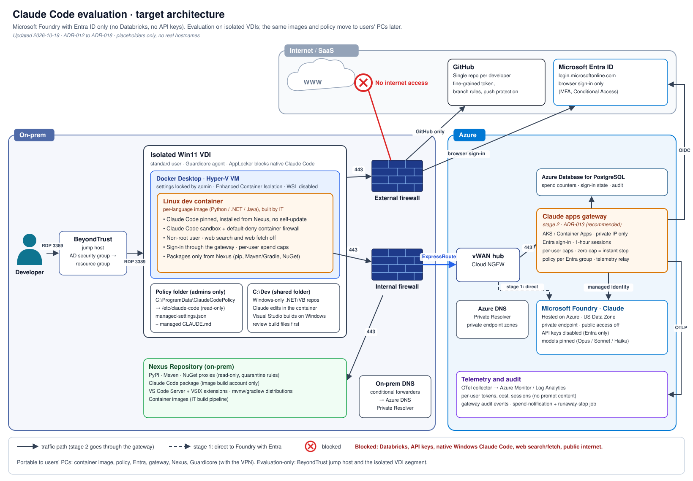
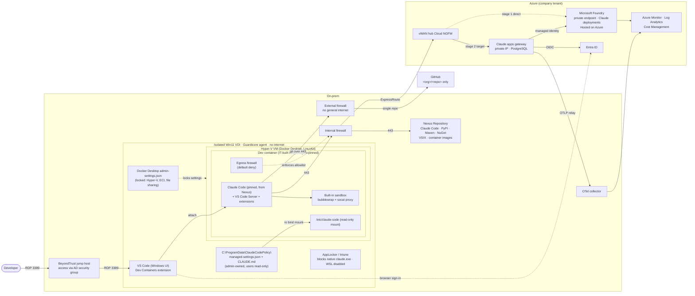
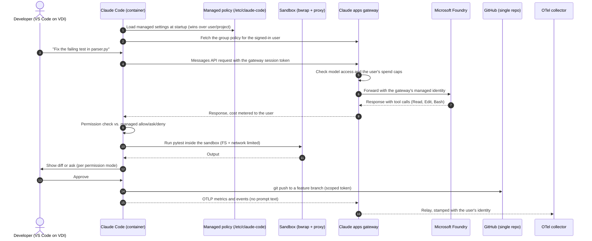
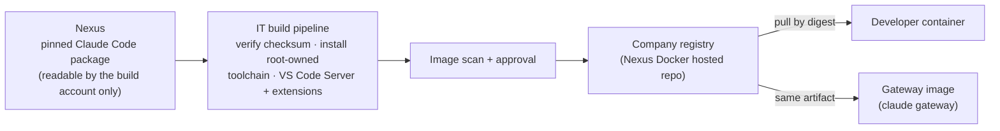
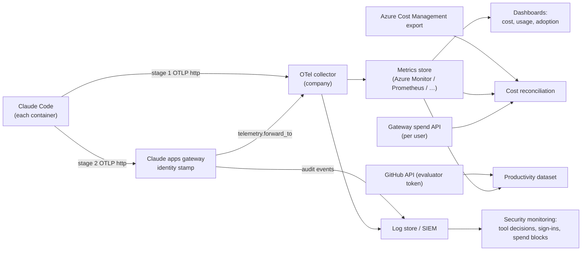

# Reference architecture

[🏠 Home](../../README.md) › Architecture › Reference architecture

This is the target deployment pattern for Claude Code in the evaluation. A developer reaches an **isolated Windows 11 VDI** through a BeyondTrust jump host. On the VDI, Docker Desktop runs on the **Hyper-V backend** and hosts a hardened Linux dev container. Claude Code runs only in that container. Model traffic goes over ExpressRoute to **Microsoft Foundry**, first directly and then through the **Claude apps gateway** ([ADR-013](../../logs/decision-log.md#adr-013)). Packages come only from **Nexus**, and the only internet destination is one GitHub repository. The page covers what runs where, who controls each layer, which trust boundaries the controls defend, and what carries over to users' PCs later.

## Contents
- [Overview diagram](#overview-diagram)
- [Staged model access](#staged-model-access)
- [Access path](#access-path)
- [Layers and ownership](#layers-and-ownership)
- [Request flow](#request-flow)
- [Why a container on the VDI (and not native Windows)](#why-a-container-on-the-vdi-and-not-native-windows)
- [Where policy lives](#where-policy-lives)
- [Docker Desktop configuration (target)](#docker-desktop-configuration-target)
- [Container specification (target)](#container-specification-target)
- [Image build and distribution](#image-build-and-distribution)
- [Language images and package managers](#language-images-and-package-managers)
- [VS Code components offline](#vs-code-components-offline)
- [.NET and VB.NET capability tiers](#net-and-vbnet-capability-tiers)
- [Telemetry path](#telemetry-path)
- [Production target: users' PCs](#production-target-users-pcs)
- [Open design questions](#open-design-questions)

## Overview diagram



*Target architecture: isolated VDI on-prem, the Claude apps gateway and Foundry in Azure, Nexus for every package, and one GitHub repository as the only internet destination.*



## Staged model access

Phase 1 proves the simplest path first, then adds the gateway on top ([ADR-013](../../logs/decision-log.md#adr-013)). Both stages use **Entra ID only**. There is no shared key, and API-key authentication is switched off on the Foundry resource ([ADR-006](../../logs/decision-log.md#adr-006), [IDN-002](../03-test-plan/catalog/identity.md#idn-002)).

| | Stage 1: direct Foundry | Stage 2: Claude apps gateway (target) |
|---|---|---|
| How Claude Code authenticates | `az login --use-device-code` in the container; Claude Code uses `DefaultAzureCredential` | `/login` to the gateway (device flow, Entra sign-in in the browser); short-lived gateway session token |
| What the container holds | Entra token cache in `~/.azure` (protected by deny rules) | Only the gateway session token. No Azure CLI, no Azure token cache. |
| Who calls Foundry | The developer's own Entra identity (custom role) | Only the gateway's managed identity ([IDN-015](../03-test-plan/catalog/identity.md#idn-015)) |
| Per-user cost | OTel with attributes we add ourselves; no per-user cap | Gateway meters every request per user; daily/weekly/monthly caps; zero cap = instant block ([COST-013](../03-test-plan/catalog/cost.md#cost-013), [COST-015](../03-test-plan/catalog/cost.md#cost-015)) |
| Policy delivery | Read-only file mount | File mount (baseline) **plus** policy per Entra group from the gateway |
| Telemetry | Claude Code → collector | Claude Code → gateway relay (identity-stamped) → collector ([TEL-013](../03-test-plan/catalog/telemetry.md#tel-013)) |
| Lost features | — | WebSearch off (we disable it anyway), 5-minute prompt cache only, no CI service tokens |
| Decided by | — | End of Phase 1 week 3, from [IDN-014](../03-test-plan/catalog/identity.md#idn-014), [COST-013](../03-test-plan/catalog/cost.md#cost-013), [COST-015](../03-test-plan/catalog/cost.md#cost-015), [TEL-013](../03-test-plan/catalog/telemetry.md#tel-013) |

Gateway documentation: [Claude apps gateway](https://code.claude.com/docs/en/claude-apps-gateway) · [configuration](https://code.claude.com/docs/en/claude-apps-gateway-config) · [deployment](https://code.claude.com/docs/en/claude-apps-gateway-deploy) · [spend limits](https://code.claude.com/docs/en/claude-apps-gateway-spend-limits).

> [!NOTE]
> Databricks Unity AI Gateway (`ug claude`) was also evaluated and rejected ([ADR-012](../../logs/decision-log.md#adr-012)). Among other reasons, `ug` writes Claude Code's managed-settings file and adds plugins, hooks, and local MCP proxies that our policy blocks.

## Access path

| Hop | From → to | Protocol | Control |
|---|---|---|---|
| 1 | Developer → BeyondTrust jump host | RDP 3389 | Access granted through an AD security group mapped to the BeyondTrust resource group |
| 2 | Jump host → isolated Win11 VDI | RDP 3389 | Isolated segment. Guardicore agent on the VDI. No general internet. |
| 3 | VDI → Docker Desktop VM → dev container | Hyper-V, Docker | Locked Docker Desktop settings, ECI ([CTL-03](../02-security-baseline/defense-in-depth.md#ctl-03)) |
| 4 | Container → Nexus | HTTPS 443 via the internal firewall | Read-only package access ([CTL-25](../02-security-baseline/defense-in-depth.md#ctl-25)) |
| 5 | Container → gateway / Foundry | HTTPS 443 via internal firewall → ExpressRoute → vWAN hub Cloud NGFW | Private DNS, Foundry private endpoint, NGFW rules ([CTL-27](../02-security-baseline/defense-in-depth.md#ctl-27)) |
| 6 | Container → GitHub | HTTPS 443 via the external firewall | Only `<org>/<repo>`; scoped token ([CTL-17](../02-security-baseline/defense-in-depth.md#ctl-17)) |
| 7 | Browser on the VDI → Entra ID | HTTPS 443 via the external firewall | Sign-in only (device flow approval) |

Firewall, DNS, and Guardicore rules are in [network-egress.md](network-egress.md). Identities are in [identity-and-access.md](identity-and-access.md).

## Layers and ownership

| # | Layer | What it provides | Owner | Can a developer change it? | Portable to PCs? | Controls |
|---|---|---|---|---|---|---|
| 1 | **Access path** | BeyondTrust jump host, isolated VDI segment | Platform / Network | ❌ No | ❌ VDI-only | [CTL-27](../02-security-baseline/defense-in-depth.md#ctl-27) |
| 2 | **Windows VDI image** | Host OS, AppLocker/Intune, Windows managed-settings backstop, VS Code | Platform/VDI team | ❌ No (standard user) | ⚠️ PC equivalent needed (Intune) | [CTL-01](../02-security-baseline/defense-in-depth.md#ctl-01) |
| 3 | **Guardicore agent** | Host-level segmentation, including Docker Desktop's traffic | Security / Network | ❌ No | ✅ Portable (agent runs on PCs) | [CTL-27](../02-security-baseline/defense-in-depth.md#ctl-27) |
| 4 | **Docker Desktop, Hyper-V backend** | Docker Desktop's LinuxKit VM in Hyper-V, running containers. Settings locked by `admin-settings.json`. | Platform/VDI team | ⚠️ **Partly.** Members of `docker-users` can start containers ([R-01](../../logs/risk-register.md#r-01)). Locked settings and Enhanced Container Isolation limit what those containers can do. | ✅ Portable (settings pushed by MDM) | [CTL-03](../02-security-baseline/defense-in-depth.md#ctl-03) |
| 5 | **Policy path** (`C:\ProgramData\ClaudeCodePolicy\`. Administrators: full control. Users: read only.) | Source of managed settings and the managed CLAUDE.md | Evaluation lead / Security | ❌ Must not be able to | ✅ Portable (pushed by Intune) | [CTL-06](../02-security-baseline/defense-in-depth.md#ctl-06) |
| 6 | **Dev container image** | Pinned Claude Code from Nexus, language toolchain, firewall script, non-root user | Evaluation lead → Platform | ❌ Built by IT, pulled by digest | ✅ Portable | [CTL-02](../02-security-baseline/defense-in-depth.md#ctl-02), [CTL-25](../02-security-baseline/defense-in-depth.md#ctl-25) |
| 7 | **Container egress firewall** | Default-deny outbound + allowlist | Image (set at start) | ❌ NET_ADMIN dropped after init | ✅ Portable (must be proven on a host with internet, [NET-014](../03-test-plan/catalog/network.md#net-014)) | [CTL-04](../02-security-baseline/defense-in-depth.md#ctl-04) |
| 8 | **Managed settings** | Permissions, sandbox, MCP/plugins/hooks lockdown, models, telemetry, web tools off | Evaluation lead / Security | ❌ Read-only mount | ✅ Portable | [CTL-06](../02-security-baseline/defense-in-depth.md#ctl-06)–[CTL-15](../02-security-baseline/defense-in-depth.md#ctl-15), [CTL-26](../02-security-baseline/defense-in-depth.md#ctl-26) |
| 9 | **Claude Code sandbox** | OS-level FS + network isolation for Bash and its children | Managed settings | ❌ `allowUnsandboxedCommands: false` | ✅ Portable | [CTL-09](../02-security-baseline/defense-in-depth.md#ctl-09)–[CTL-11](../02-security-baseline/defense-in-depth.md#ctl-11) |
| 10 | **Permission rules** | Allow/ask/deny for tools, files, commands | Managed settings | ❌ Managed-only rules | ✅ Portable | [CTL-07](../02-security-baseline/defense-in-depth.md#ctl-07), [CTL-08](../02-security-baseline/defense-in-depth.md#ctl-08), [CTL-29](../02-security-baseline/defense-in-depth.md#ctl-29) |
| 11 | **Identity** | Entra ID only (no keys). Fine-grained GitHub token → one repo. | Azure admin / GitHub admin | ❌ | ✅ Portable | [CTL-16](../02-security-baseline/defense-in-depth.md#ctl-16), [CTL-17](../02-security-baseline/defense-in-depth.md#ctl-17) |
| 12 | **Claude apps gateway** (stage 2) | Entra sign-in, per-user caps, policy per group, telemetry relay | Evaluation lead / Platform | ❌ | ✅ Portable (needs VPN) | [CTL-24](../02-security-baseline/defense-in-depth.md#ctl-24), [CTL-28](../02-security-baseline/defense-in-depth.md#ctl-28) |
| 13 | **Nexus** | Claude Code, language packages, VS Code components, images | Nexus owner | ❌ Read-only | ✅ Portable (needs VPN) | [CTL-25](../02-security-baseline/defense-in-depth.md#ctl-25) |
| 14 | **Network path and corporate proxy** | Internal/external firewalls, ExpressRoute, Cloud NGFW, egress logging | Network/Security | ❌ | ⚠️ PC equivalent needed (depends on VPN tunnel mode) | [CTL-05](../02-security-baseline/defense-in-depth.md#ctl-05), [CTL-27](../02-security-baseline/defense-in-depth.md#ctl-27) |

## Request flow

A typical interaction in stage 2: the developer asks Claude to fix a failing test.



In stage 1, Claude Code calls Foundry directly with the developer's Entra token, and exports OTLP straight to the collector.

## Why a container on the VDI (and not native Windows)

**Claude Code never runs natively on Windows**, in the evaluation or in production ([ADR-017](../../logs/decision-log.md#adr-017)).

| Option | Sandbox | Policy enforcement | Isolation from VDI user profile | Verdict |
|---|---|---|---|---|
| Native Windows install on the VDI | ❌ **None.** Claude Code's OS sandbox isn't supported on native Windows ([setup docs](https://code.claude.com/docs/en/setup), [sandboxing docs](https://code.claude.com/docs/en/sandboxing)) | Managed settings at `C:\Program Files\ClaudeCode\` | ❌ Full access to the user profile, credentials, network | **Never** ([CTL-01](../02-security-baseline/defense-in-depth.md#ctl-01)) |
| Windows containers (Docker Desktop on Hyper-V) | ❌ Same as native: it is native Windows inside the container | Weaker: ECI and our Docker lockdown target Linux containers [verify] | ⚠️ | **Rejected**: memory constraints, huge images ([ADR-017](../../logs/decision-log.md#adr-017)) |
| Dev container on Docker Desktop, **WSL 2** backend | ✅ bubblewrap | Read-only bind mount | ⚠️ Developers also get a WSL distro, where they're root-capable, and which sees the Windows filesystem via `/mnt/c` | Not used: the company standard is Hyper-V, and WSL is disabled on the VDI |
| Linux VM directly in Hyper-V (no container) | ✅ bubblewrap | `/etc/claude-code/` in an IT-managed VM | ✅ Strong | Viable alternative. Heavier per-developer VM management. Not chosen ([ADR-002](../../logs/decision-log.md#adr-002)). |
| **Dev container on Docker Desktop, Hyper-V backend (chosen)** | ✅ bubblewrap inside the container ([ENV-006](../03-test-plan/catalog/env.md#env-006)) | Read-only bind mount from an admin-owned path | ✅ Only `/workspace` and `~/.claude` volumes mounted | **Chosen** ([ADR-002](../../logs/decision-log.md#adr-002)) |

> [!WARNING]
> **The container engine is a trust boundary we don't fully control.** A developer who can run `docker` can start other containers, mount host paths, or run privileged containers. That bypasses everything inside *our* container ([R-01](../../logs/risk-register.md#r-01)). Mitigations come from Docker Desktop Business: **Settings Management** (a locked `admin-settings.json`), **Enhanced Container Isolation** (ECI: privileged containers can't touch the Docker Desktop VM, and `docker.sock` mounts are blocked), **Registry/Image Access Management** (only the company registry), and sign-in enforcement. VDI monitoring covers the rest. Tested in [ENV-010](../03-test-plan/catalog/env.md#env-010).

> [!WARNING]
> **Nested sandbox.** bubblewrap inside an unprivileged Docker container may need extra privileges, or `sandbox.enableWeakerNestedSandbox`, which the docs say "considerably weakens security". With ECI on, containers run under the Sysbox runtime, which supports nested user namespaces, so bubblewrap may work without extra privileges [verify]. If it doesn't, the container firewall and the read-only mounts carry more of the load. That gets recorded as a finding ([ENV-006](../03-test-plan/catalog/env.md#env-006), [R-16](../../logs/risk-register.md#r-16)).

## Where policy lives

Claude Code reads managed settings from `/etc/claude-code/` on Linux ([managed settings docs](https://code.claude.com/docs/en/managed-settings)). Server-managed settings from the claude.ai admin console **don't apply** to Foundry sessions ([server-managed settings](https://code.claude.com/docs/en/server-managed-settings)). In stage 1, the file is the only delivery path. In stage 2, the gateway also delivers managed settings per Entra group to signed-in sessions. The file stays deployed as the baseline, because machines that never connect get their policy from the file alone ([gateway docs](https://code.claude.com/docs/en/claude-apps-gateway)).

| Requirement | Design |
|---|---|
| Developer can't edit policy | The policy files live on the VDI in `C:\ProgramData\ClaudeCodePolicy\` (NTFS: Administrators full control, Users read only, inheritance off). Docker Desktop file sharing allows that directory, and it's bind-mounted **read-only** into the container at `/etc/claude-code/`. The dev user in the container is non-root, with no sudo. |
| Repo can't override policy | The policy is **not** in the repo's `.devcontainer/`. The docs note that a managed-settings file baked into a repo-editable image isn't enforcement ([devcontainer docs](https://code.claude.com/docs/en/devcontainer)). |
| Managed instructions | A managed `CLAUDE.md` sits next to the policy and arrives through the same read-only mount (`/etc/claude-code/CLAUDE.md`): packages only from Nexus, don't change registry settings, ask the developer to request missing packages, web tools are off ([POL-017](../03-test-plan/catalog/policy.md#pol-017)). |
| Fail closed | Invalid managed JSON stops startup ([POL-008](../03-test-plan/catalog/policy.md#pol-008)). `sandbox.failIfUnavailable: true`. In stage 2, a signed-in session exits at startup if the gateway is unreachable ([NET-015](../03-test-plan/catalog/network.md#net-015)). |
| Versioned and auditable | Policy files are kept in a separate, protected policy repo. Each file's SHA-256 is recorded with every test result. |
| Native Windows backstop | `C:\Program Files\ClaudeCode\managed-settings.json` with a deny-everything posture, in case AppLocker is bypassed ([ENV-008](../03-test-plan/catalog/env.md#env-008)). |

The full annotated policy is in [managed-settings.md](../02-security-baseline/managed-settings.md).

## Docker Desktop configuration (target)

The company standard is **Hyper-V**, so Docker Desktop runs its Linux VM on the Hyper-V backend, and WSL is disabled on the VDI. Locking these settings needs Docker Desktop **Business** (Settings Management) and sign-in enforcement. Tested in [ENV-002](../03-test-plan/catalog/env.md#env-002).

| Setting | Target | Why |
|---|---|---|
| Backend | Hyper-V. The WSL 2 engine is disabled **and locked**. | Company standard. No user-accessible Linux distro on the VDI. |
| Enhanced Container Isolation | On, locked | Contains privileged containers. Blocks `docker.sock` mounts ([R-01](../../logs/risk-register.md#r-01)). |
| File sharing | `C:\ProgramData\ClaudeCodePolicy` always. `C:\Dev` **only on machines with Windows-only .NET repos.** | Nothing else on Windows can be bind-mounted. Most repos are cloned into a container volume, which is also faster on the Hyper-V backend. `C:\Dev` exists for the [shared-folder workflow](#net-and-vbnet-capability-tiers) ([ENV-020](../03-test-plan/catalog/env.md#env-020)). |
| Docker API on TCP 2375 | Off, locked | No unauthenticated engine access |
| Updates | Managed by the platform team (in-app updates off) | Version pinning ([R-19](../../logs/risk-register.md#r-19)) |
| Registry / Image Access Management | Company registry only | Supply chain ([R-20](../../logs/risk-register.md#r-20)) |
| Sign-in enforcement | `allowedOrgs` = `<docker-org>` | Required for Settings Management and licensing |

**Example `admin-settings.json`** (`C:\ProgramData\DockerDesktop\admin-settings.json`). The key names follow Docker's Settings Management docs. Confirm them against the Docker Desktop version you deploy [verify]. Leave out the `C:\Dev` entry on machines that only work on modern-.NET, Python, or Java repos.

```json
{
  "configurationFileVersion": 2,
  "wslEngineEnabled": { "locked": true, "value": false },
  "enhancedContainerIsolation": { "locked": true, "value": true },
  "exposeDockerAPIOnTCP2375": { "locked": true, "value": false },
  "disableUpdate": { "locked": true, "value": true },
  "filesharingAllowedDirectories": [
    { "path": "C:\\ProgramData\\ClaudeCodePolicy", "sharedByDefault": true },
    { "path": "C:\\Dev", "sharedByDefault": false }
  ]
}
```

**Policy folder ACL** (run as administrator when the VDI image is built):

```powershell
New-Item -ItemType Directory -Force C:\ProgramData\ClaudeCodePolicy | Out-Null
icacls C:\ProgramData\ClaudeCodePolicy /inheritance:r /grant:r "Administrators:(OI)(CI)F" "SYSTEM:(OI)(CI)F" "Users:(OI)(CI)RX"
```

## Container specification (target)

This describes the target images. Building them is a Platform/evaluation-lead task. This repo only documents them.

| Aspect | Target |
|---|---|
| Engine | Docker Desktop (Business) `<version>`, Hyper-V backend, settings locked ([above](#docker-desktop-configuration-target)) |
| Base | One company-approved Linux base (Debian/Ubuntu LTS, patched) with Claude Code, the firewall, the non-root user, and the internal CA. A thin **language layer** on top: Python, .NET, or Java ([below](#language-images-and-package-managers)). Each developer's single repo maps to one image. |
| Claude Code | Installed at build time from **Nexus**, at one pinned version (2.1.301 at the time of writing). Root-owned install location. `DISABLE_UPDATES=1` and `DISABLE_AUTOUPDATER=1` in policy ([ADR-014](../../logs/decision-log.md#adr-014), [ENV-016](../03-test-plan/catalog/env.md#env-016)). |
| User | `dev` (non-root UID, no sudo). `remoteUser: dev`. |
| Sandbox deps | `bubblewrap`, `socat` (Linux sandbox requirements) |
| Firewall | Based on Anthropic's reference `init-firewall.sh` ([devcontainer docs](https://code.claude.com/docs/en/devcontainer)), adapted to our allowlist ([network-egress.md](network-egress.md)). Runs at start with `NET_ADMIN`/`NET_RAW`, which are then dropped ([ENV-011](../03-test-plan/catalog/env.md#env-011)). |
| Mounts | `/workspace` (repo cloned into a named volume, rw) · `~/.claude` (named volume, rw) · `/etc/claude-code` (bind mount of `C:\ProgramData\ClaudeCodePolicy`, **ro**). For Windows-only .NET repos only: `/workspace` is a bind mount of `C:\Dev\<repo>` instead of a volume. Nothing else: no Windows profile folders, no `~/.ssh`, no `docker.sock`. |
| Credentials | Stage 1: Entra token cache from `az login --use-device-code` in `~/.azure`. Stage 2: only the gateway session token (no Azure CLI, no Azure token cache). Both: a GitHub fine-grained token. Supplied at runtime, never baked in. Readable by git/az/gh, not by Claude's tools ([IDN-008](../03-test-plan/catalog/identity.md#idn-008)). **No API keys anywhere.** |
| Env (non-policy) | `CLAUDE_CONFIG_DIR` pointing at the persisted volume |
| Tooling | git, gh, the language toolchain for that image, package-manager config pointing at Nexus, VS Code Server + extensions, internal CA in every trust store |
| Registry | Company registry (for example, a Nexus Docker hosted repository). Pulled **by digest**. |

## Image build and distribution

Claude Code reaches developers **only inside the IT-built image** ([ADR-014](../../logs/decision-log.md#adr-014)). Nobody installs it at runtime, and nobody installs it on Windows.



| Rule | Why | Test |
|---|---|---|
| The build pulls one pinned Claude Code version from Nexus (npm proxy, or a raw repo with a checksum) | No internet at build time or runtime | [ENV-016](../03-test-plan/catalog/env.md#env-016) |
| The Claude Code package in Nexus is readable **only by the build account** | Stops a developer installing a different version in their home folder. The policy's `requiredMinimumVersion`/`requiredMaximumVersion` range is the backstop. | [ENV-016](../03-test-plan/catalog/env.md#env-016), [POL-010](../03-test-plan/catalog/policy.md#pol-010) |
| Installed root-owned, outside the dev user's write scope | The non-root user can't replace the binary | [ENV-004](../03-test-plan/catalog/env.md#env-004) |
| `DISABLE_UPDATES=1` in managed policy | Blocks every update path, including `claude update` ([setup docs](https://code.claude.com/docs/en/setup)) | [ENV-005](../03-test-plan/catalog/env.md#env-005) |
| AppLocker/Intune block on Windows stays | The Nexus copy must never run natively | [ENV-007](../03-test-plan/catalog/env.md#env-007) |
| Upgrades: bump the pin → rebuild → rerun P0 tests → publish the new digest → widen the policy version range | Claude Code releases often. Cadence: monthly, plus urgent security fixes. | [OPS-001](../03-test-plan/catalog/operations.md#ops-001), [OPS-002](../03-test-plan/catalog/operations.md#ops-002) |
| The same Nexus artifact builds the gateway image | One version, one provenance | [OPS-011](../03-test-plan/catalog/operations.md#ops-011) |

## Language images and package managers

Claude Code doesn't look up libraries itself. It runs the normal tools (`pip`, `uv`, `mvn`, `gradle`, `dotnet`), and those read their own config. So each language image points its tools at Nexus ([ADR-015](../../logs/decision-log.md#adr-015)). **The image config makes Nexus work; the container firewall makes it the only option** ([ENV-017](../03-test-plan/catalog/env.md#env-017), [NET-010](../03-test-plan/catalog/network.md#net-010)).

| Ecosystem | Setting in the image | Watch out for |
|---|---|---|
| **Python (pip)** | `/etc/pip.conf`: `index-url = https://<nexus-host>/repository/<pypi-group>/simple` and `cert = /etc/ssl/certs/ca-certificates.crt` | A `requirements.txt` can carry its own `--index-url`. The firewall blocks it, but expect confusing errors. |
| **Python (uv, Poetry)** | uv: a default index pointing at the same Nexus URL (`UV_DEFAULT_INDEX` or a system `uv.toml`) [verify]. Poetry: a primary source pointing at Nexus [verify]. | Project files can declare other indexes; the firewall blocks them |
| **Java (Maven)** | Maven's global `settings.xml`: a `<mirror>` with `<mirrorOf>*</mirrorOf>` → `https://<nexus-host>/repository/<maven-group>/` | `mvnw` downloads Maven itself. Host the distribution in Nexus and point `.mvn/wrapper/maven-wrapper.properties` there. |
| **Java (Gradle)** | An init script in the Gradle home `init.d/` that replaces every repository, including the plugin portal, with Nexus | `gradlew` downloads Gradle (`distributionUrl`). Host a copy in a Nexus raw repo. |
| **.NET / VB.NET (NuGet)** | A `NuGet.Config` for the dev user with `<clear/>` (drops nuget.org) and `https://<nexus-host>/repository/<nuget-group>/index.json` | A repo's own `nuget.config` can add sources back. The firewall blocks them, and edits to it are an `ask` rule ([PERM-019](../03-test-plan/catalog/permissions.md#perm-019)). |
| **Internal CA** | System trust store (`update-ca-certificates`), `cert =` in pip.conf, JDK `cacerts` (`keytool -importcert`), `NODE_EXTRA_CA_CERTS` for Claude Code. .NET on Linux uses the system store. | Each tool has its own store. Miss one and that tool fails TLS. |

| Rule | Why | Test |
|---|---|---|
| Nexus access from the container is **read-only** (anonymous read or a read-only token, masked from the agent). No publish rights. | Otherwise `twine upload`, `mvn deploy`, or `dotnet nuget push` become ways to send code out | [IDN-016](../03-test-plan/catalog/identity.md#idn-016) |
| `<nexus-host>` is in the container firewall allowlist **and** in `sandbox.network.allowedDomains` | Without it, a sandboxed `pip install` fails | [SBX-005](../03-test-plan/catalog/sandbox.md#sbx-005) |
| Consider Sonatype Repository Firewall or quarantine rules for new or suspicious packages | AI tools sometimes suggest package names that don't exist, and attackers register them ([R-26](../../logs/risk-register.md#r-26)) | [ENV-017](../03-test-plan/catalog/env.md#env-017) |
| Installing a package runs its code (`setup.py`, MSBuild targets, Gradle plugins) | The container, sandbox, and firewall contain it | [DATA-005](../03-test-plan/catalog/data.md#data-005) |

## VS Code components offline

The container has no internet, so nothing VS Code needs can be downloaded at attach time ([ADR-015](../../logs/decision-log.md#adr-015), [R-29](../../logs/risk-register.md#r-29)).

| Component | Normal behavior | Our design | Test |
|---|---|---|---|
| **VS Code Server** | Dev Containers downloads the server into the container on first attach, from Microsoft | Pin the VS Code version on the VDI (IT-managed, updates off) and pre-install the matching server build in the image, or host it in Nexus [verify] | [ENV-018](../03-test-plan/catalog/env.md#env-018) |
| **Extensions** (Python, C# Dev Kit, Java, …) | Installed from the Marketplace; some download language servers or runtimes on first run | Built into the image. Fallback: pinned VSIX files with SHA-256 checksums in a Nexus raw hosted repo, installed at container creation. Nexus has no native Marketplace format. | [ENV-018](../03-test-plan/catalog/env.md#env-018), [ENV-009](../03-test-plan/catalog/env.md#env-009) |
| **Claude Code VS Code extension** | Marketplace | Pinned to the same version as the CLI, so it stays inside the policy's version range | [ENV-009](../03-test-plan/catalog/env.md#env-009), [POL-010](../03-test-plan/catalog/policy.md#pol-010) |

## .NET and VB.NET capability tiers

What a .NET project targets decides what Claude can do in a Linux container. The language (C# or VB.NET) doesn't ([ADR-017](../../logs/decision-log.md#adr-017)).

| Tier | Which projects | What Claude can do in the container |
|---|---|---|
| **Full** | Modern .NET (`net6.0`, `net8.0`, …): libraries, console apps, ASP.NET Core, unit tests. C# or VB. | Edit, build, run tests |
| **Compile-check** | SDK-style projects targeting `net48`, or `net8.0-windows` with WinForms/WPF | Edit and **compile** (using the `Microsoft.NETFramework.ReferenceAssemblies` package or `EnableWindowsTargeting`). Tests need Windows. |
| **Edit-only** | Old-style (non-SDK) .NET Framework projects, WebForms, WCF | Edit only. The developer builds and tests on Windows. |

- **Classification.** Each repo's tier is recorded at onboarding. Claude can do it in its first session by scanning the project files for `TargetFramework`, `UseWPF`, `UseWindowsForms`, and `ToolsVersion` ([ENV-019](../03-test-plan/catalog/env.md#env-019)). The tier is a covariate in the productivity analysis ([R-28](../../logs/risk-register.md#r-28)).
- **Shared-folder workflow** (compile-check and edit-only repos). The repo lives in `C:\Dev\<repo>` on Windows and is bind-mounted into the container. Claude edits it from inside the container. The developer builds in Visual Studio on Windows. `C:\Dev` is added to Docker Desktop's file-sharing allowlist only on those machines, and file access is slower on Hyper-V ([ENV-020](../03-test-plan/catalog/env.md#env-020), [ENV-013](../03-test-plan/catalog/env.md#env-013)). The alternative is a git round trip (push from the container, pull into a Windows clone).
- **Building on Windows is where agent-written code leaves the container.** MSBuild runs whatever the project files say. So edits to build files and registry configs (`*.csproj`, `*.vbproj`, `*.props`, `*.targets`, `Directory.Build.*`, `nuget.config`, `*.ps1`, `*.cmd`, `*.bat`) are `ask` rules, and the AUP requires a review of those files and any new packages before building ([CTL-29](../02-security-baseline/defense-in-depth.md#ctl-29), [PERM-019](../03-test-plan/catalog/permissions.md#perm-019), [R-25](../../logs/risk-register.md#r-25)).
- **Options not taken.** Native Claude on Windows: never. Windows containers: rejected (memory). A self-hosted, ephemeral, on-prem Windows CI runner that builds and tests pushed branches: optional, low-priority experiment ([SURF-013](../03-test-plan/catalog/surfaces.md#surf-013)). Modernizing projects to multi-target modern .NET: out of scope for the evaluation.

## Telemetry path

Claude Code exports OpenTelemetry metrics and events. The managed policy sets this, so developers and repos can't redirect it ([monitoring docs](https://code.claude.com/docs/en/monitoring-usage)). In stage 2, signed-in sessions send OTLP/HTTP to the gateway, which stamps the user's identity and relays it to the collector (`telemetry.forward_to`). The gateway never stores prompt or completion content ([gateway docs](https://code.claude.com/docs/en/claude-apps-gateway)).



The backend choice is open ([ADR-007](../../logs/decision-log.md#adr-007)). For Phase 1, Anthropic's [claude-code-monitoring-guide](https://github.com/anthropics/claude-code-monitoring-guide) (Docker Compose with collector, Prometheus, and Grafana) is a quick way to prove the data flow before wiring up the company backend. The gateway relays OTLP over HTTP only, not gRPC.

## Production target: users' PCs

The evaluation runs on VDIs, in Phase 1 and Phase 2, because the isolated VDI adds a layer of protection while we prove the design. The production target is **the same Docker images on users' PCs** ([ADR-018](../../logs/decision-log.md#adr-018)). So the evaluation has to show that the controls work **without** the VDI around them ([R-23](../../logs/risk-register.md#r-23)).

| | Carries over to PCs | VDI-only today |
|---|---|---|
| Controls | Container image, read-only policy mount, managed policy, sandbox, container firewall, Docker Desktop locked settings (pushed by MDM), Entra ID, gateway and spend caps, Nexus, telemetry, Guardicore | Isolated network segment, BeyondTrust jump host, resettable host with no personal data, no internet on the host |
| Proof | Every control is tagged Portable or VDI-only in the [control catalog](../02-security-baseline/defense-in-depth.md#control-catalog). Portable network P0 tests are re-run on a host **with** internet access, because on the isolated VDI the VDI firewall would hide a container-firewall failure ([NET-014](../03-test-plan/catalog/network.md#net-014)). | — |

**PC prerequisites** ([ENV-022](../03-test-plan/catalog/env.md#env-022)): standard user with no local admin (otherwise the user can change Docker Desktop settings, edit the policy folder, or install Claude natively); Windows Pro/Enterprise with Hyper-V and virtualization enabled in the BIOS; a Docker Desktop Business licence; full-disk encryption (already in place); RAM sized from [ENV-013](../03-test-plan/catalog/env.md#env-013); the VPN.

- **Guardicore** runs on PCs too. It sees container traffic as Docker Desktop's process, so a process-level rule can limit Docker Desktop to the gateway, Nexus, GitHub, and the registry while other apps keep full access [verify with the Guardicore team]. It can't see inside the container, so the container firewall stays the primary control ([ENV-021](../03-test-plan/catalog/env.md#env-021)).
- **VPN.** Off the VPN, nothing in the tenant is reachable, so signed-in sessions fail closed ([NET-015](../03-test-plan/catalog/network.md#net-015)). Open question for the network team: full or split tunnel? With split tunnel, the container firewall is the only control on internet traffic.
- **Optional PC track.** The evaluation lead may run on a local PC in Phase 2, using a standard (non-admin) account for the tamper tests.

## Open design questions

| # | Question | Decision record | Blocking test |
|---|---|---|---|
| 1 | ~~Which container engine?~~ Decided: Docker Desktop (Business) on the Hyper-V backend. Remaining: confirm the locked settings work on our VDI. | [ADR-005](../../logs/decision-log.md#adr-005) | [ENV-002](../03-test-plan/catalog/env.md#env-002) |
| 2 | ~~Foundry auth mode?~~ Decided: Entra ID only, no keys. Remaining: confirm `disableLocalAuth` applies to Claude deployments. | [ADR-006](../../logs/decision-log.md#adr-006) | [IDN-002](../03-test-plan/catalog/identity.md#idn-002) |
| 3 | Do we put the Claude apps gateway in front of Foundry (stage 2)? | [ADR-013](../../logs/decision-log.md#adr-013) | [IDN-014](../03-test-plan/catalog/identity.md#idn-014), [COST-013](../03-test-plan/catalog/cost.md#cost-013), [COST-015](../03-test-plan/catalog/cost.md#cost-015), [TEL-013](../03-test-plan/catalog/telemetry.md#tel-013) |
| 4 | OTel backend | [ADR-007](../../logs/decision-log.md#adr-007) | [TEL-001](../03-test-plan/catalog/telemetry.md#tel-001) |
| 5 | Default permission mode for developers (Manual vs. auto) | [ADR-008](../../logs/decision-log.md#adr-008) | [PERM-011](../03-test-plan/catalog/permissions.md#perm-011), [POL-016](../03-test-plan/catalog/policy.md#pol-016) |
| 6 | Foundry deployment hosting option (recommendation: Hosted on Azure, US Data Zone) | [ADR-009](../../logs/decision-log.md#adr-009) | [DATA-001](../03-test-plan/catalog/data.md#data-001) |
| 7 | How developers start the container without broad engine rights | [ADR-005](../../logs/decision-log.md#adr-005) | [ENV-010](../03-test-plan/catalog/env.md#env-010) |
| 8 | Do Claude deployments support a Foundry private endpoint with public access disabled? [verify] | — | [NET-016](../03-test-plan/catalog/network.md#net-016) |
| 9 | How is the VS Code Server supplied offline (pre-installed in the image or hosted in Nexus)? | [ADR-015](../../logs/decision-log.md#adr-015) | [ENV-018](../03-test-plan/catalog/env.md#env-018) |
| 10 | Is the PC VPN full tunnel or split tunnel? (network team) | [ADR-018](../../logs/decision-log.md#adr-018) | [NET-014](../03-test-plan/catalog/network.md#net-014), [NET-015](../03-test-plan/catalog/network.md#net-015) |
| 11 | Can Guardicore limit Docker Desktop's traffic by process without affecting other apps? | [ADR-018](../../logs/decision-log.md#adr-018) | [ENV-021](../03-test-plan/catalog/env.md#env-021) |

## Related
- [Identity and access](identity-and-access.md) · [Network egress](network-egress.md) · [Threat model](threat-model.md)
- [Defense in depth](../02-security-baseline/defense-in-depth.md) · [Managed settings](../02-security-baseline/managed-settings.md)
