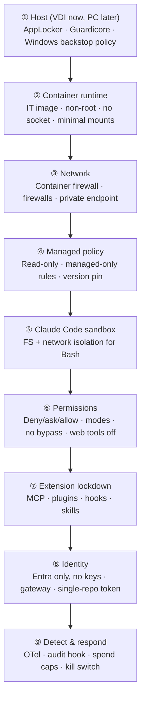

# Defense in depth (control catalog)

[🏠 Home](../../README.md) › Security baseline › Defense in depth

This is the master list of security controls (`CTL-NN`). Each control states what it protects, where it's enforced, who owns it, which tests prove it, and whether it carries over to users' PCs. The Phase 1 report's control matrix is built straight from this table.

> [!NOTE]
> **Portable vs. VDI-only.** The evaluation runs on VDIs, but the production target is the same Docker images on users' PCs ([ADR-018](../../logs/decision-log.md#adr-018)). **Portable** controls live in the image, the policy, the identity setup, or the gateway, and work the same on a PC. **VDI-only** controls come from the VDI environment and need a PC equivalent or don't exist there. The Phase 1 report can only claim "secure in Docker" from portable controls ([R-23](../../logs/risk-register.md#r-23)).

> [!IMPORTANT]
> **Design principle: assume each layer can fail.** The Claude Code docs are explicit that Bash permission rules "aren't a security boundary around the program" ([permissions](https://code.claude.com/docs/en/permissions)). They also say the sandbox only covers Bash and its children ([sandboxing](https://code.claude.com/docs/en/sandboxing)). So every high-impact threat has at least **two independent** controls.

## Contents
- [Layer model](#layer-model)
- [Control catalog](#control-catalog)
- [Coverage: threats × controls](#coverage-threats--controls)

## Layer model

## Control catalog

| ID | Control | Layer | Enforcement mechanism | Owner | Verified by | Mitigates | Portable to PCs |
|---|---|---|---|---|---|---|---|
| **CTL-01** | Native Windows Claude Code blocked; Windows backstop policy | ① | AppLocker/Intune rule blocking `claude.exe` / the npm global install. WSL optional feature disabled, so there's no Linux route around the container. `C:\Program Files\ClaudeCode\managed-settings.json` set to deny everything. | Platform | [ENV-007](../03-test-plan/catalog/env.md#env-007), [ENV-008](../03-test-plan/catalog/env.md#env-008) | R-03 | PC equivalent: AppLocker/Intune on PCs ([ENV-022](../03-test-plan/catalog/env.md#env-022)) |
| **CTL-02** | IT-built, version-pinned image from a controlled registry | ② | Image built by IT, Claude Code pinned at 2.1.301 and installed from Nexus at build time ([ADR-014](../../logs/decision-log.md#adr-014)), per-language images on a common base, pulled by digest, registry allowlist | Eval lead / Platform | [ENV-003](../03-test-plan/catalog/env.md#env-003), [ENV-005](../03-test-plan/catalog/env.md#env-005), [ENV-015](../03-test-plan/catalog/env.md#env-015), [ENV-016](../03-test-plan/catalog/env.md#env-016) | R-19, R-20 | Portable |
| **CTL-03** | Container runtime hardening | ② | Non-root `dev` user, no sudo. No `--privileged`, no `docker.sock`. `NET_ADMIN` dropped after firewall init. Mounts limited to workspace, `~/.claude`, and the policy (ro). Docker Desktop (Hyper-V backend) settings locked: Enhanced Container Isolation, file sharing limited to the policy folder, company registry only. | Platform | [ENV-004](../03-test-plan/catalog/env.md#env-004), [ENV-010](../03-test-plan/catalog/env.md#env-010), [ENV-011](../03-test-plan/catalog/env.md#env-011), [ENV-012](../03-test-plan/catalog/env.md#env-012), [SBX-013](../03-test-plan/catalog/sandbox.md#sbx-013) | R-01, R-08 | Portable (Docker Desktop settings pushed by MDM) |
| **CTL-04** | Container egress firewall (default deny) | ③ | iptables/ipset at start, adapted from Anthropic's reference `init-firewall.sh` | Eval lead | [NET-001](../03-test-plan/catalog/network.md#net-001), [NET-002](../03-test-plan/catalog/network.md#net-002), [NET-008](../03-test-plan/catalog/network.md#net-008), [NET-013](../03-test-plan/catalog/network.md#net-013) | R-06, R-09 | Portable, proven by [NET-014](../03-test-plan/catalog/network.md#net-014) |
| **CTL-05** | Corporate egress proxy with logging and TLS inspection | ③ | `HTTPS_PROXY` + `NODE_EXTRA_CA_CERTS`. Proxy policy and logs. | Network / Security | [NET-005](../03-test-plan/catalog/network.md#net-005), [NET-012](../03-test-plan/catalog/network.md#net-012) | R-06 | PC equivalent: proxy reachability depends on the VPN tunnel mode |
| **CTL-06** | Managed settings delivered read-only from an admin-owned path | ④ | `/etc/claude-code/` ro bind mount from the admin-owned `C:\ProgramData\ClaudeCodePolicy\` (users read only). Fail closed on invalid JSON. | Eval lead / Security | [POL-001](../03-test-plan/catalog/policy.md#pol-001), [POL-002](../03-test-plan/catalog/policy.md#pol-002), [POL-003](../03-test-plan/catalog/policy.md#pol-003), [POL-008](../03-test-plan/catalog/policy.md#pol-008), [POL-009](../03-test-plan/catalog/policy.md#pol-009) | R-04 | Portable (policy folder pushed by MDM) |
| **CTL-07** | Managed-only permission rules + deny rules for secrets and protected paths | ⑥ | `allowManagedPermissionRulesOnly: true`, `permissions.deny` list | Eval lead | [POL-004](../03-test-plan/catalog/policy.md#pol-004), [POL-005](../03-test-plan/catalog/policy.md#pol-005), [POL-007](../03-test-plan/catalog/policy.md#pol-007), [PERM-002](../03-test-plan/catalog/permissions.md#perm-002)–[PERM-007](../03-test-plan/catalog/permissions.md#perm-007), [PERM-017](../03-test-plan/catalog/permissions.md#perm-017) | R-05, R-08, R-17 | Portable |
| **CTL-08** | Bypass mode disabled; permission-mode policy | ⑥ | `permissions.disableBypassPermissionsMode: "disable"`, `defaultMode`, auto-mode decision | Eval lead | [PERM-001](../03-test-plan/catalog/permissions.md#perm-001), [PERM-008](../03-test-plan/catalog/permissions.md#perm-008)–[PERM-012](../03-test-plan/catalog/permissions.md#perm-012), [POL-016](../03-test-plan/catalog/policy.md#pol-016) | R-17 | Portable |
| **CTL-09** | Mandatory sandbox | ⑤ | `sandbox.enabled`, `failIfUnavailable: true`, `allowUnsandboxedCommands: false`, empty `excludedCommands` | Eval lead | [ENV-006](../03-test-plan/catalog/env.md#env-006), [SBX-001](../03-test-plan/catalog/sandbox.md#sbx-001), [SBX-002](../03-test-plan/catalog/sandbox.md#sbx-002), [SBX-008](../03-test-plan/catalog/sandbox.md#sbx-008), [SBX-010](../03-test-plan/catalog/sandbox.md#sbx-010) | R-05, R-16 | Portable |
| **CTL-10** | Sandbox network allowlist (managed-only) | ⑤ | `sandbox.network.allowedDomains`, `allowManagedDomainsOnly: true`, no Unix sockets, no local binding (pending decision) | Eval lead | [SBX-005](../03-test-plan/catalog/sandbox.md#sbx-005), [SBX-006](../03-test-plan/catalog/sandbox.md#sbx-006), [SBX-012](../03-test-plan/catalog/sandbox.md#sbx-012), [SBX-013](../03-test-plan/catalog/sandbox.md#sbx-013) | R-06, R-09 | Portable |
| **CTL-11** | Sandbox filesystem and credential protection | ⑤ | `sandbox.filesystem.denyRead`, `allowManagedReadPathsOnly`, `credentials` masking, write scope | Eval lead | [SBX-003](../03-test-plan/catalog/sandbox.md#sbx-003), [SBX-004](../03-test-plan/catalog/sandbox.md#sbx-004), [SBX-007](../03-test-plan/catalog/sandbox.md#sbx-007), [SBX-009](../03-test-plan/catalog/sandbox.md#sbx-009), [SBX-015](../03-test-plan/catalog/sandbox.md#sbx-015) | R-08 | Portable |
| **CTL-12** | MCP lockdown | ⑦ | `allowManagedMcpServersOnly: true`, no managed servers at start, claude.ai connectors off | Eval lead | [EXT-001](../03-test-plan/catalog/extensions.md#ext-001), [EXT-002](../03-test-plan/catalog/extensions.md#ext-002), [EXT-011](../03-test-plan/catalog/extensions.md#ext-011), [EXT-012](../03-test-plan/catalog/extensions.md#ext-012) | R-20, R-09 | Portable |
| **CTL-13** | Plugin, marketplace, and sideload lockdown | ⑦ | `strictKnownMarketplaces: []`, `disableSideloadFlags`, mods lockdown (`pluginConfigs.allowManagedModsOnly`, `allowManagedHooksOnly`) | Eval lead | [EXT-003](../03-test-plan/catalog/extensions.md#ext-003), [EXT-004](../03-test-plan/catalog/extensions.md#ext-004), [EXT-014](../03-test-plan/catalog/extensions.md#ext-014) | R-20 | Portable |
| **CTL-14** | Hooks lockdown + managed audit hook | ⑦ ⑨ | `allowManagedHooksOnly: true`, managed `PreToolUse`/`PostToolUse`/`ConfigChange` audit hook | Eval lead | [EXT-005](../03-test-plan/catalog/extensions.md#ext-005), [EXT-006](../03-test-plan/catalog/extensions.md#ext-006), [POL-015](../03-test-plan/catalog/policy.md#pol-015) | R-09, R-20 | Portable |
| **CTL-15** | Customization surfaces controlled | ⑦ | `disableSkillShellExecution`, project skills/agents policy, statusLine and helper commands managed-only | Eval lead | [EXT-007](../03-test-plan/catalog/extensions.md#ext-007)–[EXT-010](../03-test-plan/catalog/extensions.md#ext-010), [EXT-013](../03-test-plan/catalog/extensions.md#ext-013), [EXT-015](../03-test-plan/catalog/extensions.md#ext-015) | R-09 | Portable |
| **CTL-16** | Foundry least-privilege identity | ⑧ | Entra ID only: API keys disabled on the resource (`disableLocalAuth`, enforced by Azure Policy, [ADR-006](../../logs/decision-log.md#adr-006)). Custom RBAC role (data actions only) for the AD security group synced to Entra; in the gateway stage only the gateway's managed identity holds it. Diagnostic logs. | Azure admin | [IDN-001](../03-test-plan/catalog/identity.md#idn-001)–[IDN-005](../03-test-plan/catalog/identity.md#idn-005), [IDN-009](../03-test-plan/catalog/identity.md#idn-009), [IDN-012](../03-test-plan/catalog/identity.md#idn-012) | R-08 | Portable |
| **CTL-17** | GitHub single-repo token + branch protection | ⑧ | Fine-grained token (one repo, contents + PR only), rulesets on `main`, CODEOWNERS, secret scanning with push protection | GitHub admin | [IDN-006](../03-test-plan/catalog/identity.md#idn-006), [IDN-007](../03-test-plan/catalog/identity.md#idn-007), [IDN-010](../03-test-plan/catalog/identity.md#idn-010), [NET-009](../03-test-plan/catalog/network.md#net-009) | R-06, R-17 | Portable |
| **CTL-18** | Model and version pinning | ④ | `ANTHROPIC_DEFAULT_*_MODEL`, `availableModels`, `requiredMinimumVersion`/`requiredMaximumVersion`, `DISABLE_AUTOUPDATER`, `DISABLE_UPDATES` | Eval lead | [ENV-005](../03-test-plan/catalog/env.md#env-005), [POL-010](../03-test-plan/catalog/policy.md#pol-010), [POL-011](../03-test-plan/catalog/policy.md#pol-011), [POL-013](../03-test-plan/catalog/policy.md#pol-013) | R-10, R-19 | Portable |
| **CTL-19** | Vendor nonessential traffic, error reporting, and feedback disabled | ④ | `CLAUDE_CODE_DISABLE_NONESSENTIAL_TRAFFIC=1`, `DISABLE_ERROR_REPORTING=1`, `DISABLE_FEEDBACK_COMMAND=1`, `ENABLE_CLAUDEAI_MCP_SERVERS=false` | Eval lead | [NET-003](../03-test-plan/catalog/network.md#net-003), [DATA-007](../03-test-plan/catalog/data.md#data-007), [DATA-008](../03-test-plan/catalog/data.md#data-008), [EXT-011](../03-test-plan/catalog/extensions.md#ext-011) | R-07 | Portable |
| **CTL-20** | OTel telemetry to the org collector (managed, no content) | ⑨ | Managed `env` OTel settings. Content flags off. Repo cannot redirect. | Eval lead | [TEL-001](../03-test-plan/catalog/telemetry.md#tel-001)–[TEL-005](../03-test-plan/catalog/telemetry.md#tel-005), [TEL-008](../03-test-plan/catalog/telemetry.md#tel-008), [DATA-004](../03-test-plan/catalog/data.md#data-004) | R-12, R-13 | Portable |
| **CTL-21** | Data retention and residency | ④ | `cleanupPeriodDays`, approved Foundry hosting option, contract terms (retention, no training) | Security / Legal | [DATA-001](../03-test-plan/catalog/data.md#data-001)–[DATA-003](../03-test-plan/catalog/data.md#data-003), [DATA-010](../03-test-plan/catalog/data.md#data-010) | R-07 | Portable |
| **CTL-22** | Cost guardrails | ⑨ | Per-user spend caps and notifications through the gateway (CTL-24), Azure budgets and alerts as a backstop, deployment TPM quotas, `modelPricing`, `--max-budget-usd` in automation | Eval lead / Finance | [COST-002](../03-test-plan/catalog/cost.md#cost-002), [COST-005](../03-test-plan/catalog/cost.md#cost-005)–[COST-007](../03-test-plan/catalog/cost.md#cost-007), [COST-013](../03-test-plan/catalog/cost.md#cost-013), [COST-014](../03-test-plan/catalog/cost.md#cost-014) | R-15 | Portable |
| **CTL-23** | Operational controls | ⑨ | Kill switch (RBAC removal, or scaling the gateway to zero; per-user zero caps for one developer), offboarding, upgrade/rollback, incident reconstruction, credential rotation | Eval lead | [OPS-001](../03-test-plan/catalog/operations.md#ops-001)–[OPS-005](../03-test-plan/catalog/operations.md#ops-005), [OPS-008](../03-test-plan/catalog/operations.md#ops-008), [OPS-010](../03-test-plan/catalog/operations.md#ops-010) | R-17, R-19 | Portable |
| **CTL-24** | Claude apps gateway (proposed, [ADR-013](../../logs/decision-log.md#adr-013)) | ⑧ ⑨ | `claude gateway` on a private IP. Entra OIDC sign-in with 1-hour sessions. Per-user and per-group spend caps through the admin API. Managed settings per Entra group. Identity-stamped OTLP relay. Its managed identity is the only Foundry caller. | Eval lead / Platform | [IDN-014](../03-test-plan/catalog/identity.md#idn-014), [IDN-015](../03-test-plan/catalog/identity.md#idn-015), [COST-013](../03-test-plan/catalog/cost.md#cost-013), [TEL-013](../03-test-plan/catalog/telemetry.md#tel-013), [TEL-014](../03-test-plan/catalog/telemetry.md#tel-014), [OPS-011](../03-test-plan/catalog/operations.md#ops-011) | R-08, R-13, R-15, R-24 | Portable (needs the VPN) |
| **CTL-25** | Nexus-only supply chain ([ADR-014](../../logs/decision-log.md#adr-014), [ADR-015](../../logs/decision-log.md#adr-015)) | ② | Claude Code package readable only by the build account. pip/uv, Maven/Gradle (and wrappers), and NuGet pointed at Nexus in the image. VS Code Server and extensions baked in, with a VSIX fallback in a raw repo. Read-only access, no publish credentials. Optional Repository Firewall quarantine. Managed CLAUDE.md tells Claude the rules. | Platform / Nexus owner | [ENV-016](../03-test-plan/catalog/env.md#env-016), [ENV-017](../03-test-plan/catalog/env.md#env-017), [ENV-018](../03-test-plan/catalog/env.md#env-018), [IDN-016](../03-test-plan/catalog/identity.md#idn-016), [NET-010](../03-test-plan/catalog/network.md#net-010), [POL-017](../03-test-plan/catalog/policy.md#pol-017) | R-20, R-26, R-29 | Portable (needs the VPN) |
| **CTL-26** | Web tools disabled ([ADR-016](../../logs/decision-log.md#adr-016)) | ⑥ | `permissions.deny: ["WebSearch", "WebFetch"]`, locked by `allowManagedPermissionRulesOnly`. `CLAUDE_CODE_DISABLE_WEB_FETCH=1`. `skipWebFetchPreflight: true`. On Foundry, WebSearch runs on the server side, so the firewall can't stop it. | Eval lead | [NET-007](../03-test-plan/catalog/network.md#net-007), [PERM-014](../03-test-plan/catalog/permissions.md#perm-014), [NET-006](../03-test-plan/catalog/network.md#net-006) | R-06, R-09 | Portable |
| **CTL-27** | Network path and host segmentation | ① ③ | BeyondTrust jump host (AD security group). Guardicore host rules (Docker Desktop's process limited to approved hosts). Internal and external firewalls. ExpressRoute to the vWAN hub Cloud NGFW. Private DNS, and the Foundry private endpoint with public access off. | Network / Security | [ENV-021](../03-test-plan/catalog/env.md#env-021), [NET-014](../03-test-plan/catalog/network.md#net-014), [NET-015](../03-test-plan/catalog/network.md#net-015), [NET-016](../03-test-plan/catalog/network.md#net-016) | R-06, R-23 | Partly: Guardicore is portable; BeyondTrust and the isolated segment are VDI-only |
| **CTL-28** | Runaway-agent guardrails | ④ ⑨ | Managed env: `CLAUDE_CODE_MAX_CONCURRENT_SUBAGENTS=5`, `CLAUDE_CODE_WORKFLOW_MAX_CONCURRENT_AGENTS=3`, `CLAUDE_CODE_DISABLE_CRON=1`, agent teams off. Per-user daily cap. Detection rules trigger automation that sets a zero cap and emails the user and the lead. VDI idle and disconnected-session limits. | Eval lead / Platform | [COST-015](../03-test-plan/catalog/cost.md#cost-015), [COST-016](../03-test-plan/catalog/cost.md#cost-016), [COST-013](../03-test-plan/catalog/cost.md#cost-013) | R-15 | Portable (VDI session limits become PC power policy) |
| **CTL-29** | Build-file review for Windows-only repos ([ADR-017](../../logs/decision-log.md#adr-017)) | ⑥ | `permissions.ask` on `*.csproj`, `*.vbproj`, `*.props`, `*.targets`, `Directory.Build.*`, NuGet/pip/npm configs, and `*.ps1`/`*.cmd`/`*.bat`. A review step in the AUP and training before building on Windows. Only `C:\Dev` is shared into the container. | Eval lead | [PERM-019](../03-test-plan/catalog/permissions.md#perm-019), [ENV-020](../03-test-plan/catalog/env.md#env-020), [ENV-019](../03-test-plan/catalog/env.md#env-019) | R-25, R-26, R-28 | Portable |

## Coverage: threats × controls

Each high-impact threat from the [threat model](../01-architecture/threat-model.md#agent-specific-threats) needs at least two independent controls.

| Threat | Primary | Secondary | Detect | Independent controls |
|---|---|---|---|---|
| A1 Prompt injection → exfiltration | CTL-04 firewall | CTL-10 sandbox network, CTL-11 credential denyRead | CTL-05 proxy logs, CTL-14 audit hook | 4 ✅ |
| A2 Prompt injection → backdoor | CTL-17 PR review / CODEOWNERS | CTL-07 edit deny on CI | CTL-14 audit hook | 3 ✅ |
| A3 Permission-rule evasion | CTL-09 sandbox | CTL-04 firewall | CTL-14 audit hook | 3 ✅ |
| A4 Destructive action | CTL-17 branch rules | CTL-11 write scope, checkpoints | CTL-20 OTel | 3 ✅ |
| A5 Credential harvesting | CTL-11 sandbox denyRead | CTL-07 Read deny | CTL-14 audit hook | 3 ✅ |
| A6 Malicious MCP/plugin/hook | CTL-12 / CTL-13 / CTL-14 | CTL-06 read-only policy | CTL-20 OTel `plugin_loaded`, `mcp_server_connection` | 3 ✅ |
| A7 Persistence → escalation | CTL-11 write scope | CTL-03 non-root | — | 2 ✅ |
| A8 Runaway cost | CTL-24 per-user caps, CTL-28 guardrails | CTL-22 budgets and quotas, CTL-18 model policy | CTL-20 cost metrics, zero-cap automation | 4 ✅ |
| A9 Over-sharing to the model | AUP + training | CTL-07 deny on secret files | Proxy DLP [verify] | 2 ⚠️ (one is procedural) |
| Policy tampering | CTL-06 read-only mount | CTL-03 non-root | `managed_settings_resolved` OTel event | 3 ✅ |
| Web search or fetch used for exfiltration or injection | CTL-26 web tools off | CTL-04 firewall (WebFetch only) | CTL-14 audit hook | 2 ⚠️ (WebSearch runs server-side, so only CTL-26 stops it) |
| Malicious or fake package (R-26) | CTL-25 Nexus rules | CTL-09 sandbox, CTL-04 firewall | CTL-14 audit hook | 3 ✅ |
| Agent-written code built on Windows (R-25) | CTL-29 ask rules + review | Windows EDR on the host | CTL-14 audit hook | 2 ⚠️ (one is procedural) |
| Gateway compromise (R-24) | CTL-27 private network, hardened host | Approval dialogs for shell-capable settings, change control on `gateway.yaml` | CTL-24 audit events ([TEL-014](../03-test-plan/catalog/telemetry.md#tel-014)) | 2 ⚠️ |
| Controls only hold because of the VDI (R-23) | Portable controls proven on an internet-connected host ([NET-014](../03-test-plan/catalog/network.md#net-014)) | CTL-27 Guardicore on PCs | — | 2 ✅ |
| Engine escape (R-01) | CTL-03 Docker Desktop locked settings + ECI | CTL-01 VDI hardening | VDI EDR | 2 ⚠️ (until ENV-010 confirms ECI holds) |

## Related
- [Managed settings](managed-settings.md) · [Permissions policy](permissions-policy.md) · [Sandbox policy](sandbox-policy.md) · [Extension controls](extension-controls.md) · [Data handling](data-handling.md)
- [Threat model](../01-architecture/threat-model.md) · [Risk register](../../logs/risk-register.md)
