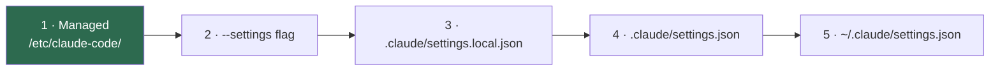

# Managed settings (target policy)

[🏠 Home](../../README.md) › Security baseline › Managed settings

This is the target `managed-settings.json` for the evaluation, annotated key by key, with how it's delivered and versioned. Managed settings have the **highest precedence** and can't be overridden by user, project, or local settings, or by CLI flags ([settings docs](https://code.claude.com/docs/en/settings)).

> [!IMPORTANT]
> This page is the *specification*. The live policy files belong in a separate, access-controlled **policy repository**. Record the SHA-256 of the deployed files with every test result ([evidence rules](../../evidence/README.md#what-to-capture)).

## Contents
- [Delivery](#delivery)
- [Precedence refresher](#precedence-refresher)
- [Target policy (v0.2)](#target-policy-v02)
- [Key-by-key rationale](#key-by-key-rationale)
- [Settings not in the file yet (decisions pending)](#settings-not-in-the-file-yet-decisions-pending)
- [Gateway overlay (ADR-013)](#gateway-overlay-adr-013)
- [Managed CLAUDE.md](#managed-claudemd)
- [Drop-in layout](#drop-in-layout)
- [Windows backstop policy](#windows-backstop-policy)
- [Change control](#change-control)

## Delivery

| Item | Value |
|---|---|
| Path in container | `/etc/claude-code/managed-settings.json`, `/etc/claude-code/managed-settings.d/*.json`, and the managed `/etc/claude-code/CLAUDE.md` |
| Source | `C:\ProgramData\ClaudeCodePolicy\` on the VDI (NTFS: Administrators full control, Users read only, inheritance off). Docker Desktop shares only this folder, and it's bind-mounted **read-only** ([Docker Desktop configuration](../01-architecture/reference-architecture.md#docker-desktop-configuration-target)). On users' PCs later, the same folder is pushed by Intune/MDM ([ADR-018](../../logs/decision-log.md#adr-018)). |
| Why outside the image | The policy is **not** baked into the image. Claude Code itself is in the image ([ADR-014](../../logs/decision-log.md#adr-014)), but the policy stays on the read-only mount, so a policy change is a file update, not an image rebuild, and developers still can't edit it. |
| Not allowed | Copying policy into the repo's `.devcontainer/` or into a dev-writable image layer. The docs say an image-baked file "is repo-editable", so it isn't enforcement ([devcontainer docs](https://code.claude.com/docs/en/devcontainer)). |
| Server-managed settings | **Not available** on Foundry ([server-managed settings](https://code.claude.com/docs/en/server-managed-settings)). If the Claude apps gateway is accepted ([ADR-013](../../logs/decision-log.md#adr-013)), the gateway delivers managed settings per Entra group instead. The file stays deployed as the baseline ([gateway overlay](#gateway-overlay-adr-013)). |
| Verification | `/status` shows the managed source ([POL-003](../03-test-plan/catalog/policy.md#pol-003)). `claude doctor` reports it. The OTel event `managed_settings_resolved` is emitted. The managed CLAUDE.md loads in every session ([POL-017](../03-test-plan/catalog/policy.md#pol-017)). |
| Failure mode | Invalid JSON in any managed source stops startup: fail closed ([POL-008](../03-test-plan/catalog/policy.md#pol-008)) |

## Precedence refresher



Higher wins. For permission **rules**, `allowManagedPermissionRulesOnly` goes further: allow/ask/deny rules from any non-managed source are **ignored** ([settings reference](https://code.claude.com/docs/en/settings-reference)).

With the gateway, its remote managed settings sit inside tier 1 and outrank the file, but they reach only clients that are signed in to it ([Claude apps gateway](https://code.claude.com/docs/en/claude-apps-gateway#restrict-parent-settings)). That's why the locks stay in the file too.

<a id="target-policy-v01"></a>

## Target policy (v0.2)

> [!NOTE]
> JSON doesn't allow comments, so the rationale for each key is in the [table below](#key-by-key-rationale). Values in `<angle brackets>` are placeholders. Keys marked `[verify]` in the table must be confirmed against our build in Phase 1. If a key isn't recognized, Claude Code reports it in `/status` or `claude doctor`.

**What changed from v0.1** (2026-10-19):

| Change | Why | Decision |
|---|---|---|
| `DISABLE_UPDATES`, `DISABLE_TELEMETRY` added | Claude Code arrives only in the IT image. No update path at all. | [ADR-014](../../logs/decision-log.md#adr-014) |
| `WebSearch` and `WebFetch` denied, `CLAUDE_CODE_DISABLE_WEB_FETCH`, `skipWebFetchPreflight`, WebFetch allow/ask rules removed | Web tools off. WebFetch is **pending the lead's confirmation**. | [ADR-016](../../logs/decision-log.md#adr-016) |
| Agent concurrency limits and `CLAUDE_CODE_DISABLE_CRON` | Runaway-agent guardrails | [CTL-28](defense-in-depth.md#ctl-28) |
| Ask rules on .NET build files, Windows scripts, and registry configs | Agent-written build files run on Windows when developers build Windows-only repos | [ADR-017](../../logs/decision-log.md#adr-017) |
| `<package-mirror>` → `<nexus-host>` in sandbox domains | All packages come through Nexus | [ADR-015](../../logs/decision-log.md#adr-015) |

```json
{
  "$schema": "https://json.schemastore.org/claude-code-settings.json",

  "env": {
    "CLAUDE_CODE_USE_FOUNDRY": "1",
    "ANTHROPIC_FOUNDRY_RESOURCE": "<foundry-resource>",
    "ANTHROPIC_DEFAULT_OPUS_MODEL": "<opus-deployment-name>",
    "ANTHROPIC_DEFAULT_SONNET_MODEL": "<sonnet-deployment-name>",
    "ANTHROPIC_DEFAULT_HAIKU_MODEL": "<haiku-deployment-name>",

    "CLAUDE_CODE_DISABLE_NONESSENTIAL_TRAFFIC": "1",
    "DISABLE_AUTOUPDATER": "1",
    "DISABLE_UPDATES": "1",
    "DISABLE_TELEMETRY": "1",
    "DISABLE_ERROR_REPORTING": "1",
    "DISABLE_FEEDBACK_COMMAND": "1",
    "ENABLE_CLAUDEAI_MCP_SERVERS": "false",

    "CLAUDE_CODE_DISABLE_WEB_FETCH": "1",

    "CLAUDE_CODE_MAX_CONCURRENT_SUBAGENTS": "5",
    "CLAUDE_CODE_WORKFLOW_MAX_CONCURRENT_AGENTS": "3",
    "CLAUDE_CODE_DISABLE_CRON": "1",

    "CLAUDE_CODE_ENABLE_TELEMETRY": "1",
    "OTEL_METRICS_EXPORTER": "otlp",
    "OTEL_LOGS_EXPORTER": "otlp",
    "OTEL_EXPORTER_OTLP_PROTOCOL": "http/protobuf",
    "OTEL_EXPORTER_OTLP_ENDPOINT": "https://<otel-collector>:4318",
    "OTEL_LOG_USER_PROMPTS": "0",
    "OTEL_LOG_TOOL_DETAILS": "0",
    "OTEL_LOG_TOOL_CONTENT": "0",
    "OTEL_LOG_ASSISTANT_RESPONSES": "0",
    "OTEL_LOG_RAW_API_BODIES": "0",

    "HTTPS_PROXY": "http://<corporate-proxy>:<port>",
    "NO_PROXY": "<otel-collector>,localhost,127.0.0.1",
    "https_proxy": "http://<corporate-proxy>:<port>",
    "no_proxy": "<otel-collector>,localhost,127.0.0.1",
    "NODE_EXTRA_CA_CERTS": "/usr/local/share/ca-certificates/corp-root.crt"
  },

  "requiredMinimumVersion": "2.1.301",
  "requiredMaximumVersion": "2.1.301",

  "availableModels": ["opus", "sonnet", "haiku"],

  "permissions": {
    "disableBypassPermissionsMode": "disable",
    "defaultMode": "default",
    "deny": [
      "WebSearch",
      "WebFetch",
      "Read(**/.env)",
      "Read(**/.env.*)",
      "Read(**/*.pem)",
      "Read(**/*.key)",
      "Read(**/*.pfx)",
      "Read(**/id_rsa*)",
      "Read(**/id_ed25519*)",
      "Read(~/.azure/**)",
      "Read(~/.config/gh/**)",
      "Read(~/.ssh/**)",
      "Read(~/.git-credentials)",
      "Read(~/.claude/.credentials.json)",
      "Read(//etc/claude-code/**)",
      "Edit(//etc/claude-code/**)",
      "Edit(./.github/workflows/**)",
      "Edit(./.github/actions/**)",
      "Edit(./.devcontainer/**)",
      "Edit(./.claude/settings.json)",
      "Edit(./.claude/settings.local.json)",
      "Edit(./.mcp.json)",
      "Bash(curl *)",
      "Bash(wget *)",
      "Bash(nc *)",
      "Bash(ssh *)",
      "Bash(scp *)",
      "Bash(git push --force *)",
      "Bash(git push -f *)",
      "Bash(git push --force-with-lease *)",
      "Bash(git config --global *)",
      "Bash(az account get-access-token *)",
      "Bash(gh auth token *)",
      "Bash(gh gist *)",
      "Bash(gh repo create *)",
      "Bash(sudo *)"
    ],
    "ask": [
      "Bash(git push *)",
      "Bash(gh pr merge *)",
      "Bash(rm -rf *)",
      "Bash(git reset --hard *)",
      "Bash(git clean *)",
      "Edit(**/*.csproj)",
      "Edit(**/*.vbproj)",
      "Edit(**/*.props)",
      "Edit(**/*.targets)",
      "Edit(**/Directory.Build.*)",
      "Edit(**/nuget.config)",
      "Edit(**/NuGet.Config)",
      "Edit(**/pip.conf)",
      "Edit(**/.npmrc)",
      "Edit(**/*.ps1)",
      "Edit(**/*.cmd)",
      "Edit(**/*.bat)"
    ],
    "allow": [
      "Bash(git status *)",
      "Bash(git diff *)",
      "Bash(git log *)",
      "Bash(git branch *)",
      "Bash(git checkout -b *)",
      "Bash(git add *)",
      "Bash(git commit *)",
      "Bash(gh pr create *)",
      "Bash(gh pr view *)",
      "Bash(gh pr checks *)"
    ]
  },
  "allowManagedPermissionRulesOnly": true,

  "skipWebFetchPreflight": true,

  "sandbox": {
    "enabled": true,
    "failIfUnavailable": true,
    "allowUnsandboxedCommands": false,
    "autoAllowBashIfSandboxed": true,
    "excludedCommands": [],
    "filesystem": {
      "denyRead": [
        "~/.azure",
        "~/.config/gh",
        "~/.ssh",
        "~/.git-credentials",
        "~/.claude/.credentials.json",
        "/etc/claude-code"
      ],
      "allowManagedReadPathsOnly": true
    },
    "network": {
      "allowedDomains": [
        "github.com",
        "api.github.com",
        "<nexus-host>"
      ],
      "allowManagedDomainsOnly": true,
      "allowLocalBinding": false
    }
  },

  "allowManagedHooksOnly": true,
  "hooks": {
    "SessionStart": [
      { "hooks": [ { "type": "command", "command": "/opt/claude-audit/audit-hook.sh SessionStart" } ] }
    ],
    "PreToolUse": [
      { "matcher": "*", "hooks": [ { "type": "command", "command": "/opt/claude-audit/audit-hook.sh PreToolUse" } ] }
    ],
    "PostToolUse": [
      { "matcher": "*", "hooks": [ { "type": "command", "command": "/opt/claude-audit/audit-hook.sh PostToolUse" } ] }
    ],
    "PermissionDenied": [
      { "hooks": [ { "type": "command", "command": "/opt/claude-audit/audit-hook.sh PermissionDenied" } ] }
    ],
    "ConfigChange": [
      { "hooks": [ { "type": "command", "command": "/opt/claude-audit/audit-hook.sh ConfigChange" } ] }
    ],
    "SessionEnd": [
      { "hooks": [ { "type": "command", "command": "/opt/claude-audit/audit-hook.sh SessionEnd" } ] }
    ]
  },

  "allowManagedMcpServersOnly": true,
  "enableAllProjectMcpServers": false,

  "strictKnownMarketplaces": [],
  "disableSideloadFlags": true,
  "disableSkillShellExecution": true,

  "cleanupPeriodDays": 30,

  "attribution": {
    "commit": "Co-Authored-By: Claude Code <noreply@anthropic.com>",
    "pr": "🤖 Assisted by Claude Code"
  }
}
```

## Key-by-key rationale

| Key | Value | Why | Control | Test | Confirmed? |
|---|---|---|---|---|---|
| `env.CLAUDE_CODE_USE_FOUNDRY` | `1` | Use Foundry as the provider (direct mode, Phase 1 step 1). Removed from the file in [gateway mode](#gateway-overlay-adr-013). | CTL-18 | [IDN-012](../03-test-plan/catalog/identity.md#idn-012) | Docs ✅ |
| `env.ANTHROPIC_FOUNDRY_RESOURCE` | resource name | The resource name only. A URL is refused. | CTL-18 | [NET-004](../03-test-plan/catalog/network.md#net-004) | Docs ✅ |
| `env.ANTHROPIC_DEFAULT_*_MODEL` | deployment names | **Pinning.** On Foundry, `opus` otherwise resolves to Opus 4.6. Without a Haiku pin, background tasks use the primary model, which costs more. In gateway mode the gateway's `models:` block does the mapping instead. | CTL-18 | [POL-011](../03-test-plan/catalog/policy.md#pol-011), [COST-010](../03-test-plan/catalog/cost.md#cost-010) | Docs ✅ |
| `env.CLAUDE_CODE_DISABLE_NONESSENTIAL_TRAFFIC` | `1` | No vendor telemetry, auto-update, error reports, or feature-flag fetches | CTL-19 | [NET-003](../03-test-plan/catalog/network.md#net-003) | Docs ✅. Interaction with our OTel export: [verify] |
| `env.DISABLE_AUTOUPDATER` / `DISABLE_ERROR_REPORTING` / `DISABLE_FEEDBACK_COMMAND` | `1` | Belt-and-braces with the above. Explicit for auditors. | CTL-19 | [ENV-005](../03-test-plan/catalog/env.md#env-005), [DATA-007](../03-test-plan/catalog/data.md#data-007), [DATA-008](../03-test-plan/catalog/data.md#data-008) | Docs ✅ |
| `env.DISABLE_UPDATES` | `1` | Blocks **every** update path, including a manual `claude update` or `claude install`. `DISABLE_AUTOUPDATER` only stops the background check. Claude Code arrives only in the IT image, sourced from Nexus ([ADR-014](../../logs/decision-log.md#adr-014)). | CTL-18, CTL-25 | [ENV-005](../03-test-plan/catalog/env.md#env-005), [ENV-016](../03-test-plan/catalog/env.md#env-016) | Docs ✅ ([setup](https://code.claude.com/docs/en/setup)) |
| `env.DISABLE_TELEMETRY` | `1` | Anthropic usage analytics off. Already off by default on Foundry. With the gateway, it also covers the startup events the CLI sends before the first sign-in ([gateway compliance posture](https://code.claude.com/docs/en/claude-apps-gateway-deploy#compliance-posture)). It doesn't switch off our own OTel export [verify]. | CTL-19 | [NET-003](../03-test-plan/catalog/network.md#net-003) | Docs ✅ ([data usage](https://code.claude.com/docs/en/data-usage)) |
| `env.ENABLE_CLAUDEAI_MCP_SERVERS` | `false` | No claude.ai connectors (no claude.ai account anyway) | CTL-12 | [EXT-011](../03-test-plan/catalog/extensions.md#ext-011) | Docs ✅ |
| `env.CLAUDE_CODE_DISABLE_WEB_FETCH` | `1` | Turns the WebFetch tool off (v2.1.285+). The container has no internet, and WebFetch could only reach allowlisted hosts such as GitHub, which is an exfiltration path. **Pending the lead's confirmation** ([ADR-016](../../logs/decision-log.md#adr-016)). WebSearch has no equivalent variable, so it's denied by rule. | CTL-26 | [PERM-014](../03-test-plan/catalog/permissions.md#perm-014) | Docs ✅ ([env vars](https://code.claude.com/docs/en/env-vars)) |
| `env.CLAUDE_CODE_MAX_CONCURRENT_SUBAGENTS` | `5` | The default is 20 at once. Limits how fast one session can burn tokens ([R-15](../../logs/risk-register.md#r-15)). | CTL-28 | [COST-016](../03-test-plan/catalog/cost.md#cost-016) | Docs ✅ (v2.1.217+) |
| `env.CLAUDE_CODE_WORKFLOW_MAX_CONCURRENT_AGENTS` | `3` | Caps how many agents one workflow run executes at once | CTL-28 | [COST-016](../03-test-plan/catalog/cost.md#cost-016) | Docs ✅ (v2.1.269+) |
| `env.CLAUDE_CODE_DISABLE_CRON` | `1` | No `/loop` or scheduled tasks. A scheduled task fires while the session sits idle and sends the full context every time ([costs](https://code.claude.com/docs/en/costs#why-usage-climbs-in-a-long-session)). [FEAT-021](../03-test-plan/catalog/features.md#feat-021) now confirms it's off. Agent teams stay unset (off by default); [COST-016](../03-test-plan/catalog/cost.md#cost-016) checks both. | CTL-28 | [COST-016](../03-test-plan/catalog/cost.md#cost-016), [FEAT-021](../03-test-plan/catalog/features.md#feat-021) | Docs ✅ |
| `env.CLAUDE_CODE_ENABLE_TELEMETRY` + `OTEL_*` | collector | Our cost, usage, and audit data source. Managed, so repos can't redirect it. In gateway mode, signed-in sessions export to the gateway, which relays to the collector. | CTL-20 | [TEL-001](../03-test-plan/catalog/telemetry.md#tel-001), [TEL-005](../03-test-plan/catalog/telemetry.md#tel-005), [TEL-013](../03-test-plan/catalog/telemetry.md#tel-013) | Docs ✅ |
| `env.OTEL_LOG_*` | `0` | Content logging stays **off**: no prompts, tool details, or responses in telemetry. Pending HR/Legal review ([R-12](../../logs/risk-register.md)). | CTL-20 | [DATA-004](../03-test-plan/catalog/data.md#data-004), [TEL-008](../03-test-plan/catalog/telemetry.md#tel-008) | Docs ✅ (defaults are off) |
| `env.HTTPS_PROXY`/`https_proxy`, `NO_PROXY`/`no_proxy`, `NODE_EXTRA_CA_CERTS` | corp values | Route through the logging proxy. Trust the inspection CA. Both cases are set because Claude Code reads the lowercase forms first. | CTL-05 | [NET-005](../03-test-plan/catalog/network.md#net-005) | Docs ✅ |
| `requiredMinimumVersion` / `requiredMaximumVersion` | `2.1.301` | Pin the exact version under evaluation. Upgrades become deliberate policy changes. The backstop if someone installs another version from Nexus into their home folder. 🔒 managed-only. | CTL-18 | [POL-010](../03-test-plan/catalog/policy.md#pol-010) | Docs ✅. Version-string format: [verify] |
| `availableModels` | aliases | Limit `/model` to our pinned deployments. Canonical model IDs in gateway mode. | CTL-18 | [POL-011](../03-test-plan/catalog/policy.md#pol-011) | [verify] value format with Foundry deployments; see also `enforceAvailableModels` |
| `permissions.disableBypassPermissionsMode` | `"disable"` | No `bypassPermissions` mode, no `--dangerously-skip-permissions` | CTL-08 | [PERM-001](../03-test-plan/catalog/permissions.md#perm-001) | Docs ✅ |
| `permissions.defaultMode` | `"default"` | Manual mode until the auto-mode decision ([ADR-008](../../logs/decision-log.md#adr-008)) | CTL-08 | [PERM-008](../03-test-plan/catalog/permissions.md#perm-008) | Docs ✅ |
| `permissions.deny` | list | **`WebSearch` and `WebFetch` denied outright** ([ADR-016](../../logs/decision-log.md#adr-016)). On Foundry, web search runs server-side, so the firewall can't stop it, and there's no variable that turns it off. Plus secrets, credential stores, policy files, CI config, and network tools. **Bash entries are speed bumps, not boundaries** ([permissions-policy.md](permissions-policy.md#why-bash-rules-are-not-a-boundary)). | CTL-07, CTL-26 | [NET-007](../03-test-plan/catalog/network.md#net-007), [PERM-014](../03-test-plan/catalog/permissions.md#perm-014), [PERM-002](../03-test-plan/catalog/permissions.md#perm-002)–[PERM-005](../03-test-plan/catalog/permissions.md#perm-005) | Path syntax ✅ (`//` absolute, `~/` home, `./` cwd). Bare tool names ✅ ([permissions](https://code.claude.com/docs/en/permissions)) |
| `permissions.ask` | list | Human confirmation for pushes, merges, and destructive commands. **New:** edits to .NET build files (`*.csproj`, `*.vbproj`, `*.props`, `*.targets`, `Directory.Build.*`), Windows scripts, and package-registry configs. Developers build Windows-only repos on Windows, where MSBuild runs whatever the project files say ([ADR-017](../../logs/decision-log.md#adr-017), [R-25](../../logs/risk-register.md#r-25), [R-26](../../logs/risk-register.md#r-26)). | CTL-07, CTL-29 | [PERM-007](../03-test-plan/catalog/permissions.md#perm-007), [PERM-019](../03-test-plan/catalog/permissions.md#perm-019) | Docs ✅. `Edit` rule coverage of Write: [verify] |
| `permissions.allow` | list | Remove prompt friction for safe, frequent commands. The WebFetch domain allows from v0.1 are gone. | CTL-07 | [PERM-006](../03-test-plan/catalog/permissions.md#perm-006) | Docs ✅ |
| `allowManagedPermissionRulesOnly` | `true` | Ignore allow/ask/deny rules from user and project settings, so nobody can re-allow WebSearch. 🔒 managed-only. | CTL-07 | [POL-007](../03-test-plan/catalog/policy.md#pol-007), [PERM-017](../03-test-plan/catalog/permissions.md#perm-017) | Docs ✅ |
| `skipWebFetchPreflight` | `true` | Stops WebFetch sending each hostname to `api.anthropic.com` for a safety check. Moot while WebFetch is off, but the setting is already right if WebFetch is re-enabled ([data usage](https://code.claude.com/docs/en/data-usage#webfetch-domain-safety-check)). | CTL-26 | [NET-006](../03-test-plan/catalog/network.md#net-006) | Docs ✅ |
| `sandbox.enabled` / `failIfUnavailable` / `allowUnsandboxedCommands` | `true` / `true` / `false` | Mandatory sandbox. Won't start without it. The escape hatch is ignored. | CTL-09 | [SBX-001](../03-test-plan/catalog/sandbox.md#sbx-001), [SBX-002](../03-test-plan/catalog/sandbox.md#sbx-002) | Docs ✅ |
| `sandbox.autoAllowBashIfSandboxed` | `true` | Sandboxed Bash runs without prompts (the default), which keeps friction low. Deny and ask rules still apply. | CTL-09 | [PERM-008](../03-test-plan/catalog/permissions.md#perm-008) | Docs ✅ |
| `sandbox.excludedCommands` | `[]` | Nothing runs outside the sandbox | CTL-09 | [SBX-008](../03-test-plan/catalog/sandbox.md#sbx-008) | Docs ✅ |
| `sandbox.filesystem.denyRead` | credential paths | Bash can't read credentials | CTL-11 | [SBX-004](../03-test-plan/catalog/sandbox.md#sbx-004) | Docs ✅. Path syntax: [verify] |
| `sandbox.filesystem.allowManagedReadPathsOnly` | `true` | Users can't add read exceptions. 🔒 managed-only. | CTL-11 | [SBX-007](../03-test-plan/catalog/sandbox.md#sbx-007) | Docs ✅ |
| `sandbox.network.allowedDomains` | GitHub + Nexus | What Bash may reach: git push, and package installs through Nexus ([ADR-015](../../logs/decision-log.md#adr-015)). Claude Code's own model traffic isn't Bash, so the Foundry or gateway host isn't listed here. | CTL-10, CTL-25 | [SBX-005](../03-test-plan/catalog/sandbox.md#sbx-005), [ENV-017](../03-test-plan/catalog/env.md#env-017) | Docs ✅ |
| `sandbox.network.allowManagedDomainsOnly` | `true` | Users can't add domains. 🔒 managed-only. | CTL-10 | [SBX-006](../03-test-plan/catalog/sandbox.md#sbx-006) | Docs ✅ |
| `sandbox.network.allowLocalBinding` | `false` | No local listeners from Bash, pending the dev-server decision | CTL-10 | [SBX-012](../03-test-plan/catalog/sandbox.md#sbx-012) | Docs ✅ |
| `allowManagedHooksOnly` + `hooks` | audit hook | Only our hooks run. The audit hook writes a JSONL trail. The hook script itself ships in the image under `/opt/claude-audit/` (root-owned). 🔒 managed-only. | CTL-14 | [EXT-005](../03-test-plan/catalog/extensions.md#ext-005), [EXT-006](../03-test-plan/catalog/extensions.md#ext-006) | Docs ✅ |
| `allowManagedMcpServersOnly`, `enableAllProjectMcpServers: false` | | No MCP servers except managed ones (none at start). 🔒 managed-only. | CTL-12 | [EXT-001](../03-test-plan/catalog/extensions.md#ext-001), [EXT-002](../03-test-plan/catalog/extensions.md#ext-002) | Docs ✅ |
| `strictKnownMarketplaces` | `[]` | An empty allowlist blocks all plugin sources. 🔒 managed-only. | CTL-13 | [EXT-003](../03-test-plan/catalog/extensions.md#ext-003) | Docs ✅ |
| `disableSideloadFlags` | `true` | Rejects `--plugin-dir`, `--mcp-config`, `--agents`. 🔒 managed-only. | CTL-13 | [EXT-004](../03-test-plan/catalog/extensions.md#ext-004) | [verify] value type |
| `disableSkillShellExecution` | `true` | Skills can't run inline shell | CTL-15 | [EXT-010](../03-test-plan/catalog/extensions.md#ext-010) | Docs ✅ |
| `cleanupPeriodDays` | `30` | Local transcript retention. Align with the data policy. | CTL-21 | [DATA-003](../03-test-plan/catalog/data.md#data-003) | Docs ✅ |
| `attribution.commit` / `.pr` | trailer text | A consistent marker on Claude-assisted commits and PRs. It's our substitute for claude.ai contribution metrics. | — | [FEAT-015](../03-test-plan/catalog/features.md#feat-015) | [verify] exact format |

## Settings not in the file yet (decisions pending)

| Setting | Options | Decision | Test |
|---|---|---|---|
| **WebFetch off** (`CLAUDE_CODE_DISABLE_WEB_FETCH`, `deny: ["WebFetch"]`) | Already **in** v0.2 as the recommendation. If the lead keeps WebFetch, remove both and restore domain-scoped `WebFetch(domain:…)` allow rules instead. | Lead to confirm ([ADR-016](../../logs/decision-log.md#adr-016)) | [PERM-014](../03-test-plan/catalog/permissions.md#perm-014) |
| Gateway sign-in (`forceLoginMethod`, `forceLoginGatewayUrl`) | See the [gateway overlay](#gateway-overlay-adr-013) | [ADR-013](../../logs/decision-log.md#adr-013) (Phase 1 step 2) | [IDN-014](../03-test-plan/catalog/identity.md#idn-014) |
| Auto mode (`permissions.defaultMode: "auto"` / disabling auto mode) | Allow auto mode (fewer prompts, classifier-reviewed) vs. disable it | [ADR-008](../../logs/decision-log.md#adr-008) | [PERM-011](../03-test-plan/catalog/permissions.md#perm-011), [POL-016](../03-test-plan/catalog/policy.md#pol-016) |
| `modelPricing` 🔒 | Contracted Foundry per-token rates, so `/usage` and OTel `cost.usage` match the invoice. In gateway mode the gateway's `pricing` block can send it to clients. | After the Finance rate card | [COST-002](../03-test-plan/catalog/cost.md#cost-002) |
| `allowedProviders` 🔒 (v2.1.285+) | Restrict to Foundry (direct) or to the gateway | [verify] value names for each mode | [POL-013](../03-test-plan/catalog/policy.md#pol-013) |
| `sandbox.credentials` | Mask credential files for Bash | [verify] schema | [SBX-009](../03-test-plan/catalog/sandbox.md#sbx-009) |
| `sandbox.enableWeakerNestedSandbox` | **Only** if the sandbox can't run inside Docker otherwise. That would be a finding. | After [ENV-006](../03-test-plan/catalog/env.md#env-006) | [ENV-006](../03-test-plan/catalog/env.md#env-006) |
| `strictPluginOnlyCustomization` 🔒 | Lock skills, agents, hooks, and MCP to plugin-provided only | Probably not needed (plugins are blocked) | [EXT-008](../03-test-plan/catalog/extensions.md#ext-008), [EXT-009](../03-test-plan/catalog/extensions.md#ext-009) |
| `pluginConfigs.allowManagedModsOnly` 🔒 | Restrict mods. The key sits under `pluginConfigs`, and mods are also covered by `allowManagedHooksOnly`. | Set once the schema is confirmed [verify] | [EXT-014](../03-test-plan/catalog/extensions.md#ext-014) |
| `CLAUDE_CODE_SUBPROCESS_ENV_SCRUB=1` | Strip credentials from the environment of subprocesses | Adopt if IDN-008 shows a benefit [verify] | [IDN-008](../03-test-plan/catalog/identity.md#idn-008) |
| `CLAUDE_CODE_EXPERIMENTAL_AGENT_TEAMS` | Off by default. An explicit `"0"` in managed `env` would pin it off against user settings [verify value semantics]. | After [COST-016](../03-test-plan/catalog/cost.md#cost-016) | [COST-016](../03-test-plan/catalog/cost.md#cost-016) |
| `CLAUDE_CODE_DISABLE_OFFICIAL_MARKETPLACE_AUTOINSTALL=1`, `CLAUDE_CODE_IDE_SKIP_AUTO_INSTALL=1` | Extra hardening switches found while building the inventory | Policy v0.3 candidates | [EXT-003](../03-test-plan/catalog/extensions.md#ext-003), [ENV-009](../03-test-plan/catalog/env.md#env-009) |
| `DISABLE_LOGIN_COMMAND=1` | Hides `/login` | **Don't set** once the gateway is in use: developers sign in to it with `/login`. Only for direct-Foundry mode. | [POL-013](../03-test-plan/catalog/policy.md#pol-013) |
| `OTEL_LOG_MANAGED_SETTINGS=1` | Include policy details in telemetry, for fleet-wide policy verification | Policy v0.3 candidate | [OPS-008](../03-test-plan/catalog/operations.md#ops-008) |
| `feedbackSurveyRate: 0`, `disableClaudeAiConnectors: true`, `enforceAvailableModels: true` | Survey off, connectors off, model allowlist strictly enforced | Policy v0.3 candidates [verify] | [DATA-007](../03-test-plan/catalog/data.md#data-007), [EXT-011](../03-test-plan/catalog/extensions.md#ext-011), [POL-011](../03-test-plan/catalog/policy.md#pol-011) |
| `OTEL_RESOURCE_ATTRIBUTES` | `team.id`, `cohort`, `dev.alias` per developer | Direct mode: set per container at launch (not in the shared file), or via `otelHeadersHelper`. Gateway mode: the gateway stamps identity on every export. | [TEL-004](../03-test-plan/catalog/telemetry.md#tel-004), [TEL-013](../03-test-plan/catalog/telemetry.md#tel-013) |

## Gateway overlay (ADR-013)

The Claude apps gateway is the **proposed** target ([ADR-013](../../logs/decision-log.md#adr-013), [CTL-24](defense-in-depth.md#ctl-24)). Phase 1 proves direct Foundry with the v0.2 file first, then puts the gateway in front. When that happens, these client-side changes go into the file. Everything else in v0.2 stays. Source: [Claude apps gateway](https://code.claude.com/docs/en/claude-apps-gateway), [configuration](https://code.claude.com/docs/en/claude-apps-gateway-config).

| Change in the file | Why |
|---|---|
| Add `forceLoginMethod: "gateway"` and `forceLoginGatewayUrl` | `/login` opens straight on the gateway screen with the URL filled in. The login keys must be in the file pushed to machines. The gateway's own policy only reaches clients that are already connected. |
| Remove `CLAUDE_CODE_USE_FOUNDRY`, `ANTHROPIC_FOUNDRY_RESOURCE`, `ANTHROPIC_DEFAULT_*_MODEL` | A developer who selects a cloud provider by environment variable skips the gateway sign-in. The gateway's `models:` block maps canonical model IDs to Foundry deployment names. |
| `availableModels` → canonical model IDs (`"<opus-model-id>"`, …) | The gateway also enforces the list server-side (a non-granted model gets a `400`) |
| Add `<claude-gateway>.<internal-domain>` to `NO_PROXY` / `no_proxy` | The CLI pins the gateway's TLS certificate on first connect, and requests through an HTTPS proxy skip the pin check |
| OTel endpoint: leave as is | Signed-in sessions send OTLP/HTTP to the gateway, which relays to `telemetry.forward_to` (our collector), stamped with the developer's identity ([TEL-013](../03-test-plan/catalog/telemetry.md#tel-013)) |
| Keep `DISABLE_TELEMETRY` | Covers the startup events sent before the first sign-in |
| Keep **all** locks (`allowManaged*Only`, sandbox locks, deny rules, hooks) | Mirror them into the gateway's `managed.policies` too. Machines that never connect get their policy from the file alone. Keep hooks in the file rather than the gateway policy, so they don't trigger the approval dialog for shell-capable settings. |
| Don't set `DISABLE_LOGIN_COMMAND` | Developers sign in with `/login` |

Client keys to add:

```json
{
  "forceLoginMethod": "gateway",
  "forceLoginGatewayUrl": "https://<claude-gateway>.<internal-domain>"
}
```

The matching group policy on the gateway (excerpt; `code` needs gateway v2.1.296 or later). Entra emits group **object IDs**, not names, unless you use App Roles:

```yaml
managed:
  policies:
    - match: { groups: ["<entra-group-object-id-cohort-a>"] }   # specific groups first
      code:
        availableModels: ["<opus-model-id>", "<sonnet-model-id>", "<haiku-model-id>"]
    - match: {}                                                  # base layer, listed last
      code:
        availableModels: ["<sonnet-model-id>", "<haiku-model-id>"]
        enforceAvailableModels: true
        allowManagedPermissionRulesOnly: true
        allowManagedMcpServersOnly: true
        allowManagedHooksOnly: true
        permissions:
          deny: ["WebSearch", "WebFetch"]
        sandbox:
          network:
            allowManagedDomainsOnly: true
            allowedDomains: ["github.com", "api.github.com", "<nexus-host>"]
          filesystem:
            allowManagedReadPathsOnly: true
```

The first matching policy wins, and `match: {}` acts as the base that other policies inherit from. Deny lists and hook arrays are unioned, and allow lists are replaced. A user who matches no policy gets **no** gateway settings, so the base layer must exist. The gateway also turns WebSearch off on its own for gateway sessions.

## Managed CLAUDE.md

A managed CLAUDE.md sits in the same policy folder, so it arrives over the same read-only mount as `/etc/claude-code/CLAUDE.md` and loads in every session ([memory docs](https://code.claude.com/docs/en/memory), [POL-017](../03-test-plan/catalog/policy.md#pol-017)). It's **guidance, not enforcement**: the firewall, sandbox, and deny rules are the controls. It saves tokens and confusion by telling Claude up front how this environment works ([ADR-015](../../logs/decision-log.md#adr-015)). Path on Linux: [verify] against our build.

Sample content:

```markdown
# Organization instructions (managed, read-only)

- Packages come only from the internal Nexus repository (<nexus-host>).
  pip, uv, Maven, Gradle, and NuGet are already configured for it.
- Don't change package-manager or registry settings (pip.conf, settings.xml,
  Gradle init scripts, NuGet.Config, .npmrc). Don't add --index-url,
  extra package sources, or repository URLs to project files.
- If a package or version is missing, stop and ask the developer to request
  it in Nexus. Don't look for workarounds.
- Web search and web fetch are turned off and the container has no internet.
  Work from the repo and what the developer gives you.
- In .NET / VB.NET repos marked compile-check or edit-only, tests can't run
  here. Say what the developer needs to build and test on Windows, and call
  out every change to project files, build scripts, or package references.
- Never print, copy, or move credentials or tokens.
```

## Drop-in layout

For maintainability, split the policy into ordered drop-ins. Later files merge on top of earlier ones ([managed settings docs](https://code.claude.com/docs/en/managed-settings)):

```
/etc/claude-code/
├── managed-settings.json            ← minimal: $schema + version pins
├── CLAUDE.md                        ← managed instructions (read-only)
└── managed-settings.d/
    ├── 10-provider-and-models.json  ← env (Foundry, model pins), availableModels; gateway keys in gateway mode
    ├── 20-permissions.json          ← permissions.* (incl. web-tool denies, build-file asks), allowManagedPermissionRulesOnly
    ├── 25-cost-guardrails.json      ← agent concurrency limits, cron off
    ├── 30-sandbox.json              ← sandbox.*
    ├── 40-extensions.json           ← hooks, MCP, plugins, skills
    ├── 50-telemetry.json            ← OTel env, content flags
    └── 60-data.json                 ← cleanupPeriodDays, attribution, skipWebFetchPreflight
```

[POL-009](../03-test-plan/catalog/policy.md#pol-009) checks the merge order, and checks that a broken drop-in fails closed.

## Windows backstop policy

Claude Code **never runs natively** on Windows ([ADR-017](../../logs/decision-log.md#adr-017)). The AppLocker/Intune block is the control. If it's ever bypassed and someone runs Claude Code natively on the VDI, `C:\Program Files\ClaudeCode\managed-settings.json` should make it close to useless. On users' PCs, Intune pushes the same file ([ENV-022](../03-test-plan/catalog/env.md#env-022)).

```json
{
  "permissions": {
    "disableBypassPermissionsMode": "disable",
    "defaultMode": "plan",
    "deny": ["Bash", "PowerShell", "Edit", "Write", "WebFetch", "WebSearch"]
  },
  "allowManagedPermissionRulesOnly": true,
  "allowManagedHooksOnly": true,
  "allowManagedMcpServersOnly": true,
  "strictKnownMarketplaces": [],
  "env": { "CLAUDE_CODE_DISABLE_NONESSENTIAL_TRAFFIC": "1" }
}
```

Tested in [ENV-008](../03-test-plan/catalog/env.md#env-008).

## Change control

| Step | Who | Record |
|---|---|---|
| 1. Propose the change (PR to the policy repo) | Eval lead | ADR if the change affects security posture |
| 2. Review | Security | PR approval |
| 3. Deploy to `C:\ProgramData\ClaudeCodePolicy\` on the test VDI (Intune on PCs later) | Eval lead | New SHA-256 in `evidence/_shared/` |
| 4. Re-run affected tests (see the "Test" column above) | Eval lead | Test results with the new policy hash |
| 5. Roll out to pilot VDIs | Platform | [OPS-008](../03-test-plan/catalog/operations.md#ops-008) |
| 6. Gateway mode only: mirror the change into the gateway's `managed.policies` and redeploy it | Eval lead / Platform | [OPS-011](../03-test-plan/catalog/operations.md#ops-011) |

**Version history**

| Version | Date | Summary |
|---|---|---|
| v0.1 | 2026-10-15 | Initial target policy |
| v0.2 | 2026-10-19 | Web tools off, `DISABLE_UPDATES`/`DISABLE_TELEMETRY`, agent concurrency limits and cron off, build-file and registry-config ask rules, Nexus in sandbox domains, gateway overlay, managed CLAUDE.md |

## Related
- [Defense in depth](defense-in-depth.md) · [Permissions policy](permissions-policy.md) · [Sandbox policy](sandbox-policy.md) · [Extension controls](extension-controls.md)
- [Settings keys inventory](../04-feature-inventory/settings-keys.md) · [Environment variables inventory](../04-feature-inventory/environment-variables.md)
