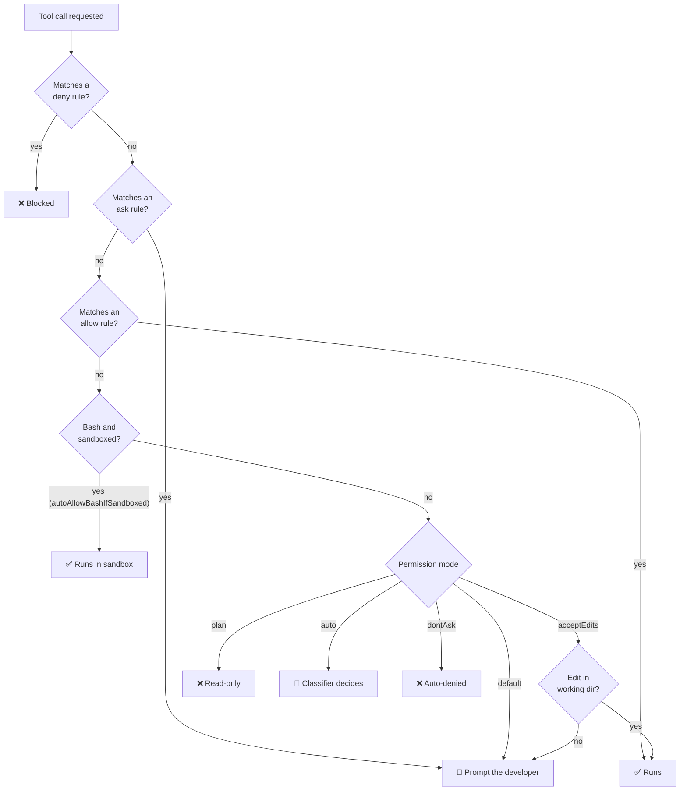

# Permissions policy

[🏠 Home](../../README.md) › Security baseline › Permissions policy

This page covers which permission modes developers may use, what's always denied, what always asks, what's pre-approved, and where permission rules stop working, so the sandbox has to take over. Source: [permissions](https://code.claude.com/docs/en/permissions), [permission modes](https://code.claude.com/docs/en/permission-modes).

## Contents
- [How permission evaluation works](#how-permission-evaluation-works)
- [Permission modes](#permission-modes)
- [Rule design](#rule-design)
- [Web tools are off](#web-tools-are-off)
- [Ask rules on build files and registry configs](#ask-rules-on-build-files-and-registry-configs)
- [Why Bash rules are not a boundary](#why-bash-rules-are-not-a-boundary)
- [Developer experience trade-offs](#developer-experience-trade-offs)

## How permission evaluation works

- **Deny beats ask, and ask beats allow.** Deny and ask rules match **any** subcommand of a compound command (`&&`, `;`, `|`, `$(...)`). An allow rule must match **every** subcommand.
- Under `allowManagedPermissionRulesOnly`, only managed rules count. "Always allow" choices made at a prompt don't persist into effective rules ([PERM-017](../03-test-plan/catalog/permissions.md#perm-017)).

## Permission modes

| Mode | Behavior | Policy | Rationale | Test |
|---|---|---|---|---|
| `default` (Manual) | Prompts on first use of each tool | 🟢 **Default for the pilot** | Developers stay in the loop while trust builds | [PERM-008](../03-test-plan/catalog/permissions.md#perm-008) |
| `acceptEdits` | Auto-accepts file edits and common FS commands in working dirs | 🟢 Allow | Edits are reviewable in git, checkpointed, and limited to the workspace | [PERM-009](../03-test-plan/catalog/permissions.md#perm-009) |
| `plan` | Read and plan only | 🟢 Allow (encouraged) | Safe exploration | [PERM-010](../03-test-plan/catalog/permissions.md#perm-010) |
| `auto` | A classifier reviews actions instead of prompting | ❓ **Pending [ADR-008](../../logs/decision-log.md#adr-008)** | Less friction. Needs testing on Foundry for availability and behavior. | [PERM-011](../03-test-plan/catalog/permissions.md#perm-011) |
| `dontAsk` | Auto-denies anything that would prompt | 🟢 Allow (CI/headless) | Safe for automation | [PERM-012](../03-test-plan/catalog/permissions.md#perm-012) |
| `bypassPermissions` | No prompts at all | 🔴 **Block** (`disableBypassPermissionsMode: "disable"`) | Removes the human checkpoint entirely | [PERM-001](../03-test-plan/catalog/permissions.md#perm-001) |

> [!NOTE]
> Since v2.1.283, auto mode is the built-in starting mode for interactive sessions, including on Foundry. Since v2.1.285, `-p` runs on third-party providers start in auto too ([permission modes](https://code.claude.com/docs/en/permission-modes)). Our managed `defaultMode: "default"` should override both. [PERM-008](../03-test-plan/catalog/permissions.md#perm-008) and [FEAT-012](../03-test-plan/catalog/features.md#feat-012) confirm it.

## Rule design

The full list is in [managed-settings.md](managed-settings.md#target-policy-v02). The design logic:

| Category | Rule type | Examples | Why |
|---|---|---|---|
| **Secrets and credentials** | deny `Read` | `**/.env*`, `**/*.pem`, `~/.azure/**`, `~/.config/gh/**` | The Read tool isn't sandboxed. Deny rules are its only control. |
| **Policy and CI integrity** | deny `Edit` | `//etc/claude-code/**`, `./.github/workflows/**`, `./.devcontainer/**`, `./.mcp.json` | Stops the agent changing its own guardrails or the pipeline |
| **Network tools** | deny `Bash` | `curl`, `wget`, `nc`, `ssh`, `scp` | A speed bump: makes intent visible. The firewall is the real control. |
| **Credential extraction** | deny `Bash` | `az account get-access-token`, `gh auth token` | Stops casual token printing |
| **Irreversible git** | deny / ask `Bash` | deny force-push. Ask on `git push`, `gh pr merge`, `git reset --hard`. | Human confirmation at points of no return |
| **Safe, frequent** | allow `Bash` | `git status/diff/log/add/commit`, `gh pr create/view` | Cuts prompt fatigue, which otherwise pushes people to loosen settings |
| **Web tools** | deny `WebSearch` and `WebFetch` (no domain allows) | `"WebSearch"`, `"WebFetch"` | Off by decision ([ADR-016](../../logs/decision-log.md#adr-016)). See [below](#web-tools-are-off). |
| **Windows build files and registry configs** | ask `Edit` | `**/*.csproj`, `**/*.vbproj`, `**/*.props`, `**/*.targets`, `**/Directory.Build.*`, `**/nuget.config`, `**/pip.conf`, `**/.npmrc`, `**/*.ps1` | These files run or redirect code **outside** the container. See [below](#ask-rules-on-build-files-and-registry-configs). |

**Path syntax** ([permissions docs](https://code.claude.com/docs/en/permissions)): `//path` is absolute · `~/path` is home · `./path` or `path` is relative to the working directory · `**` matches recursively.

## Web tools are off

Both web tools are denied in managed policy ([CTL-26](defense-in-depth.md#ctl-26), [ADR-016](../../logs/decision-log.md#adr-016)).

| Tool | Why it can't be left to the network | How it's switched off | Test |
|---|---|---|---|
| `WebSearch` | On Foundry the search runs **server-side**, inside the provider, so the container firewall and "no internet" on the VDI don't stop it. There's no environment variable that turns it off, and `CLAUDE_CODE_MAX_WEB_SEARCHES_PER_SESSION` only accepts a positive number ([env vars](https://code.claude.com/docs/en/env-vars), [tools reference](https://code.claude.com/docs/en/tools-reference#websearch-tool-behavior)). | `permissions.deny: ["WebSearch"]`. Deny beats every allow, and `allowManagedPermissionRulesOnly` stops anyone adding an allow rule. The gateway also turns WebSearch off for its sessions ([ADR-013](../../logs/decision-log.md#adr-013)). | [NET-007](../03-test-plan/catalog/network.md#net-007) |
| `WebFetch` | It runs from the container, so it could only reach allowlisted hosts such as GitHub, which is an exfiltration path, and its preflight check calls `api.anthropic.com`. Web content is also a prompt-injection vector ([DATA-011](../03-test-plan/catalog/data.md#data-011)). | `CLAUDE_CODE_DISABLE_WEB_FETCH=1` + `permissions.deny: ["WebFetch"]` + `skipWebFetchPreflight: true`. **Pending the lead's confirmation.** If WebFetch is kept, use domain-scoped `WebFetch(domain:…)` allow rules instead. | [PERM-014](../03-test-plan/catalog/permissions.md#perm-014), [NET-006](../03-test-plan/catalog/network.md#net-006) |

NET-007 checks every session type: interactive, subagents, `-p` headless, and after a `/permissions` change attempt.

## Ask rules on build files and registry configs

Some .NET and VB.NET repos can't build or test in the Linux container (the **compile-check** and **edit-only** tiers, [ADR-017](../../logs/decision-log.md#adr-017)). For those, Claude edits the code in the container and the developer builds it in Visual Studio on Windows. **That build is the moment the agent's work leaves the container.** MSBuild runs whatever the project files tell it to, so a malicious or mistaken `<Exec>` target, an imported `.targets` file, or a new package source would run on the developer's Windows session ([R-25](../../logs/risk-register.md#r-25), [R-26](../../logs/risk-register.md#r-26)).

| Rule | Covers |
|---|---|
| `Edit(**/*.csproj)`, `Edit(**/*.vbproj)` | Project files: targets, `Exec` tasks, package references |
| `Edit(**/*.props)`, `Edit(**/*.targets)`, `Edit(**/Directory.Build.*)` | Imported MSBuild logic, including `Directory.Packages.props` |
| `Edit(**/nuget.config)`, `Edit(**/NuGet.Config)`, `Edit(**/pip.conf)`, `Edit(**/.npmrc)` | Package sources. All packages must come from Nexus ([ADR-015](../../logs/decision-log.md#adr-015)). |
| `Edit(**/*.ps1)`, `Edit(**/*.cmd)`, `Edit(**/*.bat)` | Windows build and helper scripts |

These are **ask** rules, not deny: editing project files is normal work. The prompt is the checkpoint, and the [acceptable use policy](../07-phase2-pilot/acceptable-use-policy.md) and training add a review step before building on Windows ([CTL-29](defense-in-depth.md#ctl-29)). Java build files (`pom.xml`, `*.gradle`) aren't on the list: Java builds run inside the container, under the sandbox. Tested in [PERM-019](../03-test-plan/catalog/permissions.md#perm-019). Whether `Edit` rules also cover the Write tool is part of that test [verify].

## Why Bash rules are not a boundary

> [!WARNING]
> From the docs: a deny or ask rule "covers the invocation Claude usually produces and isn't a security boundary around the program." `Bash(curl *)` stops `curl https://…`, but **not** `/usr/bin/curl …` or `sh -c 'curl …'`. `Bash(git push *)` doesn't stop `git -C . push`. Environment runners such as `npx` and `docker exec` aren't unwrapped either.

What this means for us:

1. Bash deny rules are **intent signals and speed bumps**, useful for catching the common case and for audit.
2. **Enforcement** for anything that matters comes from the sandbox (filesystem and network) and the container firewall.
3. [PERM-005](../03-test-plan/catalog/permissions.md#perm-005) deliberately runs the bypass variants. **The expected result is that the rule is bypassed but the sandbox or firewall still blocks the effect.** That's the evidence for defense in depth.

| Bypass variant | Rule hit? | What actually stops it |
|---|---|---|
| `curl https://example.com` | ✅ deny | Rule (and firewall) |
| `/usr/bin/curl https://example.com` | ❌ | Sandbox network proxy + container firewall |
| `sh -c 'curl https://example.com'` | ❌ (wrapper) [verify] | Sandbox + firewall |
| `python3 -c "import urllib.request…"` | ❌ | Sandbox + firewall |
| `cat ~/.azure/msal_token_cache.json` | — (not a Bash rule) | Sandbox `denyRead` |
| Read tool on `~/.azure/...` | ✅ deny | Rule only (Read isn't sandboxed), so this rule is **critical** |

## Developer experience trade-offs

Too many prompts make people work around controls. The Phase 2 friction metric ([success criteria](../00-charter/success-criteria.md#developer-experience-criteria)) tells us whether the balance is right.

| Lever | Effect | When to use |
|---|---|---|
| `autoAllowBashIfSandboxed: true` | Sandboxed Bash doesn't prompt | Already on. The sandbox is the control. |
| Expand the `allow` list | Fewer prompts for known-safe commands (test runners, linters, build tools per repo) | After Phase 1. Tune per language stack. |
| `acceptEdits` mode | No prompts for edits in the workspace | Developers comfortable reviewing diffs in git |
| Auto mode | The classifier replaces most prompts | Only if [ADR-008](../../logs/decision-log.md#adr-008) approves it |
| Ask rules on build files | One prompt per edit to a project file in Windows-only repos | Keep. If friction is high, narrow to `*.props`/`*.targets`/`Directory.Build.*` and rely on the review step. |
| `/fewer-permission-prompts` skill | Suggests allowlist additions from transcripts | Evaluator uses it to propose managed allow rules (developers can't add their own) |

## Related
- [Managed settings](managed-settings.md) · [Sandbox policy](sandbox-policy.md) · [Permission tests (PERM)](../03-test-plan/catalog/permissions.md)
- [Tools, hooks, and modes inventory](../04-feature-inventory/tools-and-hooks.md)
