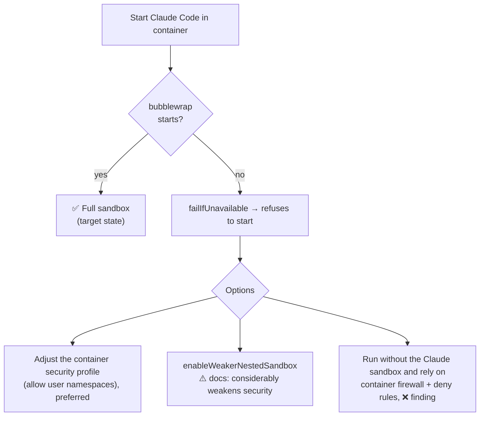

# Sandbox policy

[🏠 Home](../../README.md) › Security baseline › Sandbox policy

Claude Code's built-in sandbox applies OS-level filesystem and network isolation to Bash and its child processes. On Linux it uses **bubblewrap** and **socat**. This page covers what it does and doesn't cover, how we make it mandatory, and the open question of running it inside Docker. Source: [sandboxing](https://code.claude.com/docs/en/sandboxing).

## Contents
- [Coverage](#coverage)
- [Mandatory configuration](#mandatory-configuration)
- [Filesystem rules](#filesystem-rules)
- [Network rules](#network-rules)
- [Running inside Docker (nested sandbox)](#running-inside-docker-nested-sandbox)
- [Documented limitations](#documented-limitations)

## Coverage

| Covered by the sandbox | **Not** covered by the sandbox | Covered instead by |
|---|---|---|
| Bash and all its children | Read / Edit / Write tools | Permission deny rules ([CTL-07](defense-in-depth.md#ctl-07)) |
| PowerShell (n/a here) | WebFetch, WebSearch | Both turned off in managed policy ([CTL-26](defense-in-depth.md#ctl-26)) |
| Monitor | MCP servers | MCP lockdown ([CTL-12](defense-in-depth.md#ctl-12)) |
| Subagents' Bash (they inherit it) | Hooks, mods, statusLine | Managed-only hooks ([CTL-14](defense-in-depth.md#ctl-14)) |
| | Claude Code's own API calls (to Foundry, or to the gateway in [ADR-013](../../logs/decision-log.md#adr-013) mode) | Container firewall ([CTL-04](defense-in-depth.md#ctl-04)) and the network path ([CTL-27](defense-in-depth.md#ctl-27)) |

**Defaults** (before our policy): writes are allowed to cwd, added directories, and `$TMPDIR`. Reads are allowed **everywhere** except denied paths, so credential files are readable unless denied. Network has no direct route. A proxy allows only `allowedDomains`, which is empty by default. **The sandbox is off by default.**

## Mandatory configuration

```json
{
  "sandbox": {
    "enabled": true,
    "failIfUnavailable": true,
    "allowUnsandboxedCommands": false,
    "excludedCommands": []
  }
}
```

| Key | Effect | Test |
|---|---|---|
| `enabled: true` | Turn it on | [SBX-014](../03-test-plan/catalog/sandbox.md#sbx-014) |
| `failIfUnavailable: true` | If bubblewrap can't start, Claude Code **refuses to run** rather than silently running unsandboxed | [SBX-001](../03-test-plan/catalog/sandbox.md#sbx-001) |
| `allowUnsandboxedCommands: false` | The model's `dangerouslyDisableSandbox` request is ignored. Set in managed settings, it makes the sandbox **admin-required**, and repo settings can't loosen it. | [SBX-002](../03-test-plan/catalog/sandbox.md#sbx-002) |
| `excludedCommands: []` | No command runs outside the sandbox | [SBX-008](../03-test-plan/catalog/sandbox.md#sbx-008) |

## Filesystem rules

| Rule | Value | Purpose | Test |
|---|---|---|---|
| Write scope | Default (cwd = `/workspace`, `$TMPDIR`) | Agent can only change the repo and temp files | [SBX-003](../03-test-plan/catalog/sandbox.md#sbx-003) |
| `filesystem.denyRead` | `~/.azure`, `~/.config/gh`, `~/.ssh`, `~/.git-credentials`, `~/.claude/.credentials.json`, `/etc/claude-code` | Credentials and policy | [SBX-004](../03-test-plan/catalog/sandbox.md#sbx-004) |
| `filesystem.allowManagedReadPathsOnly` | `true` 🔒 | Users can't punch read holes | [SBX-007](../03-test-plan/catalog/sandbox.md#sbx-007) |
| `credentials.files` | Mask credential files [verify schema] | Defense in depth for credential files | [SBX-009](../03-test-plan/catalog/sandbox.md#sbx-009) |
| Shell rc / `$PATH` dirs | Must not be writable | The docs call these out as an escalation vector | [SBX-015](../03-test-plan/catalog/sandbox.md#sbx-015) |

> [!WARNING]
> **Credential tension.** If `~/.config/gh` is denied to Bash, a sandboxed `git push` through gh's credential helper may also fail. Options to evaluate in [IDN-008](../03-test-plan/catalog/identity.md#idn-008):
> 1. Store the GitHub token where git's credential helper can reach it but the denied paths don't include it, and accept that risk.
> 2. Keep it denied, and have the developer run `git push` themselves (in a normal terminal, or with `!git push`, which runs outside Claude's sandbox as the developer's own command).
> 3. Use `ask` on `git push` with a credential helper that runs outside the sandbox.
>
> Record the decision as an ADR.

## Network rules

| Rule | Value | Purpose | Test |
|---|---|---|---|
| `network.allowedDomains` | `github.com`, `api.github.com`, `<nexus-host>` | Only what Bash needs: git push, and package installs through Nexus ([ADR-015](../../logs/decision-log.md#adr-015)) | [SBX-005](../03-test-plan/catalog/sandbox.md#sbx-005), [ENV-017](../03-test-plan/catalog/env.md#env-017) |
| `network.allowManagedDomainsOnly` | `true` 🔒 | Users and projects can't add domains | [SBX-006](../03-test-plan/catalog/sandbox.md#sbx-006) |
| `network.allowUnixSockets` / `allowAllUnixSockets` | unset (none) | `docker.sock` access would mean host access | [SBX-013](../03-test-plan/catalog/sandbox.md#sbx-013) |
| `network.allowLocalBinding` | `false` (pending) | Dev servers (`npm run dev`) need to bind ports. Decide per repo. | [SBX-012](../03-test-plan/catalog/sandbox.md#sbx-012) |
| `network.deniedDomains` | not needed with an allowlist | — | — |

> [!NOTE]
> **What the sandbox domain list does and doesn't govern.**
> - **Package installs need Nexus in the list.** `pip install`, `mvn`, `gradle`, and `dotnet restore` run as sandboxed Bash, so without `<nexus-host>` here they fail even though the container firewall allows Nexus ([ENV-017](../03-test-plan/catalog/env.md#env-017), [CTL-25](defense-in-depth.md#ctl-25)).
> - **Claude Code's own model traffic isn't Bash.** Calls to the Foundry endpoint, or to the gateway once [ADR-013](../../logs/decision-log.md#adr-013) is accepted, come from the Claude Code process, not from a sandboxed command. So the Foundry or gateway host doesn't belong in `allowedDomains`. The container firewall and the network path ([CTL-27](defense-in-depth.md#ctl-27)) govern that traffic.
> - **WebSearch isn't governed here either.** On Foundry it runs server-side, which is why it's denied by rule ([CTL-26](defense-in-depth.md#ctl-26)).

## Running inside Docker (nested sandbox)

bubblewrap creates user namespaces. Inside an unprivileged Docker container that can fail, depending on the engine's seccomp/AppArmor profile and kernel settings.



[ENV-006](../03-test-plan/catalog/env.md#env-006) decides which branch applies. Record the result as an ADR and, unless it's the first branch, as a finding ([R-16](../../logs/risk-register.md)).

## Documented limitations

From the [sandboxing docs](https://code.claude.com/docs/en/sandboxing). Each limitation is acknowledged with a compensating control:

| Limitation | Compensating control |
|---|---|
| Domain fronting through broad allowed domains (for example, `github.com`) | Narrow allowlist. Token scoped to one repo. Proxy TLS inspection. |
| `allowUnixSockets` for `docker.sock` grants host access | Never allowed. No socket mounted ([ENV-011](../03-test-plan/catalog/env.md#env-011)). |
| Writes to `$PATH` dirs or shell rc files can escalate | Write scope is workspace + tmp. Tested in [SBX-015](../03-test-plan/catalog/sandbox.md#sbx-015). |
| `enableWeakerNestedSandbox` weakens security considerably | Avoid it. A finding if needed. |
| Without both FS and network isolation, the sandbox is incomplete | Both configured |
| Doesn't cover Read/Edit/WebFetch/MCP | Deny rules + MCP lockdown + firewall ([SBX-011](../03-test-plan/catalog/sandbox.md#sbx-011)). WebFetch and WebSearch are off ([CTL-26](defense-in-depth.md#ctl-26)). |

## Related
- [Managed settings](managed-settings.md) · [Permissions policy](permissions-policy.md) · [Network egress](../01-architecture/network-egress.md)
- [Sandbox tests (SBX)](../03-test-plan/catalog/sandbox.md)
