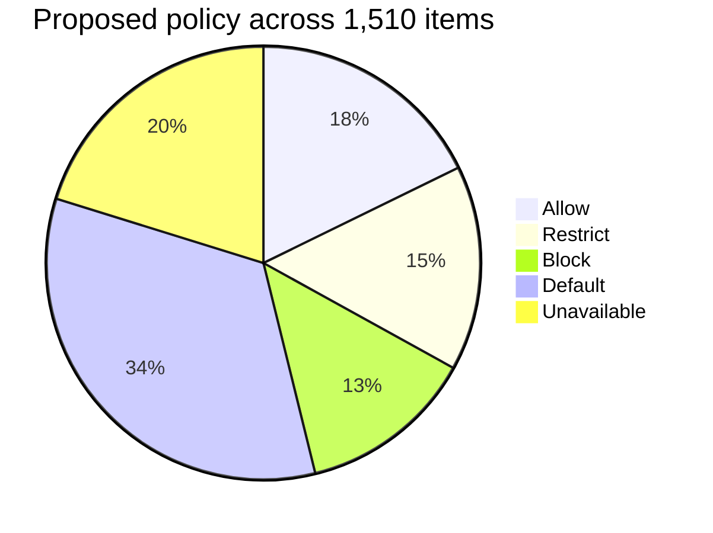

# Feature inventory

[🏠 Home](../../README.md) › Feature inventory

This is every command, flag, setting, environment variable, tool, hook, permission mode, and surface in **Claude Code 2.1.301**. It was built from the official reference pages on 2026-10-15. For each one it records whether it works on Microsoft Foundry and in our container, the proposed policy, the catalog test that covers it, and the result. This inventory is the evidence that we **"checked every button"**.

## Rollup

| Page | Rows | 🟢 Allow | 🟡 Restrict | 🔴 Block | ⚪ Default | ⛔ Unavailable | `[verify]` | 🟩 / 🟨 / 🟥 / ⏭ | ⏳ |
|---|---|---|---|---|---|---|---|---|---|
| [Slash commands & keyboard shortcuts](slash-commands.md) | 246 | 57 | 12 | 12 | 118 | 47 | 22 | 0 | 246 |
| [CLI flags & subcommands](cli-flags-and-subcommands.md) | 327 | 83 | 20 | 96 | 60 | 68 | 20 | 0 | 327 |
| [Settings keys](settings-keys.md) | 268 | 64 | 55 | 28 | 77 | 44 | 36 | 0 | 268 |
| [Environment variables](environment-variables.md) | 431 | 30 | 55 | 19 | 231 | 96 | 46 | 0 | 431 |
| [Tools, hooks & permission modes](tools-and-hooks.md) | 130 | 22 | 74 | 11 | 12 | 11 | 14 | 0 | 130 |
| [Surfaces & integrations](surfaces-and-integrations.md) | 108 | 12 | 15 | 32 | 10 | 39 | 20 | 0 | 108 |
| **Total** | **1,510** | **268** | **231** | **198** | **508** | **305** | **158** | **0** | **1,510** |

**Availability on Foundry (proposed, to be verified):** ✅ 1,149 available · ⛔ 301 unavailable · ❓ 60 unclear.

> [!NOTE]
> Update the counts as results come in. A simple count of `| 🟩 |`, `| 🟨 |`, `| 🟥 |`, and so on in the Result column per file is enough. Results use squares (🟩 Pass · 🟨 Issue · 🟥 Blocker · ⏭ N/A · ⏳ Not run). The circles in the Policy column (🟢 Allow · 🟡 Restrict · 🔴 Block) are the proposed policy, not a result. The Phase 1 report's [feature coverage](../../reports/phase1-security-configuration-report.md#7-feature-coverage) table is built from this rollup.

**What changed in v0.2 (2026-10-19).** WebSearch and WebFetch moved to 🔴 Block ([ADR-016](../../logs/decision-log.md#adr-016)). Foundry API keys are blocked ([ADR-006](../../logs/decision-log.md#adr-006)). `/loop` and scheduled tasks are off, and subagent and workflow concurrency are capped ([CTL-28](../02-security-baseline/defense-in-depth.md#ctl-28)). The Claude apps gateway rows became the proposed target ([ADR-013](../../logs/decision-log.md#adr-013)), and the Databricks gateway is recorded as rejected ([ADR-012](../../logs/decision-log.md#adr-012)). Claude Code comes only from the IT-built image ([ADR-014](../../logs/decision-log.md#adr-014)).

## How to sweep the inventory

1. Work page by page in Phase 1 week 3 ([execution order](../03-test-plan/test-strategy.md#execution-order-phase-1)).
2. **Rows with a "Covered by" test:** take the result from that catalog test, so you don't test it twice.
3. **Rows without one:** try the item in the container (run the command, set the flag or key in a test policy, or press the key) and confirm it matches the Foundry, Container, and Policy columns.
4. **⛔ rows:** confirm they're unavailable (one quick attempt), then mark them ⏭ with the reason.
5. **`[verify]` rows:** resolve each one. Correct the row, or raise a finding.
6. Evidence for a group of rows can share one file, for example `evidence/INV-CMD/20261102-sweep.log`.

## Policy-relevant facts surfaced while building the inventory

The six authoring passes turned these up. Each is folded into the baseline docs or the tests:

| # | Fact (from the docs) | Impact | Where handled |
|---|---|---|---|
| 1 | Since v2.1.283 the built-in starting mode is **auto**, including on Foundry. On v2.1.285+, `-p` runs on third-party providers also start in auto. | The managed `defaultMode` must be set explicitly | [PERM-008](../03-test-plan/catalog/permissions.md#perm-008), [ADR-008](../../logs/decision-log.md#adr-008) |
| 2 | `allowManagedPermissionRulesOnly` **ignores `--allowedTools`** | CI allowlists must live in managed policy | [FEAT-012](../03-test-plan/catalog/features.md#feat-012) |
| 3 | Commands run with the `!` prefix run **outside Claude's sandbox** | Only the container firewall applies to them. Don't use `!` to test sandbox controls. | [Test strategy](../03-test-plan/test-strategy.md#how-to-run-a-test), [FEAT-001](../03-test-plan/catalog/features.md#feat-001) |
| 4 | The docs don't clearly list **skill/subagent frontmatter hooks** among what `allowManagedHooksOnly` blocks | A possible hook-lockdown gap | [EXT-005](../03-test-plan/catalog/extensions.md#ext-005), [R-21](../../logs/risk-register.md#r-21) |
| 5 | User-level `sandbox.excludedCommands` and `autoMode` rules may still apply under managed policy | A possible sandbox-lockdown gap | [SBX-008](../03-test-plan/catalog/sandbox.md#sbx-008), [R-22](../../logs/risk-register.md#r-22) |
| 6 | **ToolSearch** isn't supported on Azure-hosted Foundry deployments | Higher context cost if MCP is enabled later | [EXT-012](../03-test-plan/catalog/extensions.md#ext-012) |
| 7 | **Custom deployment names** can lose some tools (task tools) and the 1M-context detection | Name deployments with model IDs, or use `modelOverrides` | [COST-011](../03-test-plan/catalog/cost.md#cost-011), [NET-004](../03-test-plan/catalog/network.md#net-004) |
| 8 | **Monitor** tool unavailable on Foundry or with nonessential traffic disabled | Feature gap | [tools-and-hooks.md](tools-and-hooks.md) |
| 9 | The **GitHub Action supports Foundry** (`use_foundry: "true"` + `azure/login`) | CI integration is feasible | [SURF-004](../03-test-plan/catalog/surfaces.md#surf-004) |
| 10 | **Code Review (GitHub app)** needs a claude.ai Team/Enterprise org. GitLab CI/CD and Channels aren't available on Foundry. | Feature gaps | [surfaces-and-integrations.md](surfaces-and-integrations.md) |
| 11 | Lowercase `https_proxy`/`http_proxy` are read before the uppercase forms | Set both in managed `env` | [managed-settings.md](../02-security-baseline/managed-settings.md#settings-not-in-the-file-yet-decisions-pending) |
| 12 | `allowManagedModsOnly` is an option under `pluginConfigs`. Mods also fall under `allowManagedHooksOnly`. | Correct key location for the mod lockdown | [EXT-014](../03-test-plan/catalog/extensions.md#ext-014) |
| 13 | Extra hardening switches exist: `CLAUDE_CODE_SUBPROCESS_ENV_SCRUB`, `DISABLE_LOGIN_COMMAND`, `DISABLE_UPDATES`, `CLAUDE_CODE_DISABLE_OFFICIAL_MARKETPLACE_AUTOINSTALL`, `CLAUDE_CODE_IDE_SKIP_AUTO_INSTALL`, `OTEL_LOG_MANAGED_SETTINGS`, `feedbackSurveyRate: 0`, `disableClaudeAiConnectors`, `enforceAvailableModels` | `DISABLE_UPDATES` is set in policy v0.2 ([ADR-014](../../logs/decision-log.md#adr-014)). The rest remain candidates. | [managed-settings.md](../02-security-baseline/managed-settings.md#settings-not-in-the-file-yet-decisions-pending) |
| 14 | **WebSearch runs server-side** on Foundry. No env var turns it off, and the session cap can't be 0. | The firewall can't stop it, so a managed deny rule is the only off switch | [NET-007](../03-test-plan/catalog/network.md#net-007), [ADR-016](../../logs/decision-log.md#adr-016) |
| 15 | The **Claude apps gateway** enforces per-user spend caps and stamps identity on telemetry, with Foundry as the upstream | Per-user cost control and attribution without claude.ai analytics | [COST-013](../03-test-plan/catalog/cost.md#cost-013), [ADR-013](../../logs/decision-log.md#adr-013) |

## Related
- [Test strategy](../03-test-plan/test-strategy.md) · [Defense in depth](../02-security-baseline/defense-in-depth.md) · [Managed settings](../02-security-baseline/managed-settings.md)
- Official docs index: <https://code.claude.com/docs/llms.txt>
