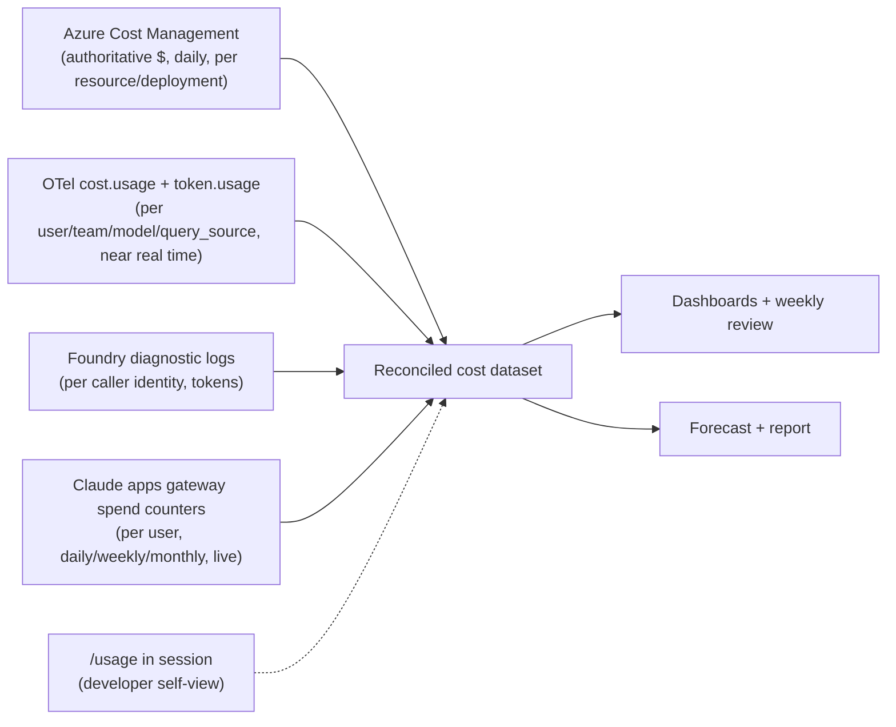
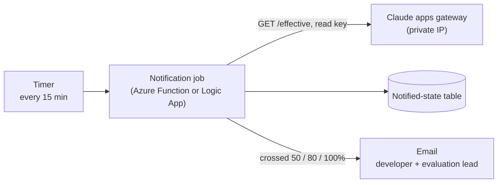
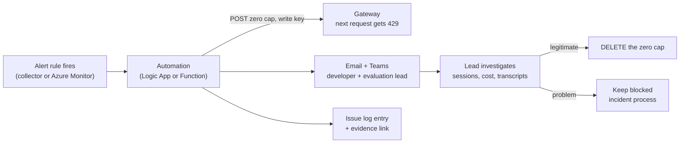

# Cost model

[🏠 Home](../../README.md) › Cost › Cost model

This page explains how we measure what Claude Code costs, attribute it to developers and teams, reconcile it with the bill, forecast it for a wider rollout, cap it, and set it against value. With Foundry, the authoritative bill is **Azure Cost Management**. Attribution comes from **OpenTelemetry** ([costs docs](https://code.claude.com/docs/en/costs)). Per-user caps, spend notifications, and the runaway shutoff come from the **Claude apps gateway** in front of Foundry (proposed, [ADR-013](../../logs/decision-log.md#adr-013)).

> [!NOTE]
> **Two stages.** Phase 1 starts with **direct Foundry**. Per-user cost then comes from OTel only, and the only caps are Azure budgets and deployment quotas. Once the **Claude apps gateway** is in front of Foundry, it adds per-user spend tracking, hard caps, the 75% and 95% warnings, and the zero-cap kill switch. Sections marked *(gateway stage)* apply only then.

## Contents
- [Data sources](#data-sources)
- [KPIs](#kpis)
- [Reference benchmarks](#reference-benchmarks)
- [Reconciliation method](#reconciliation-method)
- [Forecast model](#forecast-model)
- [ROI calculation](#roi-calculation)
- [Guardrails](#guardrails)
- [Per-user spend caps (gateway stage)](#per-user-spend-caps-gateway-stage)
- [Spend notifications (gateway stage)](#spend-notifications-gateway-stage)
- [Runaway detection and automatic shutoff (gateway stage)](#runaway-detection-and-automatic-shutoff-gateway-stage)
- [Cost levers](#cost-levers)
- [Total cost of ownership](#total-cost-of-ownership)
- [Weekly cost review](#weekly-cost-review)

## Data sources



| Source | Granularity | Latency | Authoritative for | Caveat |
|---|---|---|---|---|
| **Azure Cost Management** (export to storage or CSV) | Daily, per resource / meter / tag | 24–48 h | **Total $ actually billed** | No per-user split unless deployments are split per team |
| **OTel `claude_code.cost.usage`** | Per request, with `dev.alias`, `team.id`, `cohort`, `model`, `query_source`, `effort` | ~60 s | **Attribution** (who, which model, main vs. subagent vs. background) | Computed client-side at list price unless `modelPricing` is set ([COST-002](../03-test-plan/catalog/cost.md#cost-002)). On direct Foundry there's no `user.email`, so per-user labels come from `OTEL_RESOURCE_ATTRIBUTES` set at container start. In the gateway stage the gateway stamps identity ([TEL-013](../03-test-plan/catalog/telemetry.md#tel-013)). |
| **OTel `claude_code.token.usage`** | Tokens by type (input, output, cacheRead, cacheCreation) | ~60 s | Cache efficiency, model mix | — |
| **Foundry diagnostic logs** (Log Analytics) | Per request, per caller identity | Minutes | Independent cross-check by identity ([IDN-005](../03-test-plan/catalog/identity.md#idn-005)) | Needs diagnostic settings enabled. In the gateway stage every request comes from the gateway's managed identity, so these logs no longer split by user. |
| **Gateway spend counters** (`GET /v1/organizations/spend_limits/effective`) *(gateway stage)* | Per user (Entra identity), per day, week, and month | Live (after each response) | **Cap enforcement**, and the per-user view developers see | An estimate at the configured rates, not an invoice ([spend limits docs](https://code.claude.com/docs/en/claude-apps-gateway-spend-limits)) |
| **`/usage`** in session | Session | Live | Developer self-awareness | Estimate only |

> [!NOTE]
> Not available on Foundry: the Claude Console usage page, the Claude Code Analytics API, and the Teams/Enterprise spend reports ([costs docs](https://code.claude.com/docs/en/costs)). OTel plus Azure fill that gap. In the gateway stage, the gateway's spend counters add a live per-user view.

## KPIs

| KPI | Formula | Target | Reported |
|---|---|---|---|
| **Cost per active developer-day** | Σ cost ÷ Σ (developer × day with ≥1 session) | ≤ «$X» ([success criteria](../00-charter/success-criteria.md#cost-criteria)) | Weekly |
| **Cost per developer per month** | Σ cost in month ÷ pilot developers | ≤ «$Y» | Monthly |
| **P90 cost per active day** | 90th percentile of per-developer daily cost | ≤ «$Z» | Weekly |
| **Cost per merged PR (assisted)** | Σ cost ÷ merged PRs with the Claude trailer | Trend only | Weekly |
| **Model mix** | Share of cost by model | Informs defaults | Weekly |
| **Main / subagent / background split** | Cost by `query_source` | Informs subagent model policy | Weekly |
| **Cache hit ratio** | cacheRead ÷ (input + cacheRead + cacheCreation) tokens | High is good | Weekly |
| **Reconciliation variance** | (OTel − Azure) ÷ Azure, daily | ≤ «±10%» | Weekly |
| **Forecast accuracy** | Week-4 forecast vs. week-8 actual | ≤ «±20%» | End of Phase 2 |
| **Caps hit** *(gateway stage)* | Count of `spend.blocked` audit events, by period type | Trend. Review each one. | Weekly |
| **Runaway stops** *(gateway stage)* | Zero caps set by the automation, and the time from detection to block | ≤ «1 min» to block | Weekly |

## Reference benchmarks

Anthropic's published figures for enterprise deployments ([costs docs](https://code.claude.com/docs/en/costs)):

| Metric | Anthropic benchmark | Our Phase 1 | Our Phase 2 |
|---|---|---|---|
| Average cost per developer per active day | ~**$13** | | |
| Monthly cost per developer | **$150–250** | | |
| Users below $30 per active day | **90%** | | |

> [!WARNING]
> These benchmarks assume Anthropic list prices and Anthropic's customer mix. Foundry pricing, our model mix (Opus vs. Sonnet), effort settings, and how our developers work will all differ. Use them as a sanity check, not a target.

**Rate-limit sizing** (TPM/RPM per user, from the same page). Use it for Foundry deployment quotas ([COST-007](../03-test-plan/catalog/cost.md#cost-007)):

| Team size | TPM per user | RPM per user |
|---|---|---|
| 1–5 | 200k–300k | 5–7 |
| 20–50 | 50k–75k | 1.25–1.75 |

For a 20-developer pilot: about **1.0–1.5 M TPM** across the deployments, adjusted by Phase 1 peak data.

## Reconciliation method

Done weekly ([COST-001](../03-test-plan/catalog/cost.md#cost-001)):

1. **Export** Azure daily cost filtered to the Foundry resource. Tag the Claude deployments, for example `workload=claude-code-eval`.
2. **Query** OTel: `sum(claude_code.cost.usage) by day`.
3. **Join** by day (UTC). Compute the variance.
4. **Explain** variance over the threshold. Common causes:
   - Pricing: `modelPricing` not set, or out of date (list vs. contract).
   - Data loss: telemetry from `kill -9` or offline sessions ([TEL-009](../03-test-plan/catalog/telemetry.md#tel-009)).
   - Other workloads on the same resource (tag filtering).
   - Azure billing lag.
   - Gateway pricing *(gateway stage)*: a model without a `pricing.overrides` row, so the meter used list price or the $5/$25 unknown-model tier.
5. **Allocate** the authoritative Azure total to developers and teams **in proportion to their OTel share**. This is the per-user cost used in reports.
6. **Compare** *(gateway stage)* the gateway's monthly per-user totals (`/effective`) with the allocated Azure figure. A steady gap usually means the gateway's rates don't match the contract.

Foundry bills in **Claude Consumption Units (CCUs)** through the Azure Marketplace, metered hourly and invoiced monthly ([Claude in Microsoft Foundry](https://platform.claude.com/docs/en/build-with-claude/claude-in-microsoft-foundry#billing)). Convert the contract to per-token rates once. Use the same rates in Claude Code's `modelPricing` and in the gateway's `pricing.overrides`, so the developer view, the caps, and OTel all agree.

| Day | Azure $ | OTel $ | Variance | Note |
|---|---|---|---|---|
| YYYY-MM-DD | | | | |

## Forecast model

**Organization-wide monthly cost:**

```
Monthly cost = N_devs × adoption_rate × active_days_per_month × cost_per_active_day
```

| Parameter | Source | Pilot value | Rollout assumption |
|---|---|---|---|
| `N_devs` | HR / engineering headcount | 15–20 | `<org developer count>` |
| `adoption_rate` | Phase 2 weekly active users ÷ enrolled | | Conservative / expected / high: «50% / 70% / 90%» |
| `active_days_per_month` | Phase 2 OTel (days with ≥1 session per active dev) | | |
| `cost_per_active_day` | Phase 2 reconciled (median and P90) | | Apply the model-mix policy chosen |

Give **three scenarios** (conservative / expected / high) and the **sensitivity** to model mix. For example, the effect if 30% of Opus usage moves to Sonnet, using the [COST-003](../03-test-plan/catalog/cost.md#cost-003) results.

## ROI calculation

```
Monthly value   = N_active × hours_saved_per_dev_per_month × loaded_hourly_cost
Monthly cost    = Claude Code usage cost + platform/run cost (TCO below)
ROI multiple    = Monthly value ÷ Monthly cost
```

| Input | Source | Value |
|---|---|---|
| `hours_saved_per_dev_per_month` | Triangulated: benchmark task time savings ([benchmark-tasks.md](../06-productivity-quality/benchmark-tasks.md)), self-reported weekly pulse ([surveys.md](../06-productivity-quality/surveys.md)), cycle-time change ([measurement-framework.md](../06-productivity-quality/measurement-framework.md)) | Report as a **range** |
| `loaded_hourly_cost` | Finance | `<$>` |
| Usage cost | Reconciled Azure | |
| TCO | Below | |

> [!IMPORTANT]
> Self-reported time savings are optimistic. Benchmark-task savings measure ideal conditions. Use the **lower** of the triangulated estimates for the expected case, and show the others as the range.

## Guardrails

| Guardrail | Mechanism | Owner | Test |
|---|---|---|---|
| Budget alerts | Azure budget on the resource group: 50%, 80%, 100% of monthly budget → email to the evaluation lead and Finance. A backstop for the whole pilot, not per user. | Finance | [COST-006](../03-test-plan/catalog/cost.md#cost-006) |
| Throughput caps | Foundry deployment TPM/RPM quotas | Azure admin | [COST-007](../03-test-plan/catalog/cost.md#cost-007) |
| **Per-user spend caps** *(gateway stage)* | Gateway caps per user, Entra group, or org default, by day, week, and month. Over a cap → `429` until the period resets or an admin raises it. | Eval lead | [COST-013](../03-test-plan/catalog/cost.md#cost-013) |
| **Spend notifications** *(gateway stage)* | Scheduled job emails the developer and the evaluation lead at «50/80/100%» of the weekly and monthly caps | Eval lead | [COST-014](../03-test-plan/catalog/cost.md#cost-014) |
| **Runaway shutoff** *(gateway stage)* | Detection rules on OTel → automation sets a zero cap and emails both | Eval lead | [COST-015](../03-test-plan/catalog/cost.md#cost-015) |
| **Client-side agent limits** | Managed env caps concurrent subagents and workflow agents, turns off scheduled tasks, and leaves agent teams off ([CTL-28](../02-security-baseline/defense-in-depth.md#ctl-28)) | Eval lead | [COST-016](../03-test-plan/catalog/cost.md#cost-016) |
| Per-run caps (automation) | `--max-budget-usd`, `--max-turns` in every headless/CI invocation | Eval lead | [COST-005](../03-test-plan/catalog/cost.md#cost-005) |
| Model policy | `availableModels`. Default model and effort guidance. Haiku for background tasks. | Eval lead | [POL-011](../03-test-plan/catalog/policy.md#pol-011), [COST-010](../03-test-plan/catalog/cost.md#cost-010) |
| Outlier detection | Dashboard alert when a developer's daily cost exceeds «3×» the median, or «$Z». Feeds the runaway rules below. | Eval lead | [TEL-012](../03-test-plan/catalog/telemetry.md#tel-012) |
| Kill switch | One developer: a zero cap (gateway stage, takes effect on their next request), or removal from the Entra group. Everyone: scale the gateway to zero or remove the role assignment. (An org-wide zero cap only reaches developers without their own user or group cap, so it isn't a full kill switch.) | Eval lead / Azure admin | [OPS-003](../03-test-plan/catalog/operations.md#ops-003), [COST-015](../03-test-plan/catalog/cost.md#cost-015) |

> [!NOTE]
> Foundry on its own has **no per-user spend limit**. Azure budgets alert per subscription, resource group, or resource, and the cost data lags by hours. That's why the Claude apps gateway is proposed ([ADR-013](../../logs/decision-log.md#adr-013)). Databricks Unity AI Gateway was considered for the same reason and rejected ([ADR-012](../../logs/decision-log.md#adr-012)). In the direct-Foundry stage, per-user control is limited to telemetry, outlier review, and removing someone from the Entra group.

## Per-user spend caps (gateway stage)

The gateway meters every request and keeps daily, weekly, and monthly totals per developer in its PostgreSQL store. Caps are set through its admin API, not in `gateway.yaml`, and are checked live on every `/v1/messages` request ([spend limits docs](https://code.claude.com/docs/en/claude-apps-gateway-spend-limits)).

**How spend is computed.** After each response, the gateway prices the token counts with the first of these that applies:

1. A `pricing.overrides` row for the upstream that served the request. This is where our Azure contract rates go.
2. List price for the upstream model ID, when Claude Code's cost table recognizes it.
3. List price for the canonical `models[].id` mapped to the deployment. Foundry deployment names don't carry a model name, so the mapping matters.
4. An unknown-model tier of $5/$25 per million input/output tokens, so nothing is ever free. The gateway logs a warning when it uses it.

It then applies `pricing.multiplier`. A stream the client aborts is billed at a floor estimate, so cancelling early doesn't dodge a cap. The result is an **estimate** that works as a circuit breaker. The Azure invoice stays authoritative.

```yaml
pricing:
  overrides:
    - upstream: foundry-eval            # must match upstreams[].name
      model: <sonnet-model-id>
      input: <usd-per-million-tokens>   # from the Azure contract (CCU conversion)
      output: <usd-per-million-tokens>
      cache_read: <usd-per-million-tokens>
      cache_write: <usd-per-million-tokens>
admin:
  write_keys:
    - { id: automation, key: "${GATEWAY_ADMIN_WRITE_KEY_AUTOMATION}" }
  read_keys:
    - { id: notifier, key: "${GATEWAY_ADMIN_READ_KEY_NOTIFIER}" }
  admin_groups: [<entra-group-object-id-for-gateway-admins>]
  blocked_message: "Ask in #claude-code-pilot or contact <evaluation-lead>."
enforcement:
  fail_closed_on_error: true            # block rather than run unmetered if PostgreSQL is down
```

**Periods and resets.** Caps reset on **UTC** calendar boundaries: daily at 00:00 UTC, weekly on Monday, monthly on the 1st. In US time zones the day rolls over in the evening (7 or 8 p.m. Eastern), so a daily cap covers an overnight runaway that starts after that. Report weeks and months in UTC too, so the emails, the gateway, and the dashboards agree.

**How a cap resolves.** For each period: a per-user override wins. Otherwise the most restrictive cap among the developer's Entra groups applies (`group_limit_mode: min`). Otherwise the org default. Otherwise unlimited. Group and org caps are **per-person defaults**, not shared pools. A developer over any one period's cap is blocked.

**Starting caps (stakeholder decision at G0).** These proposals are based on Anthropic's benchmarks: about $13 per active day on average, 90% of users under $30 per active day, and $150–250 per month ([costs docs](https://code.claude.com/docs/en/costs)).

| Scope | Daily | Weekly | Monthly | Why |
|---|---|---|---|---|
| Org default (every pilot developer) | «$60» | «$200» | «$500» | The daily cap is a circuit breaker at about 2× the 90th-percentile day. The monthly cap is about 2× the top of the typical range. |
| Evaluation lead's Entra group (Phase 1 testing) | «$150» | «$500» | «$1,000» | Phase 1 deliberately runs heavy tests, such as the model and effort comparisons ([COST-003](../03-test-plan/catalog/cost.md#cost-003)) |
| Per-user override | As agreed | | | Exceptions only, each logged in the decision log |

Revisit the numbers after Phase 1 week 2 ([COST-012](../03-test-plan/catalog/cost.md#cost-012)).

**Setting caps.** Amounts are whole-number strings of US **cents**. Each `POST` creates or replaces the cap for one scope and period:

```bash
GW=https://<claude-gateway>.<internal-domain>

# Org default: $500 per developer per month
curl -sS "$GW/v1/organizations/spend_limits" \
  -H "x-api-key: $GATEWAY_ADMIN_WRITE_KEY" -H "Content-Type: application/json" \
  -d '{"scope": {"type": "organization"}, "amount": "50000", "period": "monthly"}'

# Daily circuit breaker: $60 per developer per day
curl -sS "$GW/v1/organizations/spend_limits" \
  -H "x-api-key: $GATEWAY_ADMIN_WRITE_KEY" -H "Content-Type: application/json" \
  -d '{"scope": {"type": "organization"}, "amount": "6000", "period": "daily"}'

# Higher daily cap for the evaluation lead's Entra group (Entra emits group object IDs)
curl -sS "$GW/v1/organizations/spend_limits" \
  -H "x-api-key: $GATEWAY_ADMIN_WRITE_KEY" -H "Content-Type: application/json" \
  -d '{"scope": {"type": "rbac_group", "rbac_group_id": "<entra-group-object-id>"}, "amount": "15000", "period": "daily"}'
```

**What developers see.** Claude Code warns once spend passes 75% of their most-used cap, and again past 95%. `/usage` shows a **Spend limit** bar. At the cap, Claude Code shows the gateway's `429` message, which names the period and the reset time, followed by our `blocked_message`. Our policy sets `CLAUDE_CODE_DISABLE_NONESSENTIAL_TRAFFIC`, so the bar shows a percentage rather than dollar amounts ([spend limits docs](https://code.claude.com/docs/en/claude-apps-gateway-spend-limits)).

**Reading spend.** `GET /v1/organizations/spend_limits/effective` returns each developer's resolved cap and period-to-date spend. With exactly one `period[]`, `sort=spend_desc` lists the top spenders. A developer's email appears only after their first request through the gateway. The `q=` and `user_ids[]=` query parameters can carry identities, so keep them out of proxy access logs.

## Spend notifications (gateway stage)

Claude Code's 75% and 95% warnings only reach the developer, in their terminal. Emailing the developer **and** the evaluation lead needs a small scheduled job ([COST-014](../03-test-plan/catalog/cost.md#cost-014)):



| Design point | Choice |
|---|---|
| Runs as | An Azure Function (timer trigger) or a Logic App Standard (recurrence), with VNet integration so it can reach the gateway's private address |
| Credential | A gateway admin **read** key (`admin.read_keys`) with its own `id`, so it shows up in the audit trail. Stored in Key Vault. |
| Data | `GET /v1/organizations/spend_limits/effective?period[]=weekly`, then the same for `monthly`, following `next_page` |
| Rule | For each developer with a cap: `spend ÷ cap` ≥ «50%», «80%», «100%» |
| Once only | Record `(user, period, period start, threshold)` in a small table, for example Azure Table Storage. Send each threshold once per period. |
| Email | Microsoft Graph `sendMail` from a shared mailbox, the Office 365 Outlook connector in Logic Apps, or Azure Communication Services Email. To: the developer's email from `/effective`. Cc: the evaluation lead. |
| Content | Period, spend, cap, percentage, reset time (UTC), and what to do: carry on at 50%, check for unattended agents at 80%, and at 100% you're blocked until the reset or until the lead raises the cap |
| Failure | Two failed runs in a row alert the evaluation lead. The caps still enforce without the job. |

The job's read call (confirm the response field names on our gateway build during COST-014 [verify]):

```bash
curl -sS "$GW/v1/organizations/spend_limits/effective?period[]=monthly&sort=spend_desc&limit=100" \
  -H "x-api-key: $GATEWAY_ADMIN_READ_KEY_NOTIFIER"
```

One notified-state record (our own schema):

```json
{
  "PartitionKey": "<oidc-sub>",
  "RowKey": "monthly|2026-11-01|80",
  "notified_at": "2026-11-18T14:15:00Z",
  "spend_cents": 40250,
  "cap_cents": 50000
}
```

## Runaway detection and automatic shutoff (gateway stage)

The daily cap limits the worst night. Detection stops a runaway sooner, and tells someone ([COST-015](../03-test-plan/catalog/cost.md#cost-015), [CTL-28](../02-security-baseline/defense-in-depth.md#ctl-28)).

**Signals**, from the identity-stamped telemetry the gateway relays ([TEL-013](../03-test-plan/catalog/telemetry.md#tel-013)):

| Rule | Signal | Starting threshold (stakeholder decision) |
|---|---|---|
| Burn rate | `sum(claude_code.cost.usage)` per developer over the last 60 minutes | > «$15» |
| Parallel sessions | Distinct `session.id` per developer with API activity in the last 15 minutes | > «4» |
| Unattended, off-hours | Outside «07:00–19:00 local», or at weekends: `claude_code.active_time.total` with `type="cli"` rising while `type="user"` (keyboard time) stays at zero for 30 minutes | Any |
| Cross-check | The developer's daily spend in `/effective` rising between two 15-minute polls | > «$10» per poll |

**Action.** Automation, with no human needed to stop the spend:



```bash
# Stop one developer: a zero cap blocks every request until it's deleted
curl -sS "$GW/v1/organizations/spend_limits" \
  -H "x-api-key: $GATEWAY_ADMIN_WRITE_KEY_AUTOMATION" -H "Content-Type: application/json" \
  -d '{"scope": {"type": "user", "user_id": "<oidc-sub>"}, "amount": "0", "period": "monthly"}'

# Restore: delete that cap by its spl_ ID (returned by the POST, or listed with ?scope_type=user)
curl -sS -X DELETE "$GW/v1/organizations/spend_limits/<spl-id>" \
  -H "x-api-key: $GATEWAY_ADMIN_WRITE_KEY_AUTOMATION"
```

- A `"0"` cap blocks the developer's next request, whatever they've already spent, and stays until someone deletes it. Using the `monthly` period keeps it separate from the daily circuit breaker. If the developer had their own monthly override before, re-create it after deleting the zero cap.
- Every change lands in the gateway's `admin_audit` trail under the automation key's `id`.
- Targets: zero cap in force within «1 min» of the alert, and both people emailed within «5 min» ([success criteria](../00-charter/success-criteria.md#cost-criteria)).
- The gateway has **no per-user tokens-per-minute throttle**. Its rate limits only cover sign-in. Detection plus caps is the control, and deployment TPM quotas still cap the pilot as a whole.

**Client-side limits** (managed env, checked by [COST-016](../03-test-plan/catalog/cost.md#cost-016)):

| Setting | Value | Effect |
|---|---|---|
| `CLAUDE_CODE_MAX_CONCURRENT_SUBAGENTS` | `5` (default 20) | Fewer subagents running at once in a session |
| `CLAUDE_CODE_WORKFLOW_MAX_CONCURRENT_AGENTS` | `3` | Fewer agents running at once in a workflow |
| `CLAUDE_CODE_DISABLE_CRON` | `1` | No `/loop` or scheduled tasks firing while nobody's there |
| `CLAUDE_CODE_EXPERIMENTAL_AGENT_TEAMS` | Unset (off by default) | No agent teams. The costs docs put plan-mode teams at about 7× the tokens of a standard session. |

These limit agents **within** a session, not the number of sessions a developer opens. That's why the detection rules matter. VDI idle and disconnected-session limits, which stop containers overnight, are a further backstop.

**Direct-Foundry stage.** Without the gateway, the only per-user block is removing the developer from the Entra group, which takes effect when their token expires (up to about an hour) [verify]. The same detection rules can still alert, but the action is manual.

## Cost levers

From the [costs docs](https://code.claude.com/docs/en/costs), with how we'll use each:

| Lever | Typical effect | How we apply it | Evidence |
|---|---|---|---|
| Model choice (Sonnet for most coding, Opus for hard reasoning) | Large | Default-model guidance in training. `/model` per task. | [COST-003](../03-test-plan/catalog/cost.md#cost-003) |
| Effort level | Medium | Default effort guidance. `/effort` per task. | [COST-003](../03-test-plan/catalog/cost.md#cost-003) |
| `/clear` between tasks; `/compact` | Medium | Training habit | [FEAT-006](../03-test-plan/catalog/features.md#feat-006) |
| Subagent model (Haiku for Explore-type work) | Medium | `CLAUDE_CODE_SUBAGENT_MODEL` in managed env, if COST-008 supports it | [COST-008](../03-test-plan/catalog/cost.md#cost-008) |
| Haiku for background tasks | Small–medium | `ANTHROPIC_DEFAULT_HAIKU_MODEL` pinned | [COST-010](../03-test-plan/catalog/cost.md#cost-010) |
| Prompt caching TTL | Small–medium | Direct stage: the 1-hour TTL (`ENABLE_PROMPT_CACHING_1H`) if COST-004 shows a net saving. Gateway stage: only the 5-minute TTL is available, because the CLI leaves out the extended-cache-ttl beta on gateway sessions, so long pauses re-cache more. COST-004 compares the two stages. | [COST-004](../03-test-plan/catalog/cost.md#cost-004) |
| Lean CLAUDE.md (< ~200 lines). Skills for on-demand instructions. | Small | CLAUDE.md template | [FEAT-004](../03-test-plan/catalog/features.md#feat-004) |
| Prefer CLIs over MCP servers | Small | Already policy (no MCP) | — |
| Auto-compact window | Small | Only if COST-009 shows a benefit | [COST-009](../03-test-plan/catalog/cost.md#cost-009) |

## Total cost of ownership

| Cost item | One-time | Monthly | Notes |
|---|---|---|---|
| Claude model usage (Foundry) | — | From the forecast | |
| Docker Desktop Business licences | | `<$/user>` | [ADR-005](../../logs/decision-log.md#adr-005) |
| VDI capacity uplift (the Hyper-V VM + containers need more CPU and RAM) | | `<$>` | [ENV-013](../03-test-plan/catalog/env.md#env-013) |
| OTel backend / storage | | `<$>` | [ADR-007](../../logs/decision-log.md#adr-007) |
| Claude apps gateway compute (2+ Linux replicas on AKS or Container Apps) | | `<$>` | No licence or per-seat fee ([gateway deployment docs](https://code.claude.com/docs/en/claude-apps-gateway-deploy)) |
| Azure Database for PostgreSQL (small tier, with backups) | | `<$>` | Holds sign-in state, spend counters, and the admin audit trail ([OPS-011](../03-test-plan/catalog/operations.md#ops-011)) |
| Notification job and runaway automation (Functions or Logic Apps, Table Storage) | | `<$>` (small) | [COST-014](../03-test-plan/catalog/cost.md#cost-014), [COST-015](../03-test-plan/catalog/cost.md#cost-015) |
| Nexus storage and proxy capacity | | `<$>` | Usually existing. Check with the Nexus owner. |
| Docker Desktop Business licences for PCs | | `<$/user>` | Only for the later PC rollout ([ADR-018](../../logs/decision-log.md#adr-018)) |
| Image maintenance and upgrades (staff time) | | `<h × rate>` | [OPS-001](../03-test-plan/catalog/operations.md#ops-001) |
| Policy and security operations (staff time) | | `<h × rate>` | |
| Training and enablement | `<$>` | | |
| Evaluation effort (Phase 1 + 2) | `<h × rate>` | | From journal hours |

## Weekly cost review

Every Monday during Phase 2, use [weekly-status.md](../../templates/weekly-status.md):

1. Last week's Azure total vs. budget. Burn rate.
2. Reconciliation variance.
3. Cost per active dev-day (median, P90). Outliers, with a conversation with each outlier developer: what were they doing, and was it valuable?
4. *(Gateway stage)* Top spenders from `/effective?sort=spend_desc`, caps hit, zero caps the automation set and why, and the notification emails sent.
5. Model mix and `query_source` split.
6. Forecast update.
7. Actions (guidance changes, cap changes, quota changes).

## Related
- [COST tests](../03-test-plan/catalog/cost.md) · [Telemetry tests](../03-test-plan/catalog/telemetry.md) · [Measurement framework](../06-productivity-quality/measurement-framework.md)
- [Phase 2 report template](../../reports/phase2-pilot-report.md)
