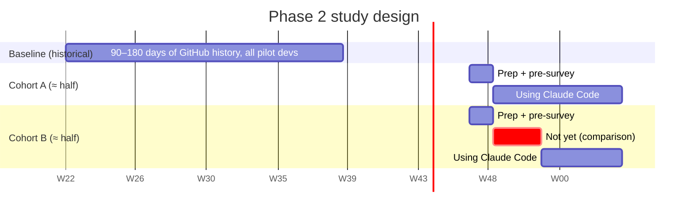

# Productivity and quality measurement framework

[🏠 Home](../../README.md) › Productivity & quality › Measurement framework

This page sets out how Phase 2 measures whether Claude Code makes 15–20 developers more productive **without hurting quality**. The design, the metrics, and the analysis are fixed before the pilot starts. That's what makes the results credible to skeptical readers.

> [!IMPORTANT]
> **Pre-register.** Before the pilot starts, freeze this document at version 1.0: the metrics, data sources, and analysis plan. Any later change goes in an ADR with the reason. Results that weren't pre-registered are reported as "exploratory".

## Contents
- [Questions we answer](#questions-we-answer)
- [Study design](#study-design)
- [Repo capability tier](#repo-capability-tier)
- [Metrics](#metrics)
- [Attribution](#attribution)
- [Data sources and pipeline](#data-sources-and-pipeline)
- [Analysis plan](#analysis-plan)
- [Threats to validity](#threats-to-validity)
- [Privacy and ethics](#privacy-and-ethics)
- [Reporting](#reporting)

## Questions we answer

| # | Question | Primary evidence |
|---|---|---|
| Q1 | Do developers deliver changes **faster**? | PR cycle time, benchmark task time |
| Q2 | Do developers deliver **more**? | Merged PRs per developer-week |
| Q3 | Does **quality** hold? | Revert rate, follow-up fixes, CI pass rate, review rework, static-analysis alerts |
| Q4 | What does it **feel** like? | Surveys, pulse, interviews |
| Q5 | **Where** does it help most? | Task-type breakdown, power-user patterns, benchmark by task type |
| Q6 | What does it **cost** per unit of value? | Cost per merged PR, ROI ([cost model](../05-cost/cost-model.md#roi-calculation)) |

## Study design

**Staggered cohort rollout with baseline**, a lightweight stepped-wedge design:



| Element | Design |
|---|---|
| **Participants** | 15–20 developers, chosen by engineering managers for a mix of seniority, language stack, repo capability tier, and enthusiasm. **Avoid only picking enthusiasts.** All participants work on VDIs ([ADR-018](../../logs/decision-log.md#adr-018)). |
| **Cohort assignment** | Stratified random: pair developers by seniority, team, and [repo capability tier](#repo-capability-tier), then randomly assign one of each pair to A and the other to B. Record the assignment in the pilot roster (secure). |
| **Comparison window** | Weeks 1–3: cohort A uses Claude Code, cohort B doesn't yet. This gives a **concurrent comparison** that controls for seasonality, release cycles, and org events. |
| **Within-person baseline** | Each developer's own 90–180 days of pre-pilot history in their repo. This controls for individual and repo differences. |
| **Duration** | 8 weeks of use for cohort A, 5 weeks for B. Optionally extend B to 8 weeks for symmetric adoption data. |
| **Ramp-up** | Weeks 1–2 of use are treated as a **learning period** and reported separately |
| **Benchmark tasks** | All participants do the [benchmark set](benchmark-tasks.md) in counterbalanced with/without order |

> [!NOTE]
> Each developer works in **one** repository, so the repo and the developer are confounded. The within-person baseline handles that. It also means the per-repo metrics below are effectively per-developer.

## Repo capability tier

What Claude can do depends on the repo. Windows-only .NET and VB.NET projects can't build or run in the Linux container ([ADR-017](../../logs/decision-log.md#adr-017)), so each pilot repo gets a tier at onboarding ([ENV-019](../03-test-plan/catalog/env.md#env-019)):

| Tier | Which repos | What Claude can do in the container |
|---|---|---|
| **Full** | Python, Java, and modern .NET (`net8.0` etc., C# or VB) | Edit, build, run tests |
| **Compile-check** | SDK-style projects targeting `net4x` or `-windows` (WinForms/WPF) | Edit and compile. Tests run on Windows. |
| **Edit-only** | Old-style .NET Framework projects, WebForms, WCF | Edit only. The developer builds and tests in Visual Studio. |

How the tier is used:

- **Covariate.** Record the tier in the roster and include it in every per-developer analysis.
- **Balance.** Stratify the cohort assignment by tier, so cohort A and B have a similar mix. An imbalance would bias the A-vs-B comparison.
- **Report separately.** Report compile-check and edit-only repos as their own group alongside the pooled result. They're expected to show smaller gains, because Claude can't verify its own work there ([R-28](../../logs/risk-register.md#r-28)).
- **Classification.** In the developer's first session, Claude scans the `.csproj`/`.vbproj` files for `TargetFramework`, `UseWPF`, `UseWindowsForms`, and old-style `ToolsVersion`. The evaluation lead confirms the result.

## Metrics

### Throughput and flow (Q1, Q2)

| Metric | Definition | Source | Direction |
|---|---|---|---|
| **PR cycle time** | `merged_at − created_at`, median per developer-week | GitHub API | ↓ better |
| Time to first review | `first_review_at − created_at` | GitHub API | (context: reviewer behavior) |
| Coding time | `created_at − first_commit_at` on the PR branch | GitHub API | ↓ better |
| **Merged PRs per developer-week** | Count of merged PRs authored | GitHub API | ↑ better |
| PR size | Median lines changed (additions + deletions), excluding lockfiles and generated code | GitHub API | Context. Smaller is usually healthier. |
| Commits per developer-week | Count | GitHub API | Context only |

### Quality guardrails (Q3)

| Metric | Definition | Source | Direction |
|---|---|---|---|
| **Revert rate** | Share of merged PRs later reverted (revert-PR referencing the original, or `Revert "…"` commits) within 30 days | GitHub API | ↓ better |
| **Follow-up fix rate** | Share of merged PRs followed within 14 days by a PR touching the same files and labelled `bug`/`fix` (or with "fix" in the title) | GitHub API | ↓ better |
| **First-run CI pass rate** | Share of PRs whose first check-suite run succeeds | GitHub Checks API | ↑ better |
| **Review rework rounds** | Number of "changes requested" reviews per PR | GitHub API | ↓ better |
| Review comment density | Review comments per 100 changed lines | GitHub API | Context |
| **Static-analysis alerts introduced** | New CodeQL / SonarQube alerts attributable to the PR | Code scanning API / Sonar | ↓ better |
| Test coverage delta | Coverage change on the PR's changed lines | CI coverage reports | ↑ better |
| Change failure rate (DORA) | Share of deployments causing an incident or rollback | Deploy/incident system (if it exists) | ↓ better |

### Usage and engagement (context for Q1–Q5)

From OTel ([telemetry reference](../03-test-plan/catalog/telemetry.md#expected-signals-reference)):

| Metric | Use |
|---|---|
| Active days per developer-week | Adoption. Dose-response analysis. |
| Sessions per day; active time (`user` vs. `cli`) | Engagement pattern |
| Lines added/removed via Claude | Volume (never a success metric alone) |
| Edit accept rate (`code_edit_tool.decision`) | Trust and quality signal |
| Commits and PRs via Claude (`commit.count`, `pull_request.count`) | Attribution cross-check |
| Cost per developer-day | Cost side of ROI |
| Model and effort mix | Behavior. Informs cost guidance. |

### Developer experience (Q4)

From [surveys.md](surveys.md): satisfaction, perceived productivity, flow, cognitive load, friction from security controls, self-reported time saved, the tasks it helped or hurt, and trust in output.

## Attribution

Without claude.ai there are no built-in contribution metrics. Attribution comes from three sources:

| Signal | How | Reliability |
|---|---|---|
| **Commit trailer** | The managed `attribution.commit` setting adds a fixed `Co-Authored-By: Claude Code <noreply@anthropic.com>` trailer to commits Claude makes ([FEAT-015](../03-test-plan/catalog/features.md#feat-015)) | High for commits Claude made. Misses code Claude wrote that the developer committed themselves. |
| **PR template checkbox** | A required section in the PR template: `Claude Code assistance: ☐ None ☐ Some ☐ Most` | Self-reported, but covers all usage |
| **OTel per-developer activity** | Sessions and lines on the days the PR was worked on | Corroborating |

A PR counts as **assisted** if any of these hold: it has a commit with the trailer, the checkbox is Some or Most, or the developer had a Claude session touching the PR branch [verify feasibility]. Report the analysis for **all PRs by pilot developers** (intent-to-treat) **and** for assisted vs. unassisted PRs (per-protocol).

**PR template snippet** (add it to each pilot repo's `.github/pull_request_template.md`):

```markdown
### Claude Code assistance
<!-- Pick one. This is for the evaluation, not a judgment. -->
- [ ] None
- [ ] Some (helped with parts: tests, refactoring, explanations)
- [ ] Most (Claude wrote most of the change; I reviewed and adjusted)
```

## Data sources and pipeline

| Data | Pulled by | How | Frequency | Stored |
|---|---|---|---|---|
| PRs, reviews, commits, checks | Evaluation lead (org-read token, **never** in dev containers) | [github-metrics-queries.md](github-metrics-queries.md) | Weekly + baseline once | Secure analysis store |
| Code scanning alerts | Evaluation lead | Code scanning API | Weekly | Secure store |
| OTel metrics | Collector backend | Export or query | Weekly | Backend + extract |
| Gateway per-user spend *(gateway stage)* | Evaluation lead (gateway admin read key) | `GET /v1/organizations/spend_limits/effective` ([cost model](../05-cost/cost-model.md#per-user-spend-caps-gateway-stage)) | Weekly | Secure store |
| Azure cost | Evaluation lead | Cost Management export | Weekly | Secure store |
| Surveys | Survey tool | Export | Pre / mid / post / weekly pulse | Survey tool + extract |
| Benchmark results | Evaluation lead | Recorded per [benchmark-tasks.md](benchmark-tasks.md) | Week 0 and week 6 | Secure store |

The repo holds only **aggregated, pseudonymized** results (`<dev-01>`… or cohort-level), never raw per-person data.

**Who each telemetry record belongs to.** In the gateway stage, the gateway stamps each developer's identity on the telemetry it relays ([TEL-013](../03-test-plan/catalog/telemetry.md#tel-013)), and the lead maps it to the pseudonym. In the direct-Foundry stage, Claude Code has no user email on Foundry. The container launcher sets `OTEL_RESOURCE_ATTRIBUTES` per developer at start (for example `dev.alias=<dev-01>,team.id=<team>,cohort=A,tier=full`), and the managed policy leaves that variable unset so the per-user value isn't overridden [verify] ([TEL-006](../03-test-plan/catalog/telemetry.md#tel-006)).

## Analysis plan

| Question | Primary comparison | Method | Report as |
|---|---|---|---|
| Q1 cycle time | (a) Cohort A vs. B in weeks 1–3. (b) Each dev's pilot period vs. their baseline. | Median and IQR. Difference-in-differences for (a)+(b). Bootstrap 90% CI. | % change with CI |
| Q2 throughput | Same as Q1 | Mean per developer-week. Difference-in-differences. | % change with CI |
| Q3 quality | Pilot vs. baseline for each guardrail | Rate comparison. Flag if the CI excludes the guardrail threshold. | Held / breached |
| Q4 experience | Pre vs. post (paired) | Mean change. Distribution plots. Thematic coding of comments. | Scores + themes |
| Q5 where it helps | Benchmark by task type. Assisted vs. unassisted PRs by type. | Descriptive | Ranked list |
| Dose-response | Active days vs. cycle-time change, per developer | Scatter + rank correlation | Exploratory |
| By tier | Q1 and Q2 split by [repo capability tier](#repo-capability-tier) | Descriptive. Tier as a covariate in the pooled model. | Effect per tier, with CI where the group allows |

> [!WARNING]
> **Small samples.** With 15–20 developers, many effects won't be statistically significant even if they're real. Report effect sizes with confidence intervals and be honest about uncertainty. Don't claim "no effect" when the CI is wide, and don't claim "40% faster" from a point estimate.

## Threats to validity

| Threat | Mitigation |
|---|---|
| **Novelty effect / Hawthorne** | Treat weeks 1–2 as ramp-up. Look at the trend over weeks 3–8. |
| **Selection bias** (enthusiasts) | Stratified random cohorts. Report participant characteristics. |
| **Goodhart's law** (gaming PR counts) | Don't publish per-person leaderboards during the pilot. Tell participants that quality guardrails are measured. |
| **Lines of code ≠ value** | Never use LOC as a success metric. Context only. |
| **Seasonality / release cycles** | Concurrent cohort comparison (weeks 1–3) |
| **Contamination** (cohort B uses A's outputs or advice) | Accept and note it. It's realistic. |
| **Repo/developer confounding** | Within-person baseline |
| **Tier imbalance** (compile-check and edit-only repos can't build or test in the container) | Stratify cohorts by tier. Tier as a covariate. Report those repos separately ([R-28](../../logs/risk-register.md#r-28)). |
| **Friction from security controls depresses results** | Measure friction explicitly. Report what the controls cost in productivity. |
| **Measurement changes mid-pilot** | Freeze definitions (pre-registration) |

## Privacy and ethics

- Participants are told **exactly** what's measured, why, and who sees it. This goes in the [AUP](../07-phase2-pilot/acceptable-use-policy.md) acknowledgement.
- Individual-level data is used only for aggregate analysis and is **never** used for performance evaluation. Confirm this with HR and management in writing.
- Pseudonymize in all shared outputs.
- Telemetry content logging stays off ([DATA-004](../03-test-plan/catalog/data.md#data-004)).
- Participants can withdraw. Their data is then excluded from analysis.

## Reporting

The [Phase 2 report](../../reports/phase2-pilot-report.md) shows, for each question: the headline (effect + CI), a chart (cohort A vs. B over time; per-dev change vs. baseline), the quality guardrail status, and a short interpretation, with caveats stated up front.

## Related
- [GitHub metrics queries](github-metrics-queries.md) · [Benchmark tasks](benchmark-tasks.md) · [Surveys](surveys.md)
- [Cost model](../05-cost/cost-model.md) · [Success criteria](../00-charter/success-criteria.md#productivity-criteria)
