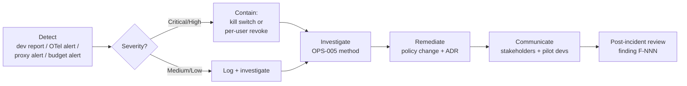

# Phase 2 pilot runbook

[🏠 Home](../../README.md) › Phase 2 pilot › Pilot runbook

This is the week-by-week operating plan for the 15–20 developer pilot: who does what, when, the recurring rituals, and what to do when something goes wrong. Every pilot developer works on an isolated VDI, as in Phase 1 ([ADR-018](../../logs/decision-log.md#adr-018)).

## Contents
- [Entry criteria](#entry-criteria)
- [Roster](#roster)
- [Onboarding checklist (per developer)](#onboarding-checklist-per-developer)
- [Week-by-week plan](#week-by-week-plan)
- [Recurring rituals](#recurring-rituals)
- [Support model](#support-model)
- [Incident handling](#incident-handling)
- [Kill switch](#kill-switch)
- [Runaway response](#runaway-response)
- [Optional PC track (evaluation lead)](#optional-pc-track-evaluation-lead)
- [Offboarding and close-out](#offboarding-and-close-out)

## Entry criteria

Don't onboard anyone until **all** of these are true:

- [ ] Gate **G1** passed ([success criteria](../00-charter/success-criteria.md#gate-g1-phase-1-go--no-go)), and the Phase 1 report is signed
- [ ] Measurement framework frozen at v1.0 (pre-registered)
- [ ] Baseline GitHub data pulled for every pilot repo
- [ ] PR template with the Claude checkbox merged in every pilot repo
- [ ] Secret scanning and push protection on for every pilot repo
- [ ] Rulesets (main protected, PR + review required) on every pilot repo
- [ ] OTel dashboards live ([TEL-012](../03-test-plan/catalog/telemetry.md#tel-012))
- [ ] Azure budget and alerts configured ([COST-006](../03-test-plan/catalog/cost.md#cost-006))
- [ ] Foundry TPM quotas sized for 20 users ([COST-007](../03-test-plan/catalog/cost.md#cost-007))
- [ ] If the gateway is accepted ([ADR-013](../../logs/decision-log.md#adr-013)): gateway live, per-user caps set ([COST-013](../03-test-plan/catalog/cost.md#cost-013)), notification job running ([COST-014](../03-test-plan/catalog/cost.md#cost-014)), runaway automation tested ([COST-015](../03-test-plan/catalog/cost.md#cost-015))
- [ ] Every pilot repo classified by capability tier ([ENV-019](../03-test-plan/catalog/env.md#env-019)). Windows-only repos have the shared-folder setup working ([ENV-020](../03-test-plan/catalog/env.md#env-020)).
- [ ] Nexus serves every pilot repo's packages ([ENV-017](../03-test-plan/catalog/env.md#env-017)), and VS Code attaches offline with the needed extensions ([ENV-018](../03-test-plan/catalog/env.md#env-018))
- [ ] Support channel created and support runbook written ([OPS-006](../03-test-plan/catalog/operations.md#ops-006))
- [ ] AUP approved. Cohorts assigned.

## Roster

Keep the real roster in the secure store. Here, use pseudonyms only.

| Dev ID | Cohort | Team | Seniority | Stack | Tier | Repo | Start | Onboarded | AUP signed | Pre-survey | Status |
|---|---|---|---|---|---|---|---|---|---|---|---|
| `<dev-01>` | A | `<team>` | Senior | Python | Full | `<repo>` | W1 | ☐ | ☐ | ☐ | |
| `<dev-02>` | B | `<team>` | Senior | C# (.NET Framework) | Edit-only | `<repo>` | W4 | ☐ | ☐ | ☐ | |

**Tier** is the repo's capability tier: full, compile-check, or edit-only ([measurement framework](../06-productivity-quality/measurement-framework.md#repo-capability-tier)). Balance tiers across the cohorts.

## Onboarding checklist (per developer)

- [ ] AUP acknowledged
- [ ] In the pilot Entra group, with BeyondTrust access to their VDI
- [ ] Container opens, and `/status` shows the managed settings
- [ ] Signed in: through the gateway with `/login`, with the account shown in `/status` (gateway stage), or `az login --use-device-code` (direct stage)
- [ ] *(Gateway stage)* The developer appears in `/effective` with the expected caps after their first request
- [ ] Tier confirmed. In the first session, ask Claude: "Scan the `.csproj` and `.vbproj` files and tell me which projects can build and test here, which can only compile, and which need Windows." The lead records the tier.
- [ ] Windows-only repos: the repo is in `C:\Dev\<repo>`, Visual Studio builds it, and the developer knows to review build-file and package changes before building
- [ ] PR template with the Claude checkbox is in their repo
- [ ] Pre-survey done

## Week-by-week plan

| Week | Cohort A | Cohort B | Evaluation lead |
|---|---|---|---|
| **Prep −2** | Briefing. AUP. Pre-survey. | Briefing. AUP. Pre-survey. | Baseline pull. Dashboards. Support channel. Repo tiers classified. Cohorts assigned. Caps set. |
| **Prep −1** | Benchmark tasks (without Claude) | Benchmark tasks (without Claude) | Score the benchmarks. Training dry-run. |
| **W1** | 🎓 Training (90 min). Onboarding. First sessions. | Business as usual | Daily check of the support channel. Daily look at per-user spend and runaway alerts. |
| **W2** | Ramp-up. Office hours ×2. | BAU | First weekly cost review. Pulse #1. |
| **W3** | Normal use | BAU | Weekly review. Pulse. **Comparison window ends.** |
| **W4** | Normal use. **Mid-survey.** | 🎓 Training. Onboarding. **Mid-survey (control framing).** | Gate **G2** check before B starts |
| **W5** | Normal use | Ramp-up. Office hours. | Weekly review. Pulse. |
| **W6** | Benchmark tasks (with/without, counterbalanced) | Normal use | Score the benchmarks |
| **W7** | Normal use | Normal use | Weekly review. Pulse. Schedule exit interviews. |
| **W8** | **Post-survey.** Exit interviews. | **Post-survey.** Exit interviews. | Final data pull. Start analysis. |
| **W9** | — (continue or pause per decision) | — | Phase 2 report. Executive summary. |

## Recurring rituals

| Ritual | When | Who | Output |
|---|---|---|---|
| Daily triage | Every morning, 15 min | Evaluation lead | Support tickets answered. Anomalies noted in the journal. |
| Weekly cost review | Monday | Evaluation lead (+ Finance monthly) | [Cost review](../05-cost/cost-model.md#weekly-cost-review) |
| Weekly status | Friday | Evaluation lead → stakeholders | [weekly-status.md](../../templates/weekly-status.md) |
| Office hours | Tue & Thu, 30 min, weeks 1–2 of each cohort | Evaluation lead + a power user | Tips captured in the training notes |
| Show & tell | Biweekly, 30 min | Volunteers | Use-case library for the report |
| Security review | Weekly | Security + evaluation lead | Review of OTel `permission_mode_changed`, denied actions, egress blocks, and (gateway stage) `spend.blocked` events and zero caps |

## Support model

| Tier | Who | Handles | SLA |
|---|---|---|---|
| 0 | [Developer quick-start](developer-quickstart.md) + troubleshooting page | Self-service | — |
| 1 | `#claude-code-pilot` channel. Evaluation lead. | Usage questions, auth issues, blocked commands | «4 business hours» |
| 2 | Platform (VDI/engine), Azure admin, GitHub admin | Environment and identity problems | «1 business day» |
| 3 | Vendor support (Microsoft / Anthropic) | Product bugs | Per contract |

Every ticket goes into the [issue log](../../logs/issue-log.md) with a category. Recurring "a control blocked me" tickets feed the permission allowlist tuning, via ADRs.

## Incident handling

An **incident** is any of these: suspected credential exposure, a policy bypass, unexpected egress, destructive agent action on shared resources, sensitive data sent to the model against the AUP, a cost spike over «3×» the forecast, or a runaway the automation had to stop that turns out not to be legitimate.

| Step | Action | Owner |
|---|---|---|
| Contain | Per-user: a zero cap (gateway stage, immediate), then remove from the Entra group and revoke the GitHub token. All users: [kill switch](#kill-switch). | Evaluation lead / Azure admin |
| Preserve | Snapshot the `~/.claude` volume (transcripts), OTel extract, audit log, proxy logs | Evaluation lead |
| Investigate | Reconstruct the timeline ([OPS-005](../03-test-plan/catalog/operations.md#ops-005) method) | Evaluation lead + Security |
| Remediate | Policy change → retest → roll out ([change control](../02-security-baseline/managed-settings.md#change-control)) | Evaluation lead |
| Record | Finding in the issue log. Evidence. Lessons in the report. | Evaluation lead |

## Kill switch

| Scope | Action | Expected effect time |
|---|---|---|
| **One developer, immediately** *(gateway stage)* | Set a zero spend cap for the developer through the gateway admin API ([cost model](../05-cost/cost-model.md#runaway-detection-and-automatic-shutoff-gateway-stage)) | Their next request ([COST-015](../03-test-plan/catalog/cost.md#cost-015)) |
| **One developer** | Remove from `grp-claude-code-pilot`. Revoke their GitHub token. | « ≤ 15 min » for new sign-ins. A gateway session ends when its refresh fails, within `ttl_hours` (1 h). A direct-stage Azure token lasts until it expires. ([IDN-011](../03-test-plan/catalog/identity.md#idn-011)) |
| **Everyone, immediately** *(gateway stage)* | Scale the gateway to zero replicas (or block it at the internal firewall). An org-wide zero cap is **not** enough on its own: it only reaches developers with no user or group cap of their own, because per-user and group caps take precedence | The next request from anyone |
| **Everyone** | Remove the role assignment (the gateway's managed identity in the gateway stage, the developer group in the direct stage), **or** disable/delete the Foundry deployments | « ≤ 15 min » ([OPS-003](../03-test-plan/catalog/operations.md#ops-003)) |
| **Everyone, immediately** | Firewall: block the gateway or the Foundry private endpoint at the internal firewall | Minutes |

## Runaway response

The automation stops the spend. The lead decides what happens next ([cost model](../05-cost/cost-model.md#runaway-detection-and-automatic-shutoff-gateway-stage)).

1. **Automation** (no human needed): a detection rule fires, the automation sets a zero cap for the developer, emails them and the evaluation lead, and opens an issue-log entry.
2. **Look.** Use the session IDs in the alert to check the OTel cost and sessions, the gateway audit events, and (with the developer) what was running.
3. **Talk to the developer.** Was it legitimate, long-running work, or agents left running unattended?
4. **Restore or hold.** Legitimate: delete the zero cap and, if needed, give a temporary per-user override, logged in the decision log. Not legitimate: keep the block and follow [incident handling](#incident-handling).
5. **Record** the timeline (alert time, block time, restore time) in the issue log and the tracker. Tune the thresholds if it was a false positive.

## Optional PC track (evaluation lead)

Everyone else stays on VDIs. The evaluation lead may move to a local PC during Phase 2, to gather early evidence for the production target ([ADR-018](../../logs/decision-log.md#adr-018)).

- Use a **standard (non-admin) Windows account** for every test. With local admin rights, the tamper tests prove nothing on that machine.
- Check the PC prerequisites first ([ENV-022](../03-test-plan/catalog/env.md#env-022)).
- Run the portable P0 tests there: [NET-014](../03-test-plan/catalog/network.md#net-014) (the container firewall with the host on the internet), [NET-015](../03-test-plan/catalog/network.md#net-015) (off the VPN), and [ENV-021](../03-test-plan/catalog/env.md#env-021) (Guardicore).
- Record those results separately, as the PC track, in the tracker and the Phase 2 report.

## Offboarding and close-out

At the end of the pilot, either **continue** (if the adoption decision allows) or **close**:

- [ ] Final surveys and interviews done
- [ ] Final data pull done
- [ ] Per developer: run the [offboarding checklist](../03-test-plan/catalog/operations.md#ops-004) (or keep access, if continuing)
- [ ] *(Gateway stage)* Delete each developer's per-user caps. Spend and identity rows age out on the gateway's retention windows. For an immediate erasure request, delete the developer's `principal_emails` row ([spend limits docs](https://code.claude.com/docs/en/claude-apps-gateway-spend-limits)).
- [ ] Delete `~/.claude` volumes, unless retained by decision
- [ ] Revoke the evaluator's org-read token
- [ ] Archive the evidence store and set retention ([OPS-009](../03-test-plan/catalog/operations.md#ops-009))
- [ ] Thank-you note to participants, with a summary of findings

## Related
- [Developer quick-start](developer-quickstart.md) · [AUP](acceptable-use-policy.md) · [Training agenda](training-agenda.md)
- [Measurement framework](../06-productivity-quality/measurement-framework.md) · [Cost model](../05-cost/cost-model.md)
