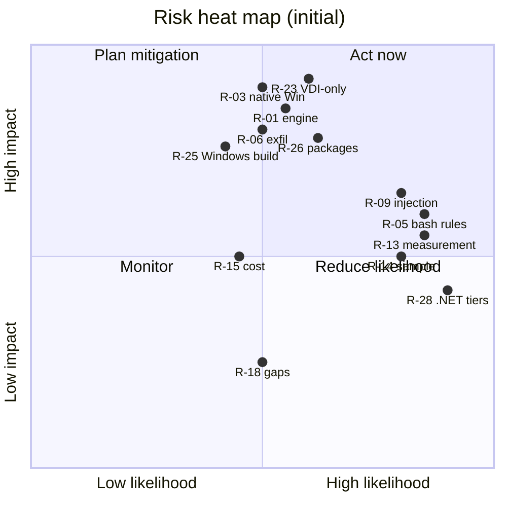

# Risk register

[🏠 Home](../README.md) › Logs › Risk register

These are the known risks to the security, cost, and validity of the evaluation, each with a mitigation and the tests that measure it. Review weekly. Update the status as tests complete.

**Scoring:** Likelihood (L) and Impact (I) on a 1–3 scale. **Score = L × I.** 🔴 6–9 · 🟡 3–4 · 🟢 1–2.

## Register

| ID | Risk | L | I | Score | Mitigation / control | Tests | Owner | Status |
|---|---|---|---|---|---|---|---|---|
| **R-01** | Docker access (`docker-users`) lets developers run unmanaged or privileged containers, or mount host paths, and so bypass every in-container control | 2 | 3 | 🔴 6 | Docker Desktop Business locked settings (ADR-005): Enhanced Container Isolation, file sharing limited to the policy folder, Image/Registry Access Management. Detect sessions without policy. VDI EDR monitoring. | [ENV-003](../docs/03-test-plan/catalog/env.md#env-003), [ENV-010](../docs/03-test-plan/catalog/env.md#env-010), [ENV-011](../docs/03-test-plan/catalog/env.md#env-011) | Platform | Open |
| **R-02** | The VDI lacks nested virtualization for Hyper-V, or performs poorly with Hyper-V + Docker Desktop | 2 | 3 | 🔴 6 | Check early. Fallbacks: Hyper-V Linux VMs on central hosts (Remote-SSH), a Linux VDI, or a cloud dev box. | [ENV-001](../docs/03-test-plan/catalog/env.md#env-001), [ENV-013](../docs/03-test-plan/catalog/env.md#env-013) | Platform | Open |
| **R-03** | A native Windows install runs with no sandbox | 2 | 3 | 🔴 6 | Claude Code never runs natively ([ADR-017](decision-log.md#adr-017)). AppLocker/Intune block on VDIs now and on PCs later. Windows backstop managed settings. | [ENV-007](../docs/03-test-plan/catalog/env.md#env-007), [ENV-008](../docs/03-test-plan/catalog/env.md#env-008), [ENV-022](../docs/03-test-plan/catalog/env.md#env-022) | Platform | Open |
| **R-04** | Policy tampering: managed settings put somewhere developers can edit | 2 | 3 | 🔴 6 | Read-only bind mount from an admin-owned path. Non-root user. Never in the repo's devcontainer. | [POL-001](../docs/03-test-plan/catalog/policy.md#pol-001), [POL-002](../docs/03-test-plan/catalog/policy.md#pol-002), [ENV-004](../docs/03-test-plan/catalog/env.md#env-004) | Eval lead | Open |
| **R-05** | Bash permission rules can be bypassed (the docs say they aren't a security boundary) | 3 | 2 | 🔴 6 | Sandbox + firewall are the boundary. Rules are speed bumps only. | [PERM-005](../docs/03-test-plan/catalog/permissions.md#perm-005), [SBX-005](../docs/03-test-plan/catalog/sandbox.md#sbx-005) | Eval lead | Open |
| **R-06** | Exfiltration through allowlisted domains (github.com, the package mirror) | 2 | 3 | 🔴 6 | Single-repo token. Gist/repo-create denied. Secret scanning + push protection. Narrow allowlist. Proxy inspection. | [NET-009](../docs/03-test-plan/catalog/network.md#net-009), [IDN-006](../docs/03-test-plan/catalog/identity.md#idn-006), [NET-002](../docs/03-test-plan/catalog/network.md#net-002) | Eval lead | Open |
| **R-07** | The Foundry hosting option may route inference to Anthropic infrastructure, which affects data residency and terms | 2 | 3 | 🔴 6 | An explicit hosting decision: recommend Hosted on Azure with US Data Zone ([ADR-009](decision-log.md#adr-009)). Fable models are Anthropic-hosted only, so they're out of scope unless approved. Contract review. | [DATA-001](../docs/03-test-plan/catalog/data.md#data-001), [DATA-002](../docs/03-test-plan/catalog/data.md#data-002) | Security / Legal | Open |
| **R-08** | Credential theft inside the container (Entra token cache, GitHub token, Foundry key in env) | 2 | 3 | 🔴 6 | Read deny + sandbox denyRead + masking. API keys disabled on the resource ([ADR-006](decision-log.md#adr-006), `disableLocalAuth`). In the gateway stage, the container holds no Azure token at all ([ADR-013](decision-log.md#adr-013)). Env scrubbing [verify]. | [IDN-008](../docs/03-test-plan/catalog/identity.md#idn-008), [SBX-004](../docs/03-test-plan/catalog/sandbox.md#sbx-004), [IDN-002](../docs/03-test-plan/catalog/identity.md#idn-002), [IDN-014](../docs/03-test-plan/catalog/identity.md#idn-014) | Eval lead | Open |
| **R-09** | Prompt injection via repo content, dependencies, issues, or web pages | 3 | 2 | 🔴 6 | Assume it succeeds and contain it: firewall, sandbox, deny rules, review. AUP. Training. | [DATA-005](../docs/03-test-plan/catalog/data.md#data-005), [DATA-011](../docs/03-test-plan/catalog/data.md#data-011) | Eval lead | Open |
| **R-10** | Unpinned model defaults lead to failures or an unexpected model (on Foundry, `opus` defaults to an older model) | 2 | 2 | 🟡 4 | Pin `ANTHROPIC_DEFAULT_*_MODEL`. `availableModels`. Name deployments with model IDs or use `modelOverrides`. | [POL-011](../docs/03-test-plan/catalog/policy.md#pol-011), [NET-004](../docs/03-test-plan/catalog/network.md#net-004), [COST-011](../docs/03-test-plan/catalog/cost.md#cost-011) | Eval lead | Open |
| **R-11** | Docker Desktop Business licensing cost (needed for locked settings and ECI) | 3 | 1 | 🟡 3 | Cost included in the TCO. Alternatives recorded in ADR-005. | [ENV-002](../docs/03-test-plan/catalog/env.md#env-002) | Platform | Open |
| **R-12** | Privacy and employee-monitoring concerns about telemetry | 2 | 2 | 🟡 4 | Content logging off. Transparent AUP. HR sign-off. Pseudonymized reports. | [DATA-004](../docs/03-test-plan/catalog/data.md#data-004), [TEL-008](../docs/03-test-plan/catalog/telemetry.md#tel-008) | Eval lead / HR | Open |
| **R-13** | No Anthropic analytics on Foundry, so measurement depends on a self-built OTel + GitHub + Azure pipeline | 3 | 2 | 🔴 6 | Prove the pipeline in Phase 1. Reconcile weekly. The gateway ([ADR-013](decision-log.md#adr-013)) adds identity-stamped telemetry and per-user spend records. | [TEL-001](../docs/03-test-plan/catalog/telemetry.md#tel-001)–[TEL-004](../docs/03-test-plan/catalog/telemetry.md#tel-004), [COST-001](../docs/03-test-plan/catalog/cost.md#cost-001), [TEL-013](../docs/03-test-plan/catalog/telemetry.md#tel-013) | Eval lead | Open |
| **R-14** | The small sample (15–20) makes productivity results inconclusive | 3 | 2 | 🔴 6 | Staggered cohorts. Within-person baseline. Benchmarks. Report effect sizes with CIs. | — (analysis design) | Eval lead | Open |
| **R-15** | Cost overrun from runaway sessions, heavy Opus use, or large contexts | 2 | 2 | 🟡 4 | Per-user caps and threshold emails through the gateway. Runaway detection that sets a zero cap ([CTL-28](../docs/02-security-baseline/defense-in-depth.md#ctl-28)). Client limits on concurrent agents. Budgets/alerts. TPM quotas. Model guidance. Outlier review. `--max-budget-usd` for automation. | [COST-005](../docs/03-test-plan/catalog/cost.md#cost-005)–[COST-007](../docs/03-test-plan/catalog/cost.md#cost-007), [COST-013](../docs/03-test-plan/catalog/cost.md#cost-013), [COST-015](../docs/03-test-plan/catalog/cost.md#cost-015), [COST-016](../docs/03-test-plan/catalog/cost.md#cost-016) | Eval lead / Finance | Open |
| **R-16** | The sandbox inside Docker needs the weaker nested mode | 2 | 2 | 🟡 4 | Try with Enhanced Container Isolation (Sysbox supports nested user namespaces) and container security options first. Firewall as a compensating control. | [ENV-006](../docs/03-test-plan/catalog/env.md#env-006), [SBX-001](../docs/03-test-plan/catalog/sandbox.md#sbx-001) | Eval lead | Open |
| **R-17** | The agent makes harmful changes (destructive git operations, CI workflow edits, deleting files) | 2 | 2 | 🟡 4 | Rulesets. Ask rules. Edit deny on CI. Checkpoints. Review. No bypass mode. | [IDN-007](../docs/03-test-plan/catalog/identity.md#idn-007), [PERM-003](../docs/03-test-plan/catalog/permissions.md#perm-003), [PERM-001](../docs/03-test-plan/catalog/permissions.md#perm-001) | Eval lead | Open |
| **R-18** | Foundry feature gaps (no analytics, fast mode, or claude.ai surfaces) reduce value compared with Anthropic-direct. WebSearch and WebFetch are off by decision ([ADR-016](decision-log.md#adr-016)), and the gateway has no 1-hour cache TTL. | 2 | 1 | 🟢 2 | Document the gaps in the inventory. Weigh them in the recommendation. | [NET-007](../docs/03-test-plan/catalog/network.md#net-007), [SURF-008](../docs/03-test-plan/catalog/surfaces.md#surf-008) | Eval lead | Open |
| **R-19** | Version drift or regressions from frequent Claude Code releases | 2 | 2 | 🟡 4 | Pin the version. Deliberate upgrades with P0 retests. | [ENV-005](../docs/03-test-plan/catalog/env.md#env-005), [OPS-001](../docs/03-test-plan/catalog/operations.md#ops-001) | Eval lead | Open |
| **R-20** | Supply chain: Claude Code, MCP servers, or packages installed from public registries | 2 | 3 | 🔴 6 | Install at image-build time only, from Nexus ([ADR-014](decision-log.md#adr-014)). Packages through Nexus ([ADR-015](decision-log.md#adr-015)). MCP and plugins blocked. | [NET-010](../docs/03-test-plan/catalog/network.md#net-010), [EXT-001](../docs/03-test-plan/catalog/extensions.md#ext-001), [EXT-003](../docs/03-test-plan/catalog/extensions.md#ext-003), [ENV-016](../docs/03-test-plan/catalog/env.md#env-016) | Eval lead | Open |
| **R-21** | Managed hook lockdown may not cover hooks declared in skill or subagent frontmatter | 2 | 2 | 🟡 4 | Test explicitly. Fall back to `strictPluginOnlyCustomization` or block project skills. | [EXT-005](../docs/03-test-plan/catalog/extensions.md#ext-005) | Eval lead | Open |
| **R-22** | User-level `excludedCommands` or `autoMode` rules may still apply under managed policy | 2 | 2 | 🟡 4 | Test explicitly. Report it to the vendor if confirmed. | [SBX-008](../docs/03-test-plan/catalog/sandbox.md#sbx-008), [POL-016](../docs/03-test-plan/catalog/policy.md#pol-016) | Eval lead | Open |
| **R-23** | Controls look effective only because of the VDI's isolation and don't hold on users' PCs ([ADR-018](decision-log.md#adr-018)) | 2 | 3 | 🔴 6 | Tag every control Portable or VDI-only. Re-run the portable P0 network tests on an internet-connected host. PC track for the evaluation lead. Guardicore on PCs. | [NET-014](../docs/03-test-plan/catalog/network.md#net-014), [ENV-022](../docs/03-test-plan/catalog/env.md#env-022), [ENV-021](../docs/03-test-plan/catalog/env.md#env-021) | Eval lead / Platform | Open |
| **R-24** | The gateway holds the Foundry credential and pushes settings, including hooks, to every developer, so it's a high-value target | 1 | 3 | 🟡 3 | Private network only, hardened Linux host, change control on `gateway.yaml`, managed identity (no stored key), audit events to the SIEM, fail-closed enforcement, a published TLS fingerprint, and approval dialogs for shell-capable settings. | [OPS-011](../docs/03-test-plan/catalog/operations.md#ops-011), [IDN-015](../docs/03-test-plan/catalog/identity.md#idn-015), [TEL-014](../docs/03-test-plan/catalog/telemetry.md#tel-014) | Platform / Security | Open |
| **R-25** | Agent-written build files run on the Windows host when developers build compile-check or edit-only repos | 2 | 3 | 🔴 6 | Ask rules on build files and registry configs ([CTL-29](../docs/02-security-baseline/defense-in-depth.md#ctl-29)). A review step before building (AUP, training). Only `C:\Dev` is shared. Windows EDR. | [PERM-019](../docs/03-test-plan/catalog/permissions.md#perm-019), [ENV-020](../docs/03-test-plan/catalog/env.md#env-020) | Eval lead | Open |
| **R-26** | Hallucinated, typosquatted, or malicious packages arrive through the Nexus proxies | 2 | 3 | 🔴 6 | Nexus quarantine rules or Repository Firewall. Read-only access. The container and sandbox contain install scripts. Ask rules on registry configs. Managed CLAUDE.md. | [ENV-017](../docs/03-test-plan/catalog/env.md#env-017), [NET-010](../docs/03-test-plan/catalog/network.md#net-010), [IDN-016](../docs/03-test-plan/catalog/identity.md#idn-016) | Nexus owner / Security | Open |
| **R-27** | Evaluation records (findings, private notes, evidence) are readable or alterable by the agent under test | 2 | 2 | 🟡 4 | Keep tracker data and evidence outside anything the agent can reach ([ADR-019](decision-log.md#adr-019)). Single-repo token can't reach the records. | [DATA-013](../docs/03-test-plan/catalog/data.md#data-013) | Eval lead | Open |
| **R-28** | Windows-only .NET/VB.NET repos limit what Claude can do and skew productivity results | 3 | 2 | 🔴 6 | Capability tiers ([ADR-017](decision-log.md#adr-017)). Classify at onboarding. Balance tiers across cohorts and report edit-only repos separately. Optional Windows CI runner. | [ENV-019](../docs/03-test-plan/catalog/env.md#env-019), [SURF-013](../docs/03-test-plan/catalog/surfaces.md#surf-013) | Eval lead | Open |
| **R-29** | VS Code Server and extensions can't download in the offline container, so attaching fails | 2 | 2 | 🟡 4 | Bake the server and extensions into the image. Pin VS Code on the VDI. VSIX fallback in a Nexus raw repo. | [ENV-018](../docs/03-test-plan/catalog/env.md#env-018), [ENV-009](../docs/03-test-plan/catalog/env.md#env-009) | Platform | Open |

## Heat map

## Change history

| Date | Risk | Change | By |
|---|---|---|---|
| 2026-10-15 | All | Initial register | <evaluation-lead> |
| 2026-10-15 | R-01, R-02, R-11, R-16 | Updated for Docker Desktop on the Hyper-V backend (ADR-005). R-11 likelihood raised: Business licences are now required. | <evaluation-lead> |
| 2026-10-19 | R-03, R-07, R-08, R-13, R-15, R-18, R-20, R-23–R-29 | Updated for Foundry confirmed, Entra only, the gateway, Nexus, web tools off, .NET tiers, and the PC target. New risks R-23 to R-29. | <evaluation-lead> |
