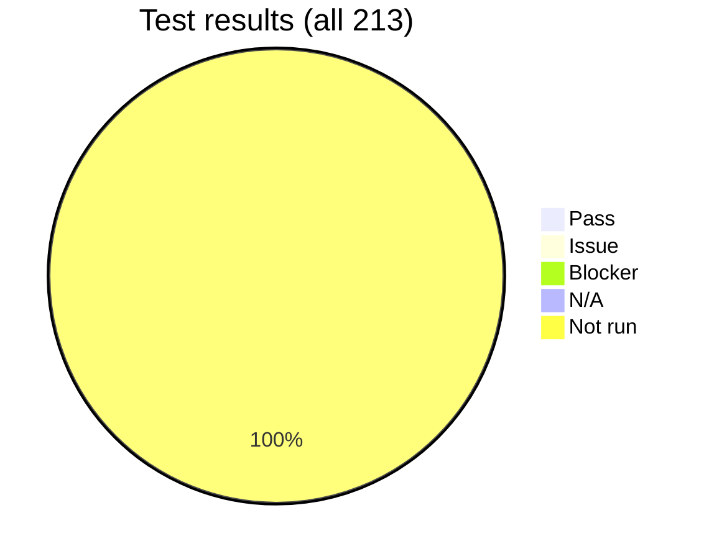

# Phase 1 report: Security and configuration

[🏠 Home](../README.md) › Reports › Phase 1

> [!NOTE]
> **This is a template.** Replace each `«…»` and every placeholder table. Keep the structure, because stakeholders review every Phase 1 report in the same order. Every claim must cite a test ID, finding ID, or ADR. Results use 🟩 Pass · 🟨 Issue · 🟥 Blocker · ⏭ N/A · ⏳ Not run. The tracker's **Build report** output (`tools/tracker/tracker.html`, [ADR-019](../logs/decision-log.md#adr-019)) supplies the per-test detail for the appendix; private notes are never included.

| Field | Value |
|---|---|
| Evaluation period | YYYY-MM-DD → YYYY-MM-DD |
| Claude Code version | 2.1.301 |
| Image digest | `sha256:…` |
| Policy version | `v… (sha256:…)` |
| Provider | Microsoft Foundry: `<foundry-resource>`, deployments `<…>` («Hosted on Azure», «US Data Zone») |
| Model access path | «Direct (Entra ID) / Claude apps gateway» ([ADR-013](../logs/decision-log.md#adr-013)) |
| Author | <evaluation-lead> |
| **Recommendation** | **«GO / GO WITH CONDITIONS / NO-GO»** for Phase 2 |

## Contents
1. [Executive summary](#1-executive-summary)
2. [What we built](#2-what-we-built)
3. [Gate G1 scorecard](#3-gate-g1-scorecard)
4. [Control verification matrix](#4-control-verification-matrix)
5. [Findings](#5-findings)
6. [Abuse drills](#6-abuse-drills)
7. [Feature coverage](#7-feature-coverage)
8. [Telemetry and cost readiness](#8-telemetry-and-cost-readiness)
9. [Residual risk](#9-residual-risk)
10. [Recommended production configuration](#10-recommended-production-configuration)
11. [Conditions and next steps](#11-conditions-and-next-steps)
12. [Gateway decision](#12-gateway-decision)
13. [Carry-over to PCs (portable vs VDI-only controls)](#13-carry-over-to-pcs-portable-vs-vdi-only-controls)
14. [Appendix](#14-appendix)

## 1. Executive summary

«Three to five sentences: can Claude Code be run securely in our environment? What are the key controls? What's the biggest residual risk? What's the recommendation?»

| | Result |
|---|---|
| P0 tests passed | «n / 73» |
| All tests passed | «n / 213» |
| Portable P0 controls proven on an internet-connected host | «n / N» ([NET-014](../docs/03-test-plan/catalog/network.md#net-014)) |
| Open Critical / High findings | «0 / 0» |
| Feature-inventory rows verified | «n / N (x%)» |
| Telemetry pipeline | «Proven / Gaps» |
| Cost reconciliation variance | «±x%» |
| Phase 1 evaluator cost per active day | «$x» |

## 2. What we built

«A short description, with the architecture diagram from [reference-architecture.md](../docs/01-architecture/reference-architecture.md#overview-diagram). Note any deviations from the planned design and their ADRs.»

## 3. Gate G1 scorecard

| # | Criterion | Result | Evidence |
|---|---|---|---|
| G1.1 | All P0 tests 🟩, or 🟨 with an accepted risk | «🟩/🟥» | [catalog](../docs/03-test-plan/test-strategy.md#catalog-index) |
| G1.2 | Zero open Critical/High findings | | [issue log](../logs/issue-log.md) |
| G1.3 | Developers can't disable controls | | POL/SBX/PERM/EXT P0 |
| G1.4 | Egress limited to the allowlist | | NET-001/002/003 |
| G1.5 | Telemetry with attribution | | TEL-001–004 |
| G1.6 | Cost reconciles within ±10% | | COST-001 |
| G1.7 | Data hosting and retention approved | | DATA-001/002 |
| G1.8 | Kill switch and offboarding proven | | OPS-003/004 |
| G1.9 | Quick-start under 30 min | | OPS-007 |
| G1.10 | Web tools off in every session type | | NET-007, PERM-014 |
| G1.11 | No API key works against the Foundry resource | | IDN-002 |
| G1.12 | Portable P0 network tests pass on a host with internet access | | NET-014 |
| G1.13 | If the gateway is accepted: per-user cap blocks at the limit, runaway check stops a user in time | | COST-013, COST-015 |

## 4. Control verification matrix

Built from [defense-in-depth.md](../docs/02-security-baseline/defense-in-depth.md#control-catalog).

| Control | Description | Tests | Result | Findings |
|---|---|---|---|---|
| CTL-01 | Native Windows blocked + backstop | ENV-007, ENV-008 | «🟩» | |
| CTL-02 | Pinned IT image | ENV-003, ENV-005, ENV-015 | | |
| … | … | … | | |
| CTL-23 | Operational controls | OPS-001–005, 008, 010 | | |
| CTL-24 | Claude apps gateway (if accepted) | IDN-014, IDN-015, COST-013, TEL-013, OPS-011 | | |
| CTL-25 | Nexus-only supply chain | ENV-016, ENV-017, ENV-018, IDN-016 | | |
| CTL-26 | Web tools disabled | NET-007, PERM-014 | | |
| CTL-27 | Network path and host segmentation | ENV-021, NET-014, NET-015, NET-016 | | |
| CTL-28 | Runaway-agent guardrails | COST-015, COST-016 | | |
| CTL-29 | Build-file review for Windows-only repos | PERM-019, ENV-020 | | |

**Results by domain:**

| Domain | P0 🟩 | P0 🟨 | P0 🟥 | All 🟩 | All 🟨 | All 🟥 | ⏭ |
|---|---|---|---|---|---|---|---|
| ENV | | | | | | | |
| POL | | | | | | | |
| PERM | | | | | | | |
| SBX | | | | | | | |
| NET | | | | | | | |
| IDN | | | | | | | |
| DATA | | | | | | | |
| EXT | | | | | | | |
| TEL | | | | | | | |
| COST | | | | | | | |
| FEAT | | | | | | | |
| SURF | | | | | | | |
| OPS | | | | | | | |

## 5. Findings

| ID | Severity | Title | Control | Status | Resolution / acceptance |
|---|---|---|---|---|---|
| F-NNN | | | | | |

«For each Critical or High finding: one paragraph with impact, root cause, mitigation, and who accepted the residual risk.»

## 6. Abuse drills

| Drill | Outcome | Layers that stopped it | Evidence |
|---|---|---|---|
| Hostile README (DATA-005) | | | |
| Poisoned web page (DATA-011) | | | |
| Evil project config | | | |
| Impatient developer | | | |
| Incident replay (OPS-005) | | | |

## 7. Feature coverage

From the [feature inventory rollup](../docs/04-feature-inventory/README.md):

| Inventory | Rows | 🟩 | 🟨 | 🟥 | ⏭ | 🟢 Allow | 🟡 Restrict | 🔴 Block | ⛔ Unavailable |
|---|---|---|---|---|---|---|---|---|---|
| Slash commands & shortcuts | | | | | | | | | |
| CLI | | | | | | | | | |
| Settings keys | | | | | | | | | |
| Environment variables | | | | | | | | | |
| Tools, hooks & modes | | | | | | | | | |
| Surfaces | | | | | | | | | |

**Notable Foundry gaps:** «list, for example: no analytics dashboard, no fast mode, Monitor tool, ToolSearch on Azure-hosted deployments». WebSearch and WebFetch are off by decision ([ADR-016](../logs/decision-log.md#adr-016)), not as a gap.

**Most useful features (from FEAT usefulness ratings):** «top 5».

## 8. Telemetry and cost readiness

«Dashboards (screenshots), reconciliation table, model/effort cost matrix (COST-003), cache hit ratio, recommended defaults.»

## 9. Residual risk

| Risk | Initial score | Residual score | Why it remains | Accepted by |
|---|---|---|---|---|
| R-01 | 6 | | | |

## 10. Recommended production configuration

«The final policy version (link to the policy repo tag), the image spec, the Foundry deployment and RBAC config, the GitHub token spec, and the OTel config. List changes from the [v0.2 target policy](../docs/02-security-baseline/managed-settings.md), and the PC-specific settings from section 13.»

## 11. Conditions and next steps

| # | Condition for Phase 2 | Owner | Due |
|---|---|---|---|
| 1 | | | |

## 12. Gateway decision

[ADR-013](../logs/decision-log.md#adr-013) puts the Claude apps gateway in front of Foundry, decided at the end of Phase 1 week 3.

| Question | Result | Evidence |
|---|---|---|
| Entra sign-in works and the container holds only a short-lived gateway token | | [IDN-014](../docs/03-test-plan/catalog/identity.md#idn-014) |
| Only the gateway's managed identity can call Foundry | | [IDN-015](../docs/03-test-plan/catalog/identity.md#idn-015) |
| A per-user cap blocks at the limit; 75%/95% warnings appear | | [COST-013](../docs/03-test-plan/catalog/cost.md#cost-013) |
| Runaway detection stops a user within «n» minutes with a zero cap | | [COST-015](../docs/03-test-plan/catalog/cost.md#cost-015) |
| Identity-stamped telemetry arrives at the collector | | [TEL-013](../docs/03-test-plan/catalog/telemetry.md#tel-013) |
| Operations are workable (replicas, Postgres backup, fail-closed, JWT rotation) | | [OPS-011](../docs/03-test-plan/catalog/operations.md#ops-011) |
| Cost of losing WebSearch (off anyway) and the 1-hour cache TTL | «measured cache effect» | [COST-004](../docs/03-test-plan/catalog/cost.md#cost-004) |

**Decision:** «Accept / reject / defer». «If rejected: what replaces per-user caps and attribution, and the accepted risk on [R-15](../logs/risk-register.md#r-15).»

## 13. Carry-over to PCs (portable vs VDI-only controls)

The evaluation runs on isolated VDIs; production runs the same images on users' PCs ([ADR-018](../logs/decision-log.md#adr-018)). The VDI adds protection a PC won't have, so this section separates what we proved about the container from what the VDI gave us ([R-23](../logs/risk-register.md#r-23)).

| Control | Portable? | Proven where | PC equivalent / gap |
|---|---|---|---|
| CTL-01 Native Windows blocked | PC equivalent needed | «VDI» | Intune/AppLocker on PCs |
| CTL-04 Container egress firewall | Portable | «internet-connected test host» ([NET-014](../docs/03-test-plan/catalog/network.md#net-014)) | |
| CTL-27 Guardicore host rules | Portable | «…» ([ENV-021](../docs/03-test-plan/catalog/env.md#env-021)) | Process-level rule for Docker Desktop |
| … | | | |

**PC prerequisites** ([ENV-022](../docs/03-test-plan/catalog/env.md#env-022)):

| Prerequisite | Status | Notes |
|---|---|---|
| Standard user, no local admin | | |
| Windows Pro/Enterprise with Hyper-V and BIOS virtualization | | |
| Docker Desktop Business licence | | |
| Full-disk encryption | In place | Confirmed by the evaluation lead |
| RAM sized from [ENV-013](../docs/03-test-plan/catalog/env.md#env-013) | | «n GB» |
| VPN required; off-VPN sessions fail closed ([NET-015](../docs/03-test-plan/catalog/network.md#net-015)) | | VPN «full / split» tunnel |

«Optional PC track: results from the evaluation lead's PC, run under a standard account.»

## 14. Appendix

- [Evidence index](../evidence/README.md#evidence-index)
- [Decision log](../logs/decision-log.md)
- [Journal](../logs/journal/README.md): total hours «n»
- Documentation discrepancies found ([issue log](../logs/issue-log.md#documentation-discrepancies))
- Tracker report export (entries, evidence, fix steps; no private notes)

## Sign-off

| Role | Name | Decision | Date |
|---|---|---|---|
| Security (accountable for G1) | | | |
| Executive sponsor | | | |
