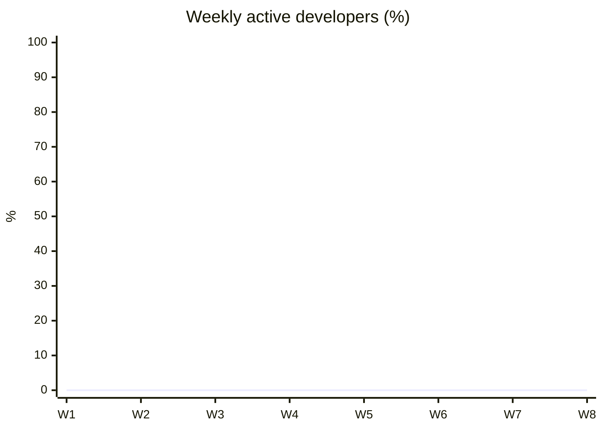

# Phase 2 report: Developer pilot results

[🏠 Home](../README.md) › Reports › Phase 2

> [!NOTE]
> **This is a template.** Every number needs its source (dataset + query) in the appendix. Report effect sizes **with ranges**. Mark exploratory (non-pre-registered) analyses as such.

| Field | Value |
|---|---|
| Pilot period | YYYY-MM-DD → YYYY-MM-DD |
| Participants | «n» (cohort A «n», cohort B «n»), «n» completed |
| Claude Code version | «2.1.301 (+ upgrades, if any)» |
| Environment | Isolated VDIs ([ADR-018](../logs/decision-log.md#adr-018)); model access «direct / Claude apps gateway» ([ADR-013](../logs/decision-log.md#adr-013)) |
| Repo capability tiers | «n Full · n Compile-check · n Edit-only» ([ADR-017](../logs/decision-log.md#adr-017)) |
| Pre-registration | [measurement-framework.md v1.0](../docs/06-productivity-quality/measurement-framework.md), frozen YYYY-MM-DD |

## Contents
1. [Executive summary](#1-executive-summary)
2. [Adoption and usage](#2-adoption-and-usage)
3. [Cost](#3-cost)
4. [Productivity](#4-productivity)
5. [Quality guardrails](#5-quality-guardrails)
6. [Developer experience](#6-developer-experience)
7. [Where it helps (and doesn't)](#7-where-it-helps-and-doesnt)
8. [Security operations during the pilot](#8-security-operations-during-the-pilot)
9. [ROI](#9-roi)
10. [Limitations](#10-limitations)
11. [Recommendations](#11-recommendations)
12. [Appendix: methods and data](#12-appendix-methods-and-data)

## 1. Executive summary

«Five bullets: adoption, cost per dev, productivity effect (with range), quality (held / breached), developer sentiment, and the recommendation.»

| Question | Answer | Confidence |
|---|---|---|
| Faster? (cycle time) | «−x% (90% CI −a% to −b%)» | «Low / Med / High» |
| More? (throughput) | | |
| Quality held? | «Yes / No: which guardrail» | |
| Developers want it? | «x/5 satisfaction, NPS +y» | |
| Cost per dev-month | «$x (P90 $y)» | |
| ROI multiple | «x× (range a–b)» | |

## 2. Adoption and usage

| Metric | Weeks 1–2 | Weeks 3–8 |
|---|---|---|
| Weekly active (% enrolled) | | |
| Active days per dev-week | | |
| Sessions per active day | | |
| Edit accept rate | | |
| Share of merged PRs assisted (trailer or checkbox) | | |

## 3. Cost

| Metric | Value | vs. target | vs. Anthropic benchmark |
|---|---|---|---|
| Total pilot cost (Azure, reconciled) | $ | | |
| Cost per active dev-day (median / P90) | $ / $ | | ~$13 / <$30 |
| Cost per dev-month | $ | | $150–250 |
| Cost per assisted merged PR | $ | | |
| Model mix (% cost Opus / Sonnet / Haiku) | | | |
| Main / subagent / background split | | | |
| Cache hit ratio | | | |
| Reconciliation variance (mean) | ±% | ±10% | |
| Per-user spend estimate (gateway) vs. Azure invoice | ±% | ±10% | |
| Developers who reached a cap / got a 75% or 95% warning | «n / n» | | |
| Spend-notification emails sent (50/80/100%) | «n» | | |
| Zero-cap shutoffs from runaway detection (true / false positives) | «n / n» | 0 false positives | |

**Per-developer cost.** Per-user spend comes from the gateway's spend data ([COST-013](../docs/03-test-plan/catalog/cost.md#cost-013), [COST-014](../docs/03-test-plan/catalog/cost.md#cost-014)), priced at the contracted Azure rates. Those figures are estimates, so reconcile the total against the Azure invoice before reporting any per-developer number. Show the distribution (median, P90, max), not just the mean.

| Developer (pseudonym) | Tier | Weekly cap | Month-to-date spend | Peak day | Caps hit | Notes |
|---|---|---|---|---|---|---|
| dev-01 | | $ | $ | $ | | |

**Org-wide forecast** ([method](../docs/05-cost/cost-model.md#forecast-model)):

| Scenario | Adoption | Devs | Monthly | Annual |
|---|---|---|---|---|
| Conservative | | | $ | $ |
| Expected | | | $ | $ |
| High | | | $ | $ |

## 4. Productivity

| Metric | Baseline | Pilot | Change | 90% CI | Cohort comparison (W1–3, A vs. B) |
|---|---|---|---|---|---|
| PR cycle time (median h) | | | | | |
| Merged PRs / dev-week | | | | | |
| Coding time (median h) | | | | | |
| Benchmark time (median, with vs. without) | | | | | — |

«Chart: per-developer change vs. baseline (dot plot), and cohort A vs. B weekly cycle time (line).»

**Results by repo capability tier** ([ADR-017](../logs/decision-log.md#adr-017), [R-28](../logs/risk-register.md#r-28)). Claude can build and test in Full repos, compile only in Compile-check repos, and only edit in Edit-only repos, where the developer builds on Windows. Report each tier separately, and check that the tiers were balanced across cohorts before comparing A with B.

| Tier | Repos | Devs | Cycle time Δ | Throughput Δ | Benchmark time Δ | Satisfaction | Notes |
|---|---|---|---|---|---|---|---|
| Full (modern .NET, Python, Java) | | | | | | | |
| Compile-check (SDK-style Windows targets) | | | | | | | |
| Edit-only (old-style .NET Framework) | | | | | | | |

## 5. Quality guardrails

| Guardrail | Baseline | Pilot | Threshold | Status |
|---|---|---|---|---|
| Revert rate | | | +2 pp | «Held / Breached» |
| Follow-up fix rate (14 d) | | | no significant increase | |
| First-run CI pass rate | | | −5 pp | |
| Review rework rounds / PR | | | no increase | |
| New static-analysis alerts / PR | | | no increase | |
| Coverage on changed lines | | | no decrease | |
| Benchmark quality score (with vs. without) | | | — | |

## 6. Developer experience

| Item | Pre | Mid | Post | Δ |
|---|---|---|---|---|
| C1 Satisfied with tools | | | | |
| C2 Efficient on typical tasks | | | | |
| C3 Flow | | | | |
| M1 More productive with Claude Code | — | | | |
| M2 Want to keep using | — | | | |
| M3 NPS | — | | | |
| M4 Hours saved / week (median) | — | | | |
| M5 Trust output after review | — | | | |
| M6 Controls got in the way | — | | | |

**Themes from comments and interviews:** «3–5 themes, each with a representative (anonymized) quote».

## 7. Where it helps (and doesn't)

| Task type | Benchmark time Δ | Quality Δ | Survey "helped most" % | Verdict |
|---|---|---|---|---|
| Bug fix | | | | |
| Feature | | | | |
| Tests | | | | |
| Refactor | | | | |
| Unfamiliar code | | | | |
| Dependency upgrade | | | | |
| Docs | | | | |
| Code review | | | | |

**Case studies:** «2–3 short stories from show & tell, each with the before/after and the measured effect».

## 8. Security operations during the pilot

| Metric | Value |
|---|---|
| Security incidents | «0» |
| Blocked egress attempts (by category) | |
| Denied tool actions (by category) | |
| Permission-mode changes | |
| Policy changes made (ADRs) | |
| Build-file approvals on Windows-only repos (PERM-019) | |
| Spend-cap blocks / runaway shutoffs | |
| Support tickets (by category) | |

## 9. ROI

| Input | Low | Expected | High | Source |
|---|---|---|---|---|
| Hours saved / dev / month | | | | Benchmark / pulse / cycle time |
| Loaded hourly cost | | | | Finance |
| Value / dev / month | | | | |
| Cost / dev / month (usage + TCO share) | | | | |
| **ROI multiple** | | | | |

## 10. Limitations

«Sample size, novelty effect, repo/developer confounding, repo capability tier, self-report bias, Foundry feature gaps, web tools being off, security-control friction, VDI-only results that may not carry over to PCs (R-23), and the pilot duration.»

## 11. Recommendations

| # | Recommendation | Rationale | Owner |
|---|---|---|---|
| 1 | «Adopt / extend / stop» | | |
| 2 | Default model and effort guidance | COST-003 + pilot mix | |
| 3 | Permission-mode policy | ADR-008 + friction data | |
| 4 | Rollout plan (waves, training, support) | | |
| 5 | Per-user cap levels and runaway-detection thresholds for rollout | Pilot spend distribution | |
| 6 | PC rollout readiness (portable controls, PC prerequisites) | Phase 1 section 13, [ADR-018](../logs/decision-log.md#adr-018) | |

## 12. Appendix: methods and data

- Pre-registration: link and freeze date
- Datasets: names, locations (secure store), extraction dates
- Queries: [github-metrics-queries.md](../docs/06-productivity-quality/github-metrics-queries.md), OTel queries
- Deviations from the pre-registered plan: ADR links
- Tracker report export for pilot operations (no private notes)
